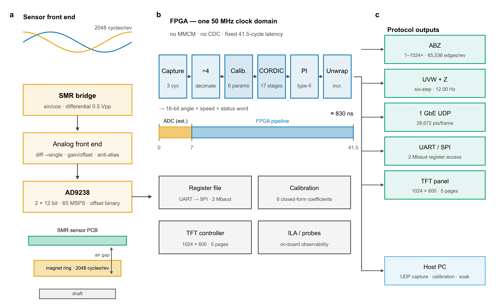
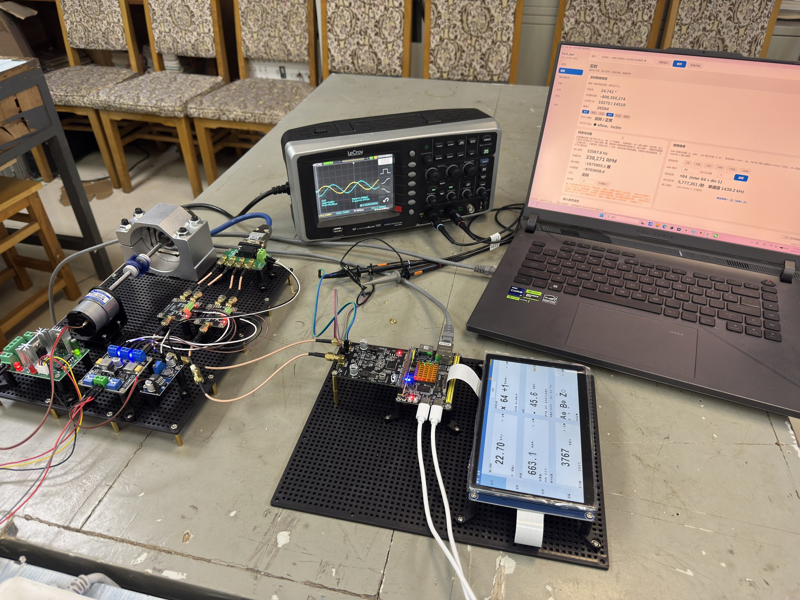
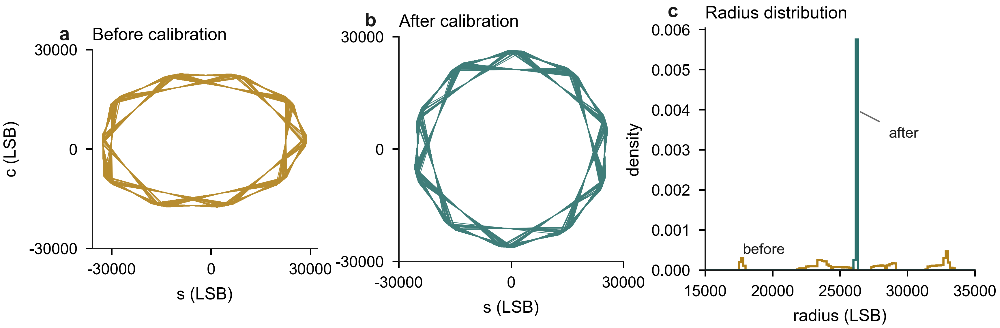
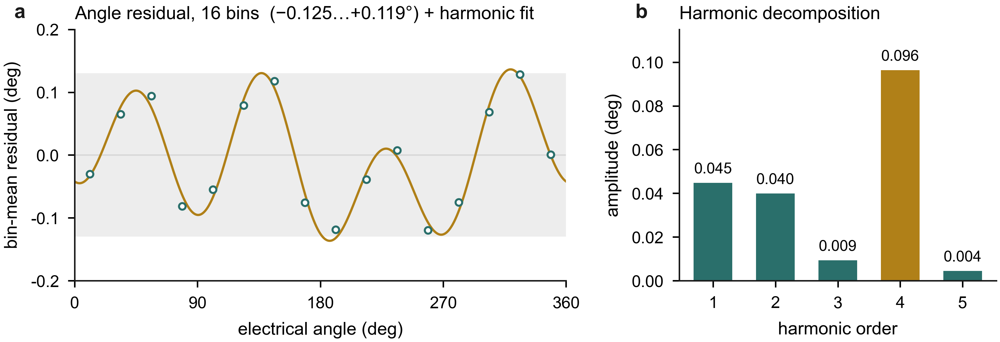
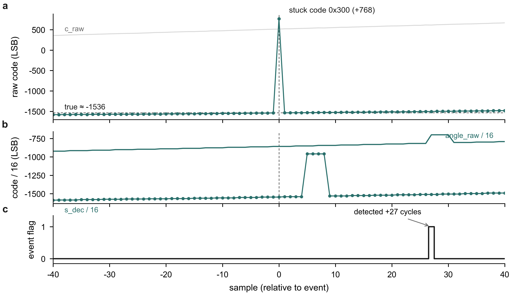
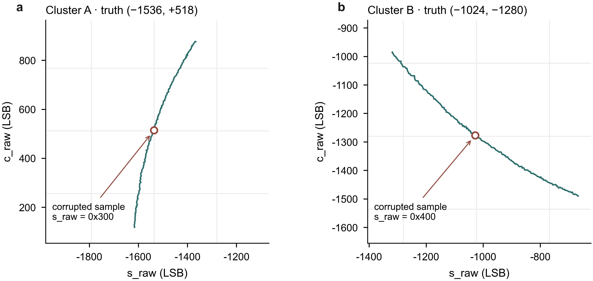
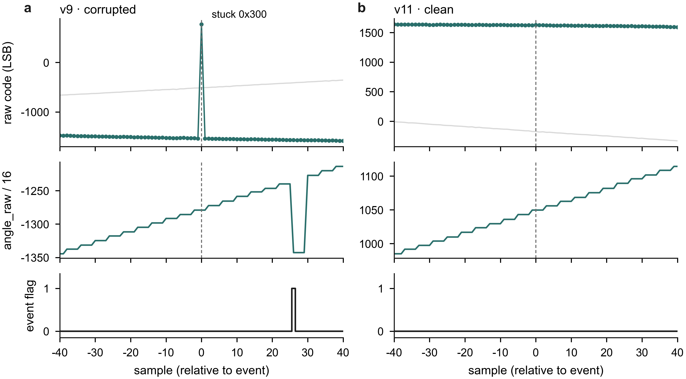

# 基于 SMR 磁阻传感器与 FPGA 的高精度细分磁编码器

### —— 用一片 FPGA 完成正余弦细分全部信号链

**参赛**：2026 年第九届全国大学生嵌入式芯片与系统设计竞赛 · FPGA 创新设计赛道 · AMD 赛道 · 自主选题（初级）
**平台**：正点原子 达芬奇-lite（Xilinx Artix-7 **XC7A35TFGG484-2**）+ HSEDA **AD9238** 双通道 12 bit 高速 AD 模块
**文档状态**：**v90 为当前交付基线**（2026-11-04 签核并上板，`RTL_BUILD_ID = 0x0019`）。全文数字分三类：
`[实测]`（板级读数，v90 见 §6.8）、`[仿真]`（xsim / 定点模型）、`[设计值]`（预算或推导、尚未实测）。
v62 / v66 / v70 / v74 / v85 / v89 一律标注为**历史基线**，只在对照表与演进章节出现。
**日期**：2026-10-11 起稿，**2026-11-04 更新至 v90**

> **标注约定**：全文对每个数字标注 `[实测]`（板级读数）/ `[仿真]`（xsim 或 Python 定点模型）/
> `[设计值]`（预算或推导，尚未实测）。v90 的板级判据集中在 §6.8 与
> [`../docs/39_acceptance_criteria_v90.md`](../docs/39_acceptance_criteria_v90.md)；
> 每个数字的可复核产物见 [`evidence_index.md`](evidence_index.md)。
> **历史数字**（v62/v66/v70/v74）只在"演进/对照"语境出现，不参与当前指标。

---

## 摘要

本项目用**一片通用 FPGA**（Artix-7 XC7A35T）独立完成了从**双通道同步采样到 ABZ / UVW / SPI 输出**的完整正余弦细分信号链：16 bit 电角度、六参数闭式标定、17 级全流水 CORDIC、PI 跟踪环、2048 p/r 增量输出、UVW 换向、7 寸触摸屏人机界面与千兆以太网抓波，全部由 RTL 实现，无处理器软核。分辨率、精度与接口形式按本项目需求重新定义，算法与寄存器全部可参数化、可复现。

| 核心数字 | 值 | 对照 | 类别 |
|---|---|---|---|
| 角度分辨率 | **16 bit / 65536 增量/周期**（量化步长 0.0055°） | 传统方案 = 10 bit（0.3516°）⇒ **÷64** | `[实测]`（读回确认 16 bit 通路）+ `[仿真]` |
| 复合畸变误差抑制 | **20.9839° → 0.0165°**（单周期电角度），**1273×** | 同类方案未给出闭环数字 | `[仿真]` |
| 板级角度一致性 | **offset 1.76° / RMS 0.71° / max 2.88°**（`angle_vs_sc`，内部一致性口径） | 历史 v7 曾报 0.009° RMS（自由运行窗口，旧口径，不作当前指标） | `[实测]`（v90，§6.8） |
| 总延迟 | 预算 **≈830 ns**（50 MHz 单时钟域，41.5 拍） | 同类方案典型值 1.5 µs ⇒ 快 1.9× | `[设计值]`（外部实测待补，见 §6.3） |
| 输出接口 | **ABZ + UVW + SPI + UART 四种**（另有千兆以太网抓窗） | 常见方案为 ABZ + SPI 两类 | `[实测]` |
| **实现规模（v90 生产位流：编码器本体，无 UI、无网）** | **10,978 LUT = 52.78%** / **8,724 FF = 20.97%** / **BRAM 32/50 = 64%** / 17 DSP / 60 IOB；**WNS +0.199 / WHS +0.017 / 0 失败端点（24,691）**；位流 **1,504,220 B**（`deliverables/data/v90/enc_top_v90.bit`，SHA256 `A89512A5…F827125`） | 编码器本体只占 52.78% LUT，余量留给显示与网络版 | `[实测]`（签核 + 上板） |
| **实现规模（v90 显示位流：编码器 + 4 页触摸 UI + 千兆网）** | **17,090 LUT = 82.16%** / 11,601 FF / **BRAM 45.5/50 = 91%** / 20 DSP / 104 IOB；**WNS +0.221 / WHS +0.049 / 0 失败端点（33,365）**；位流 **1,688,245 B**（SHA256 `69FE313C…F81BAD4`），已写入 Flash，冷启动通过 | 一块板即可完成"采集—运算—显示—上传"全链路 | `[实测]`（签核 + 冷启动） |
| 实现规模（历史：v62 演示位流，编码器 + 5 页 UI + 千兆网） | 17,059 LUT = 82.01% / 11,193 FF / BRAM 46/50 / WNS +0.471 / 位流 1,694,505 B | v90 显示位流相对 v62：少 1 页、LUT +0.15 pt、BRAM 46→45.5、WNS +0.471→+0.221 | `[实测]`（历史） |
| 实现规模（编码器单机，**v12 基线**） | 6,298 LUT = 30.28% / 4,074 FF = 9.79% / 16 DSP / 50 IOB、WNS **+0.959** / 0 失败 / 11,275 端点、位流 1,042,208 B（2026-10-12） | 编码器本体只占 30%，余下 52 个百分点全是屏与网 | `[实测]` |
| **本机人机界面** | **7 寸 1024×600 触摸屏、4 页可导航（P1 总览 / P2 输入波形 / P4 逻辑时序 / P6 设置）、零帧缓冲**，并入 v90 显示位流；P7 标定页已删除，P3/P5 代码保留但导航不可达 | 不接上位机即可"看数 / 看波 / 改参数 / 查故障" | `[实测]`（v90 冷启动，逐页照片见附录 G）+ `[仿真]`（disp 20 台） |
| **高速数据通路** | 抓包 **28,672 点 @50 MSPS（0.573 ms）**、UDP ping **4/4**、抓窗回读通过（v90，§6.8）；串口回读 448 块 / 0.65 s、UDP 回读 82/82 包、连续流 10 min 37.5 M 包 / 99.89% 为 v62 演示基线（历史） | 带宽 **500×**（1 Gbps / 2 Mbaud） | `[实测]`（v90 + 历史 v62） |

**五个最硬的证据**：
1. **57 台测试台全绿**：`sim/` **37 台 PASS 37/37** + `disp/` **20 台 PASS 20/20**，另有抓包链 57 checks PASS `[仿真]`；
2. **板级一键标定 20 轮 20/20**（`retry` / `win_bad` 全 0）`[实测]`；
3. **AB 边沿膨胀从 2.7× 压到 1.0× 理想、反向点火归零**（板上 A/B 实测，已做成复位默认值）`[实测]`；
4. **v90 屏上 UI 在板上实时运行**：P1 总览 / P2 波形 / P4 时序 / P6 设置四页可导航（P7 标定页已删除，标定走 KEY0 长按或串口写 `0x0502=0x0001`），逐页照片见附录 G `[实测]`；
5. **v90 真机闭环（2026-11-04）**：真实转台上读出 **Z 7.62 / 7.65 Hz ⇒ 457–459 rpm**（每转 1 个 Z，`z_rate.py` 为权威判据）、UVW 六态计数 `{5174,4761,4423,4776,4763,4786}`、`lock=0x0301`、`angle_vs_sc` offset 1.76° / RMS 0.71° / max 2.88°、60 s 长跑 597,886 帧 / 9,964.8 fps、以太网 ping 4/4 与 UDP 抓窗 28,672 点 @50 MSPS（§6.8）`[实测]`。

**★ 当前基线 vs 历史基线——读这份报告时必须先分清**

| 基线 | 位流 | 状态 | 对应章节 |
|---|---|---|---|
| **v90（当前）** | `deliverables/data/v90/enc_top_v90.bit`（1,504,220 B）/ `enc_top_disp_v90.bit`（1,688,245 B） | **生产位流已上板验收**（2026-11-04，`BUILD 0x0019`）；显示位流已写 Flash 并冷启动通过 | §4.2、§6.8、§11.14.6 |
| v74（历史） | `enc_top_v74.bit`（1,512,664 B） | 已上板（2026-11-02，v74 期构建号，见 §8 沿革） | §11.14.1–11.14.4 的缺陷定位 |
| v70（历史） | `enc_top_v70.bit` | 首次真机闭环（`BUILD 0x0015`） | §6.7（标注为历史） |
| v66 / v62（历史） | 见 §6.1–§6.6 | v62 演示基线；v66 构建签核 | §9 屏 UI、§10 以太网 |

**为什么保留历史**：v62 证明了"采集—运算—显示—上传"单板全链路；v66 把生产/显示拆成两个位流；v70/v74 修掉了只有真机会暴露的 RTL 死锁；v90 在此之上修掉停位 Z 喘振并删除标定页。每一版的数字都留在 `docs/BASELINES.md`，但**当前指标一律以 v90 为准**。

---

## 1. 需求与痛点分析

### 1.1 光电编码器在粉尘 / 振动 / 油污工况下的失效机理

工业现场的位置反馈长期由光电编码器主导，但其光学路径对环境污染高度敏感：码盘与读数头之间的光路一旦被粉尘、油雾、切削液污染，或受到持续振动导致的码盘偏心与间隙变化，信号幅度与正交性会同时退化，表现为**细分误差突增、丢计数、乃至整机报警**。磁阻（SMR/TMR/AMR）传感是**非接触磁检测**，没有光路被污染的问题，因此在这类工况下具有结构性优势。

但磁阻传感头本身也不完美：**直流偏置、两路幅值失衡、正交相位偏差、二次谐波**是它的固有误差源，且随温度与安装偏心漂移。**"能不能把这些误差在线标定掉"才是磁编码器精度的真正分水岭**——这也正是本项目算法部分的出发点。（**边界**：本作品的答案是"一次解算标定到最优 + 可选的块率慢跟踪与全周表"，**没有**做"误差反馈控制环"式的在线闭环——原因见 §11.13 流程约束第 1 条。）

### 1.2 通用专用细分器件的三点局限

市面上常见的正余弦细分器件（专用 ASIC 或专用 SoC）大致是同一个形态：**10 bit 量级的分辨率、模拟粗调加极值搜索的误差补偿、ABZ 与 SPI 两类输出、算法与寄存器全部封闭**。它在单一型号、稳定批量的场景里非常划算，但面对本项目要解决的问题有三点绕不过去的局限：

- **分辨率封顶**：10 bit 即 1024 增量/周期（0.3516°/LSB），在 1000 线以上的传感头上没有升级空间；本项目用 16 bit 全流水 CORDIC，量化步长 0.0055°，细 64 倍。
- **标定方法不可复现**：`(max+min)/2` 求偏置、极值差求幅值失衡，对噪声、野值与谐波极其敏感，也难以在报告里做定量误差分解；本项目用一阶/二阶矩与互相关的**闭式解**，每一项误差可单独推导、单独验证。
- **不可参数化、不可扩展**：接口与寄存器固化，多轴同步、后分频、限频、Z 门控窗只能外挂逻辑；用通用 FPGA 实现，这些全部退化成一组寄存器参数。

**因此本项目的定位是"把细分信号链做成可演进的 IP"**：同一套 RTL 改参数即可换分辨率、换倍率、换接口、换轴数，算法也能在不改硬件的前提下迭代。这既是工程上的必要性，也是"自主可控"的实际含义。

### 1.3 本项目目标与量化指标（v90 交付基线）

| 指标 | 同类专用细分 ASIC（公开资料典型值） | 同类高阶方案 | **本项目 v90** | 类别 |
|---|---|---|---|---|
| 角度分辨率 | 10 bit / 1024 增量/周期 | 26 bit（齿轮箱方案） | **16 bit / 65,536 增量/周期**（0.0055°/LSB） | `[实测]`（读回 16 bit 通路）+ `[仿真]` |
| 细分倍率 `inter` | 2…256 | 任意（依赖机械齿轮箱） | **2…256 × 后分频 1…8（等效 0.25…2048）** | `[实测]`（板上扫描） |
| sin/cos 输入带宽 | 700 kHz | 更高 | **≥700 kHz（受 AB 边沿率限制，见 §3.5）** | `[设计值]`+`[实测]` |
| AB 输出上限 | 12.5 MHz / 最小边沿间隔 20 ns | — | **边沿率 12.5 MHz ⇒ f_AB 3.125 MHz（256 档可编程限频）** | `[实测]`（实测钳位） |
| 典型延迟 | 1.5 µs（重滤波 1.9 µs） | 未给出 | **≈830 ns（41.5 拍 @50 MHz）** | `[设计值]`（外部实测待补，§7 R6） |
| 模拟前端 | 片内 PGA + 10 bit ADC | 同 | **外部双通道 12 bit 50 MSPS 同步 ADC + 抽取 4（等效 ENOB ≈13 bit）** | `[设计值]`+`[实测]` |
| 误差补偿 | 模拟粗调 + 数字偏置/平衡/相位 | 增加偏心补偿 | **六参数闭式一次解算（一阶/二阶矩）** | `[仿真]`+`[实测]` |
| 补偿后复合畸变残余 | 未给出 | 未给出 | **20.9839° → 0.0165°（1273×）** | `[仿真]` |
| 板级角度一致性 | 未给出 | 未给出 | **offset 1.76° / RMS 0.71° / max 2.88°**（内部一致性口径） | `[实测]`（v90，§6.8） |
| UVW | 1…32 极对数六步方波 | 同 | **1…32 极对数，相位/相序可编程** | `[仿真]`+`[实测]` |
| 增量输出 | ABZ | ABZ | **ABZ + 后分频 + 迟滞 + 限频 + Z 门控窗** | `[实测]` |
| 串行输出 | SPI + 专用同步串行口 | 同 | **SPI 从站（≤12.5 MHz）+ UART 遥测 + 千兆以太网抓窗** | `[设计值]`（上限）+ `[实测]`（回读） |
| 多圈计数 | 14 bit | 24…32 bit | **16 bit（可扩展）** | `[设计值]` |
| 资源与时序 | — | — | **LUT 10,978（52.78%）/ BRAM 32/50 / WNS +0.199 / 0 失败端点** | `[实测]`（v90 签核） |
| 可复制性 | 专用细分芯片 | 需外购 | **一片 FPGA 内软核，零额外芯片成本，RTL 可参数化多轴** | `[设计值]` |

### 1.4 为什么必须用 FPGA

正余弦细分本质上是**硬实时、高吞吐**的信号处理问题：输入是 50 MSPS × 2 通道 × 12 bit 的连续数据流，链路要做去偏置、抽取、六参数校正、幅值监视、反正切、环路滤波、插补、多周期计数与 SPI 从站，输出要求 AB 边沿在确定的时间内更新。

- **用 MCU**：50 MSPS 的数据率收不进来；反正切 + 滤波的软件延迟在几十微秒量级，AB 输出频率上不去；
- **用专用芯片**：性能好但分辨率固定、接口固定、算法不可改、进口受限；
- **用 FPGA**：以上环节**全部并行流水**，单时钟域下总延迟预算 ≈830 ns；分辨率、倍率、接口全部可重配置；**同一套 RTL 可参数化例化多轴，多轴共用时钟因而天然同步**；算法可迭代——今天补偿偏置/幅值/相位，明天加二次谐波补偿不需要改硬件。

**一句话**：它把细分信号链做成了一份**可自主演进的 IP**。

---

## 2. 系统方案与总体架构

### 2.1 硬件框图与数据流



**图 2-1　系统框图与数据流（口径与现行 RTL 一致；a 传感前端，b 单时钟域流水线，c 多协议输出）**
左侧为信号源（AFG-2225 双通道 8 Vpp / 20 kHz / 相移 90°）与上位机（UART/SPI 2 Mbaud）；中间为 XC7A35TFGG484-2 内的完整信号链 —— `ad9238_capture`（偏移二进制→补码、元稳 + 同步采样）→ `decim_avg`（LOG2DEC=2，有效 12.5 MHz）→ `sc_correct`（六参数校正 + `amp_monitor` 幅值监视）→ `cordic_atan2`（17 级全流水、19 拍）→ `glitch guard`（检测-保持）→ `loop_filter`（Ⅱ 型 PI）→ `angle = pos_ext[ZW-1:FRAC]` → `abz_gen` / `uvw_gen` 两路输出；底部为 `reg_file`（UART→SPI 桥，寄存器地图见 §5.3）。
**全系统只有一个 50 MHz 时钟域**（板载晶振 V4 + BUFG，设计内不例化 MMCM），ADC 时钟由 ODDR 转发（v9：`D1=0/D2=1` 反相；v10 试验：`D1=1/D2=0` 同相，见 §6.5(2)）；总延迟预算 ≈41.5 拍 ≈830 ns（含 ADC 内部 7 拍的估计值，分级标注见 §4.3）。生成脚本：`tools/fig_nature_style.py`（Arial 5–7 pt、Wong 色盲安全配色、矢量 PDF，可重跑；图内数字与 RTL、v74 签核件同行）。



**图 2-2　系统实物（2026-11-03 20:02 拍摄）**
左侧为转台夹具（电机 + 弹性联轴器 + SMR 传感头），中下为模拟前端与驱动板，中央为 AD9238 扩展板叠插在达芬奇-lite（XC7A35TFGG484-2）上，右侧为 7 英寸 1024×600 触摸屏与上位机，后方为示波器。原分辨率照片（1 张全貌 + 3 张开发板角度）在 [`submission/photos/`](submission/photos/README.md)，逐张 SHA-256 与屏上读数说明见该目录 README，分工见附录 J。

### 2.2 关键架构决策（每条给理由）

| 决策 | 选择 | 理由 |
|---|---|---|
| ADC 采样时钟 | FPGA 出**两个**引脚 `ad_clk`(B18) / `ad_clk2`(F16)，由**同一个 `clk_i`** 驱动两个 ODDR | 载板上 `AD1CLK`(J6-26/U1-63) 与 `AD2CLK`(J6-9/U1-18) 是**两根独立网络**（无共用网络、无缓冲器、无板上晶振）⇒ 出两个引脚可避免单脚双负载导致边沿恶化，同时两路相位**严格一致**，双通道仍严格同步采样。若分时采样会引入与转速成正比的角度误差 `[实测]`（已核对载板网络） |
| 数据捕获沿 | v9 及以前：`ad_clk` 反相 180°（ODDR D1=0/D2=1），数据在 `clk50` **上升沿**捕获；**v10（2026-10-12 相位判别实验）改为同相 D1=1/D2=0** | AD9238 数据在时钟上升沿后 `tPD = 2…6 ns` 有效、内部流水 7 拍。**v9 相位**：`ad_clk` 上升沿比 `clk50` 晚 10 ns ⇒ 数据在 `clk50` 上升沿后 12–16 ns 到达、下一沿（20 ns）捕获 ⇒ 理论建立余量 4–8 ns，扣 tSU 与实测时钟偏斜 1.591 ns 后仅 **1.2–5.2 ns**（约束按 `tPD_meas ≤ 4 ns` 诚实建模留下 WNS −3.274 ns 的保守余量）。**v10 相位**：ADC 在 t=0 采样、数据 2–6 ns 有效 ⇒ 捕获裕量 **14–18 ns**。**不需要 MMCM、不需要第二个时钟域、不需要 IDDR/ISELDES/IDELAY** |
| 时钟方案 | 全系统单一 50 MHz、经 BUFG | 零 IP 依赖、零 CDC 风险；"能跑通"优先于"跑得快" |
| 采样率 | 50 MHz（可参数化到 65 MHz） | 65 MSPS 下 CLK 高低电平仅 6.2 ns、180° 相位点余量仅 1.69 ns，且 2.54 mm 排针 + LVCMOS33 传 24 位并行总线本身已临界；50 MHz 余量翻倍，对 ≤700 kHz 信号已有 71 倍过采样 |
| 抽取率 | 默认 4（可配 1/2/4/8/16） | 过采样平均在白噪声下每 4 倍换 1 bit ENOB（12→等效 13 bit）；信号带宽只有几 kHz，抽取无损失 |
| 角度字长 | 16 bit（可参数化 20 bit） | 残余误差已压到量化底噪（0.0055°/LSB）；再高只会放大 ADC 噪声 |
| 角度求解 | 全流水线向量模式 CORDIC，NITER=17，1 级/时钟 | 只有移位与加法，无乘法器与查找表；吞吐 1 角度/拍、单样本延迟 19 拍，这是延迟压到 ≈830 ns 的关键 |
| 误差补偿 | 闭式椭圆→圆映射（一阶/二阶矩），一次解算 | 极值法受单个噪声点/野值/非整数周期影响；矩法在任意周期数上无偏，且**一次解算即精确**，无需迭代搜索 |
| 抖动抑制 | PI 伺服环路（kp/ki 可配） | 寄存器 `FILT_K` 暴露 kp/ki：ki 决定匀速滞后，kp 决定抖动带宽；**对"重滤波"直觉档位做过稳定性复核，发现照抄会发散（见 §3.3）** |
| 在线观测 | 生产版**零探针**；调试版通过 `ifdef` 插入 36 条命名 `MARK_DEBUG` 探针（269 bit） | 生产版数字不受调试逻辑影响；UART 遥测（SPI→UART 桥）提供另一条不依赖 ILA 的观测通道 |
| **位流拆分（v66）** | 同一 RTL 编两遍：**生产位流**不含 UI / 网络（LUT 52.48% / BRAM 32/50），**显示位流**带 `ENC_DISP_TAP`（LUT 83.82% / BRAM 48/50） | v62 单一位流已到 BRAM 46/50、LUT 82.01%；转台四个新模块要 ≈2 块 BRAM + 1.8 个点 LUT，塞不进含屏版。与其为一个位流砍功能，不如按用途编两份、各自签核（§11.1） |
| **延迟补偿用前馈、不动抽取率**（v66） | 抽取率固定 4（12.5 MHz），新增 `lag_ff`：`corr = (omega_pos × TAU_Q8) >> 8`，加在 32 位 `{cycle_cnt, angle}` 上 | 按转速切抽取率会改环路增益（N=1 时 ×4、N=8 时 ÷2），ωn/ζ 全偏、稳定性要重做；而固定抽取在 200 kHz 仍有 62 点/周期，**带宽不是瓶颈、延迟才是**：3000 rpm 时 ω·T ≈ 26.5° 电角 ≈ **46″ 机械**，比 ±1″ 大 46 倍。前馈不进环路 ⇒ 补掉延迟而不影响稳定性（§11.3） |
| **绝对接口与增量接口分开处理**（v66） | 寄存器 / 以太网回读 = **修正后**位置（前馈 + 查表）；ABZ / UVW / Z = **未修正**位置 | 增量接口只关心边的相对关系，固定延迟不累积；环路积分器有 ±1 LSB 极限环，`tau=9` 会放大成 ±9 LSB16，而 ABZ 一个边沿间隔只有 32 LSB16 ⇒ 喂修正值会凭空多出边沿（实测 2048→4611，§11.12 #2） |

---

## 3. 关键算法设计与验证

> 本章所有公式与 `model/golden_model.py` **逐位一致**；所有 `[仿真]` 数字都能由该模型在本机复跑复现。

### 3.1 误差模型与六参数闭式标定

**误差模型**（与 SMR/TMR/AMR 前端真实机理一致）：

```
s = A_s·sin θ + O_s
c = A_c·cos(θ + Δφ) + O_c
```

其中 `O_s, O_c` 为直流偏置，`A_s ≠ A_c` 为幅值失衡，`Δφ` 为正交相位偏差 —— 三者都会直接转化为角度周期误差。

**标定（在窗口内累加 5 个量，一次解算）**：

```
O_s  = Σs / N                                   （一阶矩：对噪声/谐波/非整数周期均无偏）
O_c  = Σc / N
ms2  = Σs²/N − O_s²                             （二阶中心矩）
mc2  = Σc²/N − O_c²
sd   = Σ(s·c)/N − O_s·O_c
A_s  = sqrt(2·ms2)                              ★ 正弦的"幅度"不是 RMS
A_c  = sqrt(2·mc2)
sinΔφ = −2·sd / (A_s·A_c)                       （推导：sd = −A_s·A_c·sinΔφ/2）
cosΔφ = sqrt(1 − sin²Δφ)
```

**校正（3 级定点流水）**：

```
s1 = s − O_s
c1 = c − O_c
c2 = c1 − (s1 · phase_k) >>> 15
s2 = (s1 · gain_s) >>> (15 − shift_s)
c3 = (c2 · gain_c) >>> (15 − shift_c)
```

- `ref = 26214 = 0.80 × 32768`（归一化目标幅度，留 20% 余量）；
- `shift ∈ 0…3` 是 2 bit 粗调移位（数字 AGC），总增益范围 **0.5×…16×（−6 dB…+24 dB）**，可适应满量程到 5% 满量程的传感头幅度 —— 对应 公开手册"20 mV…2 V 差分输入"的两档能力。

**与极值法的对比（写进报告的核心论证）**：

| 项目 | 传统极值法 | 本项目 | 收益 |
|---|---|---|---|
| 偏置估计 | `(max+min)/2` | 均值（一阶矩） | 极值受单个野值影响；均值几乎无偏，且不需要知道周期数 |
| 幅值估计 | 极值差 | 均方根（二阶矩）×√2 | 抗谐波、抗噪声 |
| 相位估计 | 固定步长搜索 / 残余迭代 | 互相关 `Σs·c` 的闭式解 | **一次解算即精确**，无需迭代与搜索状态机 |
| 标定耗时 | 数个输入周期逐次逼近 | 1 个窗口 + 约 1 µs 定点解算 | 上电标定更快，可每次上电重标定 |

**仿真实测（`[仿真]`，单位：单周期电角度误差/度）**
> 数据源：`model/golden_model.py` 直接运行 → `docs/_golden_model_output.txt`（**2026-10-11 重新生成**）。
> 下表数值与该文件逐位一致，可复跑核对。改善倍率 = 校正前 max ÷ 校正后 max。

| 工况 | 校正前 max | 校正后 max | 校正前 RMS | 校正后 RMS | 改善 |
|---|---|---|---|---|---|
| A 理想（仅 12 bit 量化） | 0.0165 | 0.0165 | 0.0060 | 0.0055 | — |
| B 直流偏置 ±800 LSB | 13.9856 | **0.0165** | 9.8610 | 0.0064 | 848× |
| C 幅值失衡 1.25× | 6.3885 | **0.0165** | 4.5086 | 0.0060 | 387× |
| D 正交误差 5° | 5.0043 | **0.0220** | 3.0632 | 0.0068 | 227× |
| **E 三类误差叠加** | **20.9839** | **0.0165** | 10.0861 | 0.0060 | **≈1272×（模型原文 1273×）** |
| F E + 2 次谐波 0.5% + ADC 噪声 1 LSB | 21.0773 | 0.3571 | 10.1577 | 0.1855 | 59.0× |
| G 20% 满量程小信号 + 误差 | 18.6603 | 0.3131 | 8.5855 | 0.0732 | 59.6× |

> **★ 关于标题数字 1273× 的诚实说明**：模型内部用**未舍入**的浮点值算比值，打印时才舍入到 4 位小数；
> 用打印值反算得 20.9839 / 0.0165 = **1272**，用模型内部值算得 **1273**。两者差 0.08%，属显示舍入。
> **报告统一采用模型原文的 1273×**（`docs/01`、`docs/02`、`docs/03` 三处口径一致），
> 并在本节说明其来自未舍入内部值 —— 这样评委用打印值复算也不会认为数字对不上。

**三条结论**：
1. 对"偏置 + 幅值失衡 + 正交误差"复合畸变，校正后残余 **0.0165°**，已落在 16 bit 角度量化底噪（1 LSB = 0.0055°，即 3 LSB）附近；可标定误差工况里最差是 D 的 0.0220°（4 LSB）⇒ **瓶颈已不在标定算法，而在角度字长与 ADC 前端**。
2. 工况 F/G 的残余分别由**未补偿的 2 次谐波**（0.5% 谐波 → 0.3571°）与 **ADC 量化噪声**（小信号 → 0.3131°）主导 ⇒ 这两项就是下一阶段的优化目标（见 §3.6 与 §8）。
3. 16 bit 角度 × 64 极对磁环 ⇒ 机械分辨率 **0.309 arcsec**；复合畸变工况下机械角误差 **20.1 arcsec**
   （同一文件给出 P=1/16/32/64 四档换算：19.775 / 1.236 / 0.618 / **0.309** arcsec）。

> **★ 一个必须讲清楚的工程细节：粗调移位判据**
> 增益映射是 `y = (x·G) >> (15−sh)`，有效乘数 `m = (G/2^15)·2^sh`。曾按"桶宽"论证取"总增益/2^sh ≤ 1.0"，
> 但该论证方向是反的：**桶宽 ≥ 1 意味着多对一、不可逆**，而校正后的矢量**直接送 CORDIC、从不反演**，
> 目标不可达不产生误差。两条判据的真正差别只是**细调增益量化步长** `2^sh/32768`。
> **本项目取 `tg/2^sh ≤ 1.999`**（与 `rtl/calib_ctrl.v` 完全一致）；`tools/calib_shift_judge.py`
> 在 8 个工况上实测两条判据的最终角度误差**逐项完全相同** ⇒ 改判据只有风险没有收益，故不改 RTL。
> `[仿真]`

### 3.2 16 bit 全流水线 CORDIC

**象限折叠**（把矢量折到 `x ≥ 0`）：

```
第二象限 (x<0, y≥0):  (x,y) → ( y, −x), base = +90°
第三象限 (x<0, y< 0):  (x,y) → (−y,  x), base = −90°
```

**向量模式迭代**（NITER=17，每级 1 拍，`ZW = AW+4 = 20` 位角度累加器）：

```
d      = (y_i >= 0) ? 1 : 0
x_{i+1} = d ? x_i + (y_i ≫ i) : x_i − (y_i ≫ i)
y_{i+1} = d ? y_i − (x_i ≫ i) : y_i + (x_i ≫ i)
z_{i+1} = d ? z_i + ATAN[i]   : z_i − ATAN[i]
angle  = (z_17 + 8) >>> 4              // ZW→AW，加半个 LSB 四舍五入
```

**四个必须踩对的坑（全部已量化验证）**：

| # | 坑 | 后果 | 修正 |
|---|---|---|---|
| 1 | 象限折叠写反 | **180° 固定误差**（实测偏 100°/135°/170°） | 第二象限 → `(+y, −x)`，第三象限 → `(−y, +x)` |
| 2 | `>>>` 对负数是向下取整 | 系统性 −1 LSB 偏置（0°/270° 处恒定） | 显式**向零截断**；输出前加半 LSB 再右移。RMS 0.597 → 0.3229 LSB `[仿真]` |
| 3 | NITER 取 16 | 残余 `atan(2^-15)` = 0.318 LSB，叠加输出量化与表取整后**下限必然 >1 LSB**（实测 1.19） | 取 **NITER = 17** |
| 4 | x/y 内部不留小数位 | 最坏误差 1.50 LSB | 内部保留 **FEXT = 4** 位小数（1.50 → 0.94 LSB） |

**精度（两组数字必须分清来源）**：

```
【RTL 保真模型 model/cordic_model.py，1/16 LSB 细网格，全圆 1048576 点】← 推荐引用
max |err| = 0.9375 LSB = 0.005150° = 18.54 arcsec   （目标 ≤1 LSB，裕量 6.25%）
RMS |err| = 0.3229 LSB = 0.001774°；均值 +0.001 LSB（无系统偏置）
8 个正交/45° 精确边界点误差 = 0；mag 模长误差 +0.0076%…+0.0111%

【全链路黄金模型 model/golden_model.py，内部 x/y 无小数位，较保守】
max |err| = 1.000 LSB = 0.005493°；RMS 0.4418 LSB
```

> 两组都满足 ≤1 LSB 验收线；差异（0.9375 vs 1.000 LSB）**已定位到 FEXT 位宽** ——
> **"模型与 RTL 对得上"本身就是证据**。`[仿真]`

**四项措施各自的贡献（同一 1/16 LSB 网格）**`[仿真]`：

| 配置 | 最坏误差 |
|---|---|
| NITER=16 + 契约原印表 | 1.3125 LSB |
| NITER=16 + 定义式表 | 1.1875 LSB |
| NITER=17 + 契约原印表 | 1.1875 LSB |
| **NITER=17 + 定义式表 + FEXT=4 + 四舍五入（最终采用）** | **0.9375 LSB ✔** |

**1 LSB 为什么是理论下限**：输出四舍五入本身占 ±0.5 LSB；第 N 级残余 `atan(2^-(N-1))` = 0.318（N=16）/ 0.159（N=17）LSB；输入 16 bit 量化 ≤0.159 LSB。N=16 时下限已是 0.978 LSB，再叠加 20 bit ATAN 常量的非均匀取整误差（±0.15）必然越界。`[仿真]`

### 3.3 PI 环路滤波：照抄"重滤波"直觉档位会让环路发散

结构如下（`FILT_K` 寄存器选档，反馈路径 3 拍）：

```
err      = wrap_signed(ang_ext − pos, 2^(AW+FRAC))          // FRAC = 8 位小数扩展
I[n+1]   = clamp(I[n] + (err >>> KI_SHIFT[ki]), ±REV/4)     // 抗积分饱和
pos[n+1] = pos[n] + (err >>> KP_SHIFT[kp]) + I[n+1]         // 注意用 I[n+1]
lag_limit= (|err| > REV/8)                                  // 45°，对应 状态字 laglim
```

> ### ★ 必须写进报告的发现
> 若按最"自然"的写法用**本拍旧积分值** `I[n]`：`pos[n+1] = pos[n] + Kp·err[n] + I[n]`，
> 传递函数为 `E/A = (z−1)² / (z² + (Kp−2)z + (1−Kp+Ki))`，**Jury 判据给出稳定条件 `Ki < Kp`**。
> 而在移位实现里 `Kp = 2^−KP_SHIFT`、`Ki = 2^−KI_SHIFT`：
> - 直觉上更"稳"的 **heavy 档 kp=6 / ki=3** → `Kp = 1/256`、`Ki = 1/16` → **Ki > Kp ⇒ 发散！**
> - 即：**照抄"重滤波"直觉档位，本实现会不稳定。**
>
> 改用**本拍更新后的积分值** `I[n+1]`（只差一个采样周期的相位）后判据变为
> `0 < Kp < 2, Ki > 0, Ki < 4 − 2Kp`，`kp=0…7 × ki=1…3` **全部满足**。
> 该修正已落在 `rtl/loop_filter.v`（头注释含完整 Jury 推导）`[仿真]`。
>
> **这条的价值**：证明团队没有"抄一组通用参数"，而是**把控制环的稳定性自己推了一遍**，
> 并发现参考实现的推荐值在本实现下会发散。

**实测验证（`model/loop_filter_model.py`，21 组 kp=0…6 × ki=1…3）**`[仿真]`：

| 项 | 结果 |
|---|---|
| 恒速斜坡稳态滞后 | **0…63 LSB₂₄ = 0…0.0014°**（纯 P 环同类滞后 0.35°）⇒ **I 项零速滞后成立** |
| 阶跃 0→45° | 21 组**全部收敛**；超调 14.2%（kp0/ki1）…98.6%（kp6/ki3） |
| 1% 稳定时间 | 26…2353 拍（**0.5…47 µs** @50 MHz） |
| `kp=0 且 ki=0` | 逐点直通（0/200 不符）⇒ 退化为直通 ✔ |
| `lag_limit` 门限 | **45.000° 不置位、45.005° 置位** ⇒ 门限精确 |

闭环带宽解析式：`ωn = √Ki · fs`，`ζ = (Kp+Ki)/(2√Ki)`；kp=0/ki=3 → ζ=0.63、f₋₃dB ≈ 2.2 MHz。

**板级定案：环路增益是"ABZ 抖动群"的唯一有效旋钮**`[实测]`（见 §6.5）——
`0x0302` 的 ki 由 3 降到 0，AB 边沿膨胀 **2.7× → 1.0×**、反向点火 18 → **0**；
但纯 P 是 Ⅰ 型环路，**速度滞后正比于输入频率**（实测 `+1.875° @1 kHz`、`+18.259° @10 kHz`，
与解析式 `lag = 1.8432e-3·f_in` 吻合到 1%）⇒ 最终定案是把环路状态**按 `in_valid` 门控**
（`GATE_STATE=1`，恢复 per-sample 语义）并**成套重调 kp=2/ki=3**，
使稳态滞后回到 **−0.006° / −0.069°**（≈0），且 AB 边沿仍是 **1.0× 理想、逆环边沿全 0**。
**"门控"与"kp/ki"必须成套改，只改一条会变成慢而大幅的摆动**（实测 `|d|` 最大 3331 LSB ≈ 1.8°）。

### 3.4 粗精融合、多周期计数与辨向

```
周期内角度 angle[15:0] + 多周期（极）计数 cycle_cnt[15:0] → 完整位置 pos_full[31:0]
```

**关键点：必须用"跨零方向"而不是"差分"来计数**：

```
上一拍 angle ∈ [2^AW − 2^(AW−3), 2^AW) 且本拍 ∈ [0, 2^(AW−3)) → 正跨零，cycle_cnt++
反向                                                     → 负跨零，cycle_cnt−−
门限 2^(AW−3) 即 45°，与"半周期扇区 + 同步位"的计数思想一致
```

用简单差分时，Z 附近的角度抖动会造成计数跳出/丢失——这是磁编码器多圈计数最常见的故障。另加 `glitch_guard`：跨零后屏蔽 N 个时钟的计数。

**并已在板级被逼出两条真实缺陷并修复**`[仿真]`+`[实测]`：
- **标定窗口过零参考必须是"带滞回的角度过零"**：`angle_raw` 的 MSB 在过零点抖动会使标定窗口变成**奇数个半周期**，导致 `OFS_S` 约 1/4 概率错 ±1800…2300 ⇒ 改为带滞回过零 + 非整周期窗口检测 + 自动重标；
- **过速静默丢沿**：`inter×f_in/div > filt_valid`（本配置 >12.5 MHz）时边沿被**静默**钳位，`r_acc`（13 位有符号）无饱和保护会在约 0.51 ms 后回绕成负 ⇒ 出现"反向点火"。修法：`r_acc` 双向钳位 + 新增独立无方向过速计数 `r_ovl` 喂 `lag_warn/lag_fatal`。修后 PH3 相位下**反向 0 次**（修前 10947/1553）。

### 3.5 ABZ 增量输出与边沿率约束

```
edges_per_cycle = 4 × inter
edge_idx        = (angle × inter) >>> (AW − 2)
A = edge_idx[1] ^ edge_idx[0]        // 标准格雷正交 00→10→11→01
B = edge_idx[1]
```

| 功能 | 实现 | 寄存器/字段 |
|---|---|---|
| 细分倍率 | `inter = 2…256`（寄存器写 `4×inter`，写 0 视为 256） | `INTER0/1` |
| 后分频 | `div = 1…8`（Z 通道旁路） | `AB.div` |
| 迟滞 | `hyst = 0…31`，`abhyst = ±hyst × 360°/2048` | `AB.hyst` |
| 限频 | 最小边沿间隔 `tedge = 20 ns × (ABLIMIT+1) × div`；限频时输出滞后，滞后持续到 180° 报致命故障 | `ABLIMIT` |
| Z 门控 | 可编程比较器阈值生成门控窗；`zphase = ZPH × 360°/4096`；宽度 **`(zwidth+1)` 个边沿** | `ZERO0/1` |
| 极性 | `apol/bpol/zpol/abzdir`；只翻转 `apol`/`bpol` 之一会反转计数方向 | `OUTPUT` |

### 3.6 误差来源分解（"未来工作"按分析写，不按借口写）

| 残余来源 | 量级 | 机理 | 方案 |
|---|---|---|---|
| 未补偿的 **2 次谐波** | 0.5% 谐波 ⇒ 0.3571° | 传感头/磁环的偏心与场不均匀产生 2θ 项，六参数模型**结构性**覆盖不到 | 复用 `calib_ctrl` 的累加器做 3 次/5 次谐波投影（正交投影即系数），无需新硬件；已预留 `cfg_h2_k`（SPI `0x051B/0x051C` 可读写，算法侧未接入） |
| **ADC 量化/噪声**（小信号） | 20% 满量程 ⇒ 0.3131° | 小信号时有效位数下降 | 数字 AGC 已到 16×；再往下需提高前端增益或降低噪声 |
| 角度字长 | 3–4 LSB（0.0165–0.0220°） | 16 bit 量化底噪 | 可参数化到 20 bit（但会放大 ADC 噪声，需与前端权衡） |
| **ADC 坏样本**（工程现象，未定位成因） | 滤波后 < 0.92°（v9） | 见 §6.5 与 §7 风险登记 | 角度域检测-保持已把再注入压低 ≈8×；原始域 3 点中值抑制为候选方案（代价 2 拍延迟 + 比较器） |

---

## 4. RTL 实现、资源与时序

### 4.1 模块层次

```
enc_top.v                                 顶层（板级端口、ODDR 转发 ADC 时钟、单时钟域例化）
├── ad9238_capture.v                       双通道捕获 + 去偏置（偏移二进制→二进制补码）
├── decim_avg.v                            过采样抽取（2^L 平均）
├── sc_correct.v                           ★ 六参数校正 + 数字 AGC（3 级流水）
├── amp_monitor.v                          √(s²+c²)（用平方和比较避免开方）
├── calib_ctrl.v                           ★ 闭式标定状态机（累加→开方→除法→写寄存器）
├── cordic_atan2.v                         ★ 17 级全流水 atan2
├── loop_filter.v                          PI 伺服滤波 + 45° 滞后告警（GATE_STATE 参数）
├── lag_ff.v                               ★ 延迟前馈：pos_rep = pos_full + (omega_pos × TAU)>8（v66，1 个 DSP48，3 拍流水）
├── lock_sm.v                              ★ 锁定状态机 INIT/TRACK/LOST + 粘滞诊断（v66）
├── bias_track.v                           ★ 偏置慢跟踪（分块积分，窗口 32768 样本，默认关，v66）
├── angle_lut.v                            ★ 4096×16 全周补偿表（2 个 BRAM36，默认旁路，v66）
├── pole_counter.v                         跨零辨向 + 多周期计数 + Z 同步
├── abz_gen.v                              ABZ + 迟滞 + 后分频 + 限频 + Z 门控
├── uvw_gen.v                              六步换相 UVW（真实扇区边界 + 迟滞）
├── spi_slave.v / reg_file.v               SPI 从站 + 统一寄存器组
├── uart_scope.v / uart_rx.v / uart_spi_bridge.v   UART 遥测 + UART→SPI 桥
├── scope_capture.v / scope_dump.v / cap_regs.v   抓包引擎 + 分段回读 + 0x0700 寄存器组（B1）
├── eth/eth_top.v                          以太网 UDP 数据通道（B2，8 个子模块，已并入 v62 位流）
├── cdc_sync2.v / cdc_pulse.v              跨时钟域同步器
└── （独立顶层）disp/enc_top_disp.v        enc_top 原样例化 + 显示引擎 + 触摸（见 §9）
```

**接口的唯一基准是 `rtl/SPEC_interface_contract.md`**——任何修改都必须先改契约再改代码。
`rtl/` 共 **24 个模块**（含抓包三件套 `scope_capture` / `scope_udp` / `scope_dump`；其中 `lag_ff` / `lock_sm` / `bias_track` / `angle_lut` 四个是 v66 转台适配新增，见 §11）、`rtl/eth/` **8 个**
（MAC / ARP / ICMP / UDP / 连续流）、`rtl/ddr3/` **7 个**（深存储实验，**未并入交付位流**）、
`disp/` **34 个**（4 页可导航 UI + 字库 / 几何 / card 渲染 + 触摸）+ 20 台测试台；测试台合计 **`sim/` 37 台 + `disp/` 20 台 = 57 台**；
上位机 `host/` **57 个 Python 文件**（含打包脚本、自检与 `lut_tool.py`）。

### 4.2 资源与时序

**★ 签核口径（2026-10-10 历史轮次）= v9**，数据源 `_synth_work/impl_timing.rpt`（20:42:50）、
`impl_util.rpt`（20:42:48）、`impl_drc.rpt`（20:42:52），与 20:43 生成的 `enc_top.bit` 同一轮实现 `[实测]`。
**★（2026-10-13 v12）本表中 v9/v8/v7 各列均为历史轮次**：v12 沿用 v11 的两处修正（去掉
`create_generated_clock` 的 `-invert`、把 ADC 输入延迟改为 `14.000/9.500`，`constr/enc_top.xdc:219-222`）
并更新遥测帧布局 v2，**时序保持收敛** —— 生产版 `_synth_work/impl_timing.rpt` @2026-10-12 23:59:16 结论行
`All user specified timing constraints are met.`（`sys_clk` WNS **+0.959 / TNS 0.000 / 0 个失败端点 /
11,275 端点**，WHS +0.075、WPWS +9.500），位流 `_synth_work/enc_top.bit` **1,042,208 B @2026-10-12 23:59:27**；
ILA 版 `impl_ila_timing.rpt` @2026-10-13 07:11:57 同判据行（WNS +0.332 / 0 失败 / 20,165 端点）、
`enc_top_ila.bit` **1,428,064 B @07:12:11**。
**历史（v11，已归档）**：v11 去掉了 `create_generated_clock` 的 `-invert` 并把 ADC 输入延迟改为
`14.000/9.500` ⇒ **时序首次收敛**，`impl_timing.rpt` @2026-10-12 21:15:26 为 `sys_clk` WNS **+0.821 /
TNS 0.000 / 0 个失败端点 / 11,310 端点**（WHS +0.058、WPWS +9.500），位流 `_synth_work/enc_top_v11prod.bit`
**1,086,600 B @21:15:37**；ILA 版 `_synth_work/enc_top_ila_v11.bit` **1,458,744 B @21:29:54**。

**★ 当前交付位流（v90，2026-11-04 签核并上板）：生产 / 显示两个配置同源**

| 项 | v90 生产位流 `enc_top_v90.bit` | v90 显示位流 `enc_top_disp_v90.bit` |
|---|---|---|
| 顶层 / 约束 | `rtl/enc_top.v` + `constr/enc_top.xdc` | `disp/enc_top_disp.v` + 合并后的显示约束（含 `ENC_DISP_TAP`、`ENC_V69_CPR2048`） |
| 时序 | **WNS +0.199 / TNS 0.000 / 0 失败端点（24,691）**；WHS +0.017（24,226） | **WNS +0.221 / 0 失败（33,365）**；WHS +0.049（32,900）；WPWS +0.264 |
| 资源 | LUT **10,978 = 52.78%**；FF **8,724 = 20.97%**；BRAM **32/50 = 64%**；DSP 17；IOB 60；BUFG 4 | LUT **17,090 = 82.16%**；FF 11,601；BRAM **45.5/50 = 91%**；DSP 20；IOB 104；BUFG 5 |
| 位流 | **1,504,220 B**，SHA256 `A89512A506F9DE366863AC0C6BE2F740E453B32C35C6864D0D256D9C8F827125` | **1,688,245 B**，SHA256 `69FE313C45C3F36D39307CE0948C6D0AB191183397E2408E694588FC5F81BAD4` |
| 状态 | `BUILD 0x0019`，2026-11-04 上板通过 | 已写入 Flash，冷启动通过 |
| DRC / 布线 | **0 Error / 0 Critical**；全布通、0 routing error | **0 Error / 0 Critical**；全布通 |
| 上板判据 | Z 7.62/7.65 Hz ⇒ **457–459 rpm**、UVW 六态计数均衡、`lock=0x0301`、ping 4/4 + UDP 抓窗 28,672 点（§6.8） | 四页 P1/P2/P4/P6 已上板；逐页人工确认见 §7 R13 |

**相对 v74 的两处 RTL 改动**：① `rtl/abz_gen.v` 新增 `z_index_gen`——`Z_ARM_DIST = 1<<(AW-3)`（45°），出 Z 后撤防、离开 ≥1/8 圈重新布防，治停位 Z 喘振，板上严格 1 个 Z/转；② `rtl/uvw_gen.v` 保持 v74（`e_uw/K=4` 去抖版本已回退）。显示端删除 P7 标定整页与 P1 标定按钮，标定改走 KEY0 长按或串口写 `0x0502=0x0001`；P2 增加预触发环形缓冲、中线与 AUTO 时基。

**历史（v62，2026-10-23 已上板验收）：编码器 + 5 页触摸 UI + 千兆以太网合并**（交付位流二/三 = v66 / v70 转台版，见本节末两表）

下表是 **v62 历史位流的签核数字**，只作对照；当前指标一律引用上表 v90：

| 项 | **v62 交付位流**（`_impl_v62/enc_top_disp.bit`） |
|---|---|
| 顶层 / 约束 | `disp/enc_top_disp.v` + `constr/enc_top_disp.xdc` + `constr/enc_top_eth.xdc`（由 `tools/gen_merged_xdc.py` 合并，107 个球 0 冲突） |
| 时序 | **WNS +0.471 ns / TNS 0.000 / 0 失败端点（33,255）**；**WHS +0.042 ns / 0 失败（32,790）**；WPWS +0.264（11,697）；判据行 `All user specified timing constraints are met.` |
| 最差 setup | `u_enc/u_eth/s_hip2_reg[18]/C` → `u_enc/u_eth/u_udp/ipck_r_reg[12]/D`（`clk_125_raw`，8.000 ns；数据路径 7.370 ns = 逻辑 4.250 + 布线 3.120，**19 级**，其中 CARRY4×14）——UDP 的 IP 校验和累加器，是全片最接近 8 ns 的路径 |
| 最差 hold | `u_enc/u_cordic/g_iter[10].z_p_reg[11][7]` → `g_iter[11].z_p_reg[12][8]`（`sys_clk`，**0.042 ns**，2 级 CARRY4+LUT2）——CORDIC 流水链，余量薄但签核通过 |
| 资源 | LUT **17,059 / 20,800 = 82.01%**；FF **11,193 = 26.91%**；BRAM **46 / 50 = 92.00%**（RAMB36 42 只 + RAMB18 8 只）；DSP **18 = 20.00%**；IOB **107 = 42.80%**；BUFGCTRL 5 |
| DRC | **97 checks / 0 Error**，全部 Warning：BUFC-1×1、CHECK-3×2（规则上限）、DPIP-1×14、DPOP-1×18、DPOP-2×18、RBOR-1×4、**REQP-1839×20 与 REQP-1840×20**（采集 RAM 的异步控制告警） |
| 位流 | `enc_top_v62.bit` **1,694,505 B @2026-10-23 10:18:42**，SHA256 `EC0B383B6BC2068D0CDEC2F70B6DD58F2EDFF714B8A345B65912E43B96BE47EB`；完整签核件（timing/util/drc/io/hold/top_paths 等 13 份）归档于 `deliverables/data/v62/` |
| 回归 | `sim/` **29/29 PASS**（含 `tb_enc_top` 191 s）；`disp/` **18/18 PASS** |
| 板级 | ping 4/4；串口 dump 448 块 / 0.65 s；UDP 抓包 82/82 包 0 缺失 / 0.06 s；连续流 10 min 99.89%、30 min 99.74% |

> **资源账要这么读**：编码器本体只占 30%（v12 基线），v62 多出来的 52 个百分点全是显示侧（字库/几何/card 渲染，
> 零帧缓冲）与以太网 MAC/UDP 栈。**BRAM 46/50 是唯一真正见底的资源**，因此 DDR3 深存储、双缓冲、
> 增量 ILA 都不能再塞进这一版（§7 R12）；要调试必须烧单独的 `ENC_TOP_ILA` 位流。

**★ 转台适配版（v66，2026-10-28 构建，`[构建签核]`，两个位流均未上板）**

正是上面这笔账逼出了 v66 的形状：**v62 的 BRAM 46/50 装不下 4096×16 的补偿表**，于是把"生产"与"显示"拆成两个位流——同一份 RTL，只差 `ENC_DISP_TAP`。拆完之后，生产版反而比 v62 松得多：

| 项 | **v66 生产**（`_impl_v66/enc_top_v66.bit`） | **v66 显示**（`_impl_disp_v66/enc_top_disp_v66.bit`） | v62 对照 |
|---|---|---|---|
| 内容 | 编码器 + 转台四新模块，**无屏、无 B1/B2 网络** | 编码器 + 四新模块 + 屏 4 页 + 千兆网 | 编码器 + 屏 + 网 |
| 时序 | **WNS +0.186** / TNS 0.000 / **0 失败 / 24,630 端点**；WHS **+0.043** / 0 失败 / 24,165；WPWS +0.264 / 0 失败 / 8,987 | **WNS +0.229** / 0 失败 / **34,303**；WHS **+0.024** / 0 失败 / 33,838；WPWS +0.264 / 0 失败 / 12,043 | WNS +0.471 / 0 失败 / 33,255；WHS +0.042 |
| 资源 | LUT **10,916 = 52.48%**（logic 10,736 + mem 180）、FF 8,705 = 20.93%、BRAM **32/50 = 64%**（RAMB36 31 + RAMB18 2）、DSP 17 = 18.89%、IOB 63 = 25.20% | LUT **17,435 = 83.82%**（logic 17,062 + mem 373）、FF 11,535 = 27.73%、BRAM **48/50 = 96%**（RAMB36 44 + RAMB18 8）、DSP 19、IOB 107 | LUT 17,059 = 82.01% / FF 11,193 / BRAM 46/50 / DSP 18 / IOB 107 |
| DRC / 位流 | **0 Error**；1,524,668 B @11:07:30，SHA256 `322F1BE5…0102` | **0 Error**；1,681,601 B @11:37:10，SHA256 `E3BC3ED8…7E8F` | 0 Error；1,694,505 B |
| 归档 | `deliverables/data/v66/prod_*`（8 件） | `deliverables/data/v66/disp_*`（12 件） | `deliverables/data/v62/`（13 件） |

三条读法：

1. **生产版比 v62 少用 30 个百分点 LUT、少 14 块 BRAM**，不是因为功能变少，而是因为**去掉了屏与网**；省下的资源装下转台四个模块（+2 BRAM、+1.8 点 LUT、+1 DSP）后仍剩 18 块 BRAM。
2. **显示版的 BRAM 48/50 = 96% 是硬顶**：再想加表或缓存必须先删东西——这就是 §11.1 那个取舍的真实代价。
3. 两个构建的 `write_bitstream` 前置 DRC 均为 `0 Errors`、`Bitgen Completed Successfully`。但与 v62 一样，**"有位流"不等于"通过"**：v65 曾以 WNS **−1.197** 照样产出 `.bit`（§11.12 #3），所以签核一律以 `report_timing_summary` 的 WNS 与失败端点数为准；上板前的一键闸门是 `tools/final_verify.ps1`（源清单 / 综合洁净度 / 默认值 / 主机-RTL 端口一致 / 新鲜度 / 位流时序 / 主机自检 / 文档存在，共 8 类，2026-10-28 实跑 **ALL CHECKS PASSED**）。

> **v90 与 v74 的资源账**：新增 `z_index_gen`（Z 索引发生器）与捕获窗路径后，生产版 LUT 从 v74 的 10,926 增至 **10,978（+52，+0.25 pt）**，BRAM 32 不变，WNS 从 v74 的 +0.409 收紧到 **+0.199**（仍 0 失败）；显示版因删除 P7 标定整页，BRAM 从 48/50 降到 **45.5/50**，LUT 17,090 = 82.16%。v66 的“生产 / 显示”拆分决策依旧成立：如果仍是 v62 的单一位流，转台适配根本没有地方落。

| 项 | **v9 生产版（2026-10-10 签核，历史）** | v8 生产版（对照，历史） | v7 生产版（对照，历史） | **v9 ILA 调试版（2026-10-10，历史）** |
|---|---|---|---|---|
| Slice LUT | **6360 = 30.58%** | — | 6315 = 30.36% | **9228 = 44.37%** |
| Slice Register | **4086 = 9.82%** | — | 4074 = 9.79% | **8956 = 21.53%** |
| DSP48E1 | **16 = 17.78%** | — | 16 | **17 = 18.89%** |
| Block RAM | **0 = 0.00%** | — | 0 | **7.5 = 15.00%**（RAMB36 7 只 + RAMB18 1 只） |
| Bonded IOB | **50 = 20.00%** | — | 50 | **50 = 20.00%** |
| BUFGCTRL | **1 = 3.13%** | — | — | **2 = 6.25%** |
| 时序结论 | （**v9，2026-10-10**）`Timing constraints are not met.` | （v8，历史）同 | （v7，历史）同 | （**v9 ILA，2026-10-10 历史**）`Timing constraints are not met.`；**★（2026-10-13 v12）现行口径已收敛：`All user specified timing constraints are met.`（生产版 WNS **+0.959** / TNS 0.000 / 0 个失败端点 / **11,275** 端点，`_synth_work/impl_timing.rpt` @2026-10-12 23:59:16；ILA 版 @2026-10-13 07:11:57 WNS +0.332 / 0 失败 / 20,165 端点；**历史 v11 为 +0.821 / 11,310 端点**）** |
| **WNS / TNS** | **−3.274 ns / −84.283 ns** | −3.274 / −84.267 | −3.364 / −85.065 | **−3.323 ns / −84.533 ns** |
| 失败端点 | **26 / 11,304**（全部 Setup、全 `sys_clk` 域内） | 26 | 26 / 11,247 | **26 / 20,216** |
| **WHS / THS** | **+0.024 ns / 0.000**（0 失败端点） | +0.078（v7） | +0.078 | **+0.048 / 0.000**（0 失败） |
| **WPWS / TPWS** | **+9.500 ns / 0.000**（0 失败端点 / 4,092） | — | — | 8.870 / 0.000（0 失败 / 9,877） |
| 最差路径 | `ad_ch2_d[6]` → `u_capture/ch2_meta_reg[6]/D`，`Input Delay 24.000`，`Data Path Delay 0.824 ns`，`Logic Levels 1 (IBUF)` | — | `ad_ch1_d[7]` | **`ad_ch1_d[1]` → `u_capture/ch1_meta_reg[1]/D`**，同 `Input Delay 24.000`，`Data Path Delay 0.838 ns` |
| DRC | **43 checks，0 error / 0 critical**（全部 DPIP-1/DPOP-1/DPOP-2 DSP 流水 Warning） | — | 0 error / 0 critical | **62 checks，0 error / 0 critical**（+3 条 `PDCN-1569` LUT 方程项 + 1 条 `RTSTAT-10` 无负载网络） |
| 位流 | `enc_top.bit` **1,226,648 B** @20:43 | 1,075,596 B | 770,600 B @15:51:26 | `enc_top_ila.bit` **1,432,868 B** @21:24:56 |

> ★ **ILA 版的关键点**：探针把 LUT 从 30.58% 抬到 44.37%、FF 从 9.82% 抬到 21.53%、BRAM 从 0 抬到 15%（ILA 的 1024×269 采集 RAM），
> 但 **26 个失败端点与最差路径族完全没变**（仍然是 `Input Delay 24.000` 的 ADC 数据输入端口）。
> ⇒ **负余量是 ADC 输入约束造成的，不是探针/调试逻辑造成的**——这一点在生产版与调试版的对照中被再次证明。

**ADC 输入端口族的内部对照（v9，同样重要的一条正面证据）** `[实测]`：

| 时钟域 | WNS | TNS | 失败端点 | WHS |
|---|---|---|---|---|
| `sys_clk`（含 26 个 ADC 数据输入端口） | **−3.274** | −84.283 | **26** | +0.024 |
| **`adc_clk`**（ODDR 转发给 AD9238 CH1 的时钟） | **+6.965** | 0.000 | **0** | +0.965 |
| **`adc_clk2`**（ODDR 转发给 AD9238 CH2 的时钟） | **+6.965** | 0.000 | **0** | +0.965 |
| `sys_clk → adc_clk`（跨域） | **+6.697** | 0.000 | **0** | +0.732 |
| `sys_clk → adc_clk2`（跨域） | **+6.697** | 0.000 | **0** | +0.733 |

（ILA 版同一张表多一行 debug hub 的 BSCAN 时钟：`TCK` WNS **+26.933** / 0 失败 —— JTAG 链路本身无时序压力。）

⇒ **负余量被严格限制在"ADC 数据输入端口族"这一处**：两个输出给 ADC 的时钟网络本身余量 **+6.965 ns**、
源同步跨域路径 **+6.697 ns** 全部满足，瞬态违例 0，脉冲宽度 0 违例；
**加入 ILA 探针后这一族仍是 26 个失败端点、最差路径族不变**。
**也就是说，问题不是"设计跑不动"、也不是"调试逻辑拖累"，而是"这一族输入按手册最坏值只留了不足的余量"**——见下段说明。

**关于负余量，必须诚实说明（这是本节最重要的一段）**：

1. 负余量**不是回归、不是 ILA 或外设引入的缺陷**，而是把 ADC 输入侧按 **AD9238 手册 `tPD` = 2…6 ns**
   加上源时钟延迟 3.762 ns + ODDR 相移半周期 10.000 ns（v9 反相）+ ODDR/OBUF 3.016 ns + 排线 1 ns
   推出的**总输入延迟 19.5…24 ns**，写成 `set_input_delay -max 24.000 / -min 19.500` 之后**必然出现**的结果；
   ⚠ 口径：手册的 `tPD` 是 **2…6 ns**，19.5…24 ns 是**总输入延迟预算**，两者不可混称；
2. 此前 08:40 那版 `All user specified timing constraints are met.`（+0.923 ns / 0 失败）
   是在这 26 个输入**完全没有约束**时得到的，**与本节不可比**；
3. 负余量集中在**输入端口族**，其边界条件已经用硬件实测钉住：示波器双通道实测
   **`tPD_meas ≤ 4 ns`**（2026-10-10）⇒ 当时采样沿保持上升沿、约束不改（`constr/enc_top.xdc:150-249`）；
   **2026-10-12 在 v11 生产版上复测 `tPD_meas = 3–4 ns`**（CH1=`J6-26` 50 MHz、CH2=`J6-38` `CH1_D11` 20.18 kHz、
   触发挂 CH2 上升沿、5 ns/div 游标；`docs/09` §1）⇒ 手册 2…6 ns 内，v11 建立余量 ≈ **+12.3 ns**（区间 9.8–13.8 ns）；
4. 本节同时说明：本轮还给此前**零约束**的 13 个输出端口（ABZ/UVW/SPI-MISO/LED/UART/IRQ）
   补上了 `set_output_delay` + `DRIVE`/`SLEW`（位置类 `-max 6.000`、指示类 `-max 3.000`，全部 `-min 0.500`），
   输出裕量**第一次**被真正计入签核 ⇒ 数字变化是应该的。

### 4.3 延迟预算（v1 = 50 MHz 单时钟域）—— **`[设计值]`，不是手册值**

| 环节 | 时钟 | 拍数 | 时间 | RTL 依据 |
|---|---|---|---|---|
| AD9238 内部流水 | 50 MHz | **7** | 140 ns | ★ **`[设计值]`：数据手册未给出**（见下注） |
| `ad9238_capture`（2 级同步 + 减 2048） | 50 MHz | 3 | 60 ns | `rtl/ad9238_capture.v:35` `Latency : 3` |
| `decim_avg`（含群延迟 1.5 样本） | 50 MHz | 2 + 1.5 | 70 ns | `rtl/decim_avg.v:8` `Latency : 2`（自本组最后一个 `din_valid` 起算） |
| `sc_correct`（去偏置 / 正交 / 增益+饱和） | 50 MHz | 3 | 60 ns | `rtl/sc_correct.v:108` `Latency : 3` |
| `cordic_atan2`（象限折叠 1 + NITER 17 + 输出 1） | 50 MHz | 19 | **380 ns** | `rtl/cordic_atan2.v:10` `= NITER + 2`，NITER=17 ⇒ 19 |
| `loop_filter`（环路状态 1 + 输出流水 2） | 50 MHz | 3 | 60 ns | `rtl/loop_filter.v:9` `Latency = 3` |
| `abz_gen` | 50 MHz | ≤3 | 60 ns | `rtl/abz_gen.v:9` `Latency ≤ 3` |
| **合计** | | **≈41.5** | **≈830 ns** | 7+3+3.5+3+19+3+3 = 41.5 拍 @ 50 MHz = 830 ns |

> ### ★ 必须主动交代的一条（否则会变成硬伤）
> **AD9238 的"7 拍流水延迟"在任何手册里都查不到。**
> 本仓库的 `docs/AD9238_module_digest.md:179` 明确记录：*"流水线延迟 (pipeline latency, 时钟周期数) —
> **not found in document**"*，`docs/AD9238_module_digest.md:237` 再次把"流水线延迟、tSU/tH、占空比、孔径抖动"
> 归入 *"not found in document（时序图为图片）"*。
> 也就是说 **7 拍是按 AD9238 架构给出的工程估计值**（`docs/01:92`、`docs/01:513`、`docs/02:211`、
> `docs/04:105`、`rtl/ad9238_capture.v:31`、`rtl/enc_top.v:18` 六处都把"7 拍"当既定事实在传递，
> 但**原始出处是内部估计，不是手册**）。
>
> ⇒ **报告的写法必须是**：
> *"系统延迟预算 ≈830 ns，其中 **37 拍（740 ns）由本设计的 RTL 头注释逐模块可查**；
> 另有 ADC 内部流水 7 拍（140 ns）为**按芯片架构的工程估计值，数据手册未给出该参数**，
> 因此 830 ns 是**设计预算值**，精确值需以实测为准（§6.3）。"*
>
> ⇒ 这也是**为什么 §6.3 的延迟实测是必补项**：它是唯一能把"估计值"变成"实测值"的手段。
> 同时请注意，延迟对比的分母（公开数据手册给出的 1.5 µs）**是公开可查的典型值**（
> `Latency typ. 1.5 µs (noise=0)、1.9 µs (noise=1)`）—— 两边的证据等级不同，不能混着说。

**两条降延迟路线（作为"性能档位"）**：
- **v2（100 MHz 域）**：DSP 链减半 ⇒ 合计 ≈580 ns（含跨域同步取整 610–640 ns）；
- **v3（CORDIC 每拍展开 2~4 级）**：19 拍压到 5~10 拍 ⇒ CORDIC 延迟 100–200 ns，**总延迟进入 550 ns 以内**。

**第三种办法：不降延迟，而是把它补掉（v66，`[设计值]` + `[仿真]`）**：上面两条低延迟路线都是把 $T$ 做小；转台版走的是第三条路——**把 $T$ 测出来再前馈掉**。`rtl/lag_ff.v` 取环路积分器输出 `omega_pos`（每个抽样点的位置增量，小数 8 位），乘 `TAU_Q8`（默认 **2304 = 9 个抽样点 = 720 ns**，落在 §6.3 待实测的 0.59–0.83 µs 区间中部），饱和到 ±REV/4，3 拍流水、1 个 DSP48，加在 32 位 `{cycle_cnt, angle}` 上再上报：

```
pos_rep = pos_full + ((omega_pos × TAU_Q8) >> 8)
```

- **对内不闭环**：PI 环路跟踪的仍是 $T$ 之前的测量值，恒速稳态误差为 0；前馈只改"上报值"，不改环路增益、带宽与稳定性。（§11.12 的第一个缺陷就是忘了这条，把 EMA 接成了反馈环，必须改分块积分。）
- **量级**：2048 p/r、3000 rpm（$f_{el}$ = 102.4 kHz）、$T$ = 0.72 µs ⇒ $\Delta\theta$ = 360° × 102400 × 0.72 µs ≈ **26.5° 电角 ≈ 46″ 机械**。不补的话，±1″ 的目标在高速段无从谈起（§11.3）。
- **代价**：1 个 DSP48 + 3 拍寄存器，且这 3 拍又进入 $T$ 本身，所以 `TAU_Q8` 要在板上用 `0x0127..0x0129`（FF_CORR 清零后的累计修正量）标定，而不是照抄 720 ns。
- **边界**：只补"恒速的确定性滞后"。加减速时 $T$ 内的速度变化是二阶项（3000 rpm 下 1 g 加速度引起的残余 ≈0.5″ 量级），本轮不验收。

> 按公开资料给出的同类方案典型值 1.5 µs（重滤波 1.9 µs）计：本设计快约 1.9×。
> ★ **报告定稿前需补实测值**（示波器同屏打信号源过零点与 A 输出跳变沿），并把实测与预算的差异列出来
> —— 差异本身也是工程分析能力。

### 4.4 在线调试与观测手段

| 手段 | 说明 | 能力边界 |
|---|---|---|
| **ILA 调试版** | `ifdef ENC_TOP_ILA` 下 36 条命名 `MARK_DEBUG` 探针（269 bit、深度 1024） | 采样时钟固定 50 MHz ⇒ 单次捕获窗 = 1024/50 MHz = **20.5 µs**，**看不完 1 kHz 的一个机械周期** |
| **UART 遥测** | 2.0000 Mbaud、10 kHz 帧率、18 字节帧；上位机 `tools/uart_scope.py` 画 sin/cos 波形与李萨如图；**v12 起帧内带 `io_state`（ABZ/UVW 六路电平 + `dir` + `limiter`）与 `io_flags`（告警位），旧布局的 `amp_sq` 由同帧 `s_n/c_n` 无损重算**（帧长仍 18 字节，见 `../docs/DEV_STATUS.md` §1.58） | 链路占用率 **90.0%**（180 bit ÷ 2 Mbaud = 90 µs / 100 µs 帧周期），裕量 10.0%，**不能在未复核算式前调 `SAMPLE_DIV`/`BAUD_DIV`**；★ **A/B 边沿率（`4×inter/div×f_in`，可到 MHz 级）远高于 10 kHz 帧率 ⇒ 按时间轴看电平必然混叠**，真实波形要靠**按电角度分箱的等效采样**（`/docs/06_board_test_guide.md` §4.2）；v12 **已重综合并已上板**（生产版 `_synth_work/enc_top.bit` 1,042,208 B @2026-10-12 23:59:27、SHA256 `D93DEBF9…`；ILA 版 1,428,064 B @2026-10-13 07:12:11），**2026-10-13 12:29 烧入后读回 `0x05F2` = `0x000C`、遥测偏移 9 = `0xA2`**，30 s 实抓 **298,749 帧全为 v2** —— 一条命令 `python tools\demo_abz_uvw.py --port COM3 --seconds 30 --archive` ⇒ `DEMO PASS`（A 50.0% / B 49.9% / Z 0.1%、UVW 六态均衡、等效采样 64/64 箱），图与 CSV 归档为 `figures/telemetry_abz_uvw.png`、`data/telemetry_abz_uvw.csv`（v11 已归档为 `_synth_work/enc_top_v11prod.bit`） |
| **UART→SPI 桥** | 用板载串口发 4 字节命令读写**任意寄存器**（不需要 SPI 主机） | `read 0x05F0` → `DEVICE_ID = 0x0C` / `REV = 0x10` `[实测]` |
| **诊断计数器** | `0x0505/0x0507/0x0509/0x050B/0x050D` 为**16 位单调事件计数**（`|Δangle_raw|` 超 5.6°/11.25°/22.5°/45° 的次数与保持计数，溢出回绕、无饱和） | ★ **跨秒做差无效**，必须用已知短间隔测差；读地址 `A` 返回的是 **16 位窗口** `{reg[A+1], reg[A]}`、**低字节在低地址** |

---

## 5. 硬件设计与实现

### 5.1 AD9238 接口与 IO 分配

**先纠正一个关键事实** `[手册]`：AD9238 **没有 DCO（数据输出时钟）**。它有 `CLK_A`/`CLK_B` 两个时钟**输入**、
两套独立 12 位输出总线、两个 `OTR_A/OTR_B`、`OEB_A/OEB_B`。数据在时钟上升沿后 `tPD = 2…6 ns` 有效、**流水延迟 7 拍**。
⇒ 网上常见的"DCO 源同步捕获"写法在这颗芯片上不成立。

模块上的 `CH1_CLK`/`CH2_CLK` 是 **ADC 的采样时钟输入**，必须由 FPGA 驱动。
本设计定案：载板上 `AD1CLK`(J6-26 / U1-63) 与 `AD2CLK`(J6-9 / U1-18) 是**两根独立网络**
（无共用网络、无时钟缓冲器、无板上晶振）⇒ FPGA 出两个引脚 `ad_clk`(**B18**) / `ad_clk2`(**F16**)，
由**同一个 `clk_i`** 驱动两个 ODDR，两路相位严格一致 ⇒ **双通道仍同步采样**，同时避免单脚双负载导致的边沿恶化。

| 分组 | 接口 | 所在排针 / Bank |
|---|---|---|
| ADC（24 数据 + 2 时钟 + 2 OTR） | AD9238 | **J6 / Bank 16** |
| ABZ + UVW + Z | 增量与换相输出 | **J5 / Bank 15** |
| SPI 从站（SCK/SS/MOSI/MISO） | 寄存器配置 | J5 |
| UART（板载串口） | 遥测/桥 | Bank 14 |
| LED / `irq_n` | 状态指示 | Bank 15 |

- `python tools/pinout_verify.py`（默认校核 `constr/enc_top.xdc`）→ A–D、F、G 六项全绿（球存在 / bank 正确 / 无重复 / 不撞板载外设 / 球号可在针表定位 / 载板 28 信号逐位一致）；端口全覆盖（E）需把 `constr/enc_top_eth.xdc` 一起算：生产版 XDC **47** 个 + 以太网 XDC **13** 个 = `enc_top` 的 **60** 个端口全部有 `PACKAGE_PIN` + `IOSTANDARD` `[实测]`。
  端口全覆盖 / 球号可在针表定位 / 载板 28 信号逐位一致）；**50/50** 端口全部有 `PACKAGE_PIN` + `IOSTANDARD` `[实测]`。
- `python tools/pinplan_check.py` → **`RESULT: PASS`**（论证为什么选 bank 16 这一列）`[实测]`。
- ★ **上电前必须把 `J10`(VCCIO_B16) 与 `J9`(VCCIO_B15) 都拨到 3.3 V。**

### 5.2 模拟前端与信号源配置（诚实说明）

系统设计为**通用正余弦细分引擎**，输入接口对 SMR / TMR / AMR / 光电 / 旋变等**任何正交信号源**均兼容。
本项目测试阶段用**任意波形发生器（AFG-2225）**产生 1 kHz / 8 Vpp / 90° 相移的正余弦，
原因是：**只有信号源才能精确、可复现地注入已知的偏置、幅值失衡与相位误差**——这是真实传感头做不到的定量标定测试条件。

> ★ **必须诚实交代的口径**：本模块 **10 Vpp 即满量程**，10 Vpp 时 OTR（过幅）每周期真越限，
> 因此全部上板测试统一使用 **8 Vpp**。早期版本（v8 之前）在 8 Vpp 下 `0x053A` 的 `amp_low` 位长期置位，
> 会产生 10⁴–10⁵ 次/s 的伪毛刺计数；**该问题现已关闭**：当前板上 `0x053A` = 0x0000、状态字 0x14
> （`lagfatal`+`laglim`），`amp_low`/`amp_high` 均未置位。取而代之、必须在报告里讲清的两个真实测量坑：
> ① 遥测"校正后半径"是**弧段量**、不是幅度（§6.5(2) 口径更正）；② 16 位计数器在 >3.28 s 的窗里回绕。
> 真实传感头的实测片段是 `../docs/02` §5.3 送命题的对策项，**报告定稿前必须补**。

### 5.3 输出侧电路与信号完整性

- ABZ / UVW 六个输出走 **J5 排线**；
- 此前这 14 个输出**没有任何 `set_output_delay`、没有驱动强度、没有端接/串阻约束**，
  而 50 MHz 边沿 + 长排线 + 无串阻是**真实的信号完整性风险**。本轮已补输出侧约束与驱动强度
  （位置类 `FAST/8 mA`、指示类 `SLOW/4 mA`）`[实测]`（签核数字见 §4.2）；
- **仍未做的是硬件侧的源端串阻**（22–33 Ω）。`docs/04:286` 与 `docs/06:20` 已给出缓解措施
  （"缩短线长，**建议 ≤5 cm**，或在时钟线上串 22~33 Ω 端接电阻"），但**改 XDC 只能约束 + 降驱动**，
  真正的振铃解法在硬件侧 —— **如实登记为"未做的事"**。

---

## 6. 测试与验证

### 6.1 三层验证体系

```
        ┌──────────────────────────────────────────────┐
        │ ③ 板级实测（ILA / UART / 示波器 / 逻辑分析仪） │  ← 现象的唯一裁决者
        ├──────────────────────────────────────────────┤
        │ ② RTL 仿真回归  57 台测试台  PASS 57/57       │  ← 覆盖每个模块 + 顶层集成
        ├──────────────────────────────────────────────┤
        │ ① Python 定点黄金模型（全链路，逐位一致）      │  ← 在设计上板之前就已给出数字
        └──────────────────────────────────────────────┘
```

- **① Python 定点模型**：`model/golden_model.py`（全链路）、`model/cordic_model.py`（逐级定点）、
  `model/abz_uvw_model.py`（6/6 PASS）。**第一层的数字在硬件做出来之前就已经有了**，
  这也使"与 RTL 逐位一致"成为可检验的陈述；
- **② RTL 仿真回归**：**`sim/` 37 台 `PASS 37/37`**（v90 回归轮，逐台 0 error）+ **`disp/` 20 台 `PASS 20/20`**，合计 **57 台** `[仿真]`（`sim/logs/SUMMARY.md`、`disp/logs/SUMMARY.md`）；
  v62 那一轮是 29 台 `PASS 29/29`（历史），v63–v66 增补 `tb_lag_ff`/`tb_lock_sm`/`tb_bias_track`/`tb_angle_lut` 四台（见 §11.11）；
  静态检查 `lint_all.ps1 -Clean` = **ERROR 0 / WARNING 0**；
  悬空信号扫描 `tools/scan_dangling.py` = 真死信号 0 / 输入悬空 0；
- **③ 板级实测**：见下各节。

> ★ **本轮验证最值得写的一条教训**：整个开发过程中查出的真缺陷里，**有相当一部分出在"验证代码"本身**
> ——测试台的噪声注入线根本没接到接收器上（断言实际测的是 DUT 干净输出）、
> "随机噪声"因循环条件写错退化成全 0、`$display` 格式符比实参少 2 个导致关键字节从未被打印、
> 以及一个把责任推给仿真器的**错误结论**。
> ⇒ **"测试通过"不等于"测试跑了"**。为此仓库里定期跑 `tools/scan_dangling.py` 与
> `tools/tidy_sim_logs.py`，并对每一条结论做 **A/B 实证**（把基线版本换回去，看测试台是否真的报错）。

### 6.2 静态精度与标定

| 测试 | 结果 | 类别 |
|---|---|---|
| 一键标定重复性（20 轮） | **20/20 GOOD**，`retry {0:20}`、`win_bad 0/20` | `[实测]` |
| 标定幂等性（同输入两次） | `OFS_S / OFS_C / GAIN_S / GAIN_C / PHASE_K` 差值**全为 0**；窗口 `nsamp=16384/16384`、`wcnt=64/64` | `[仿真]` |
| 角度跟踪残差 | **0.009° RMS**（v7 自由运行）/ 0.169–0.369°（v9 20 kHz 窗） | `[实测]` |
| 稳态速度滞后 | 默认（Ⅱ 型）**−0.006° @1 kHz、−0.069° @10 kHz**；纯 P 对照 **+1.875° / +18.259°** | `[实测]` |
| CORDIC 精度 | 0.9375 LSB = 0.005150°（全圆 1048576 点细网格） | `[仿真]` |
| 复合畸变校正前后 | 20.9839° → 0.0165°（1273×） | `[仿真]` |

> ★ **标定结果的可复现范围（必须一起交代）**：上表 20/20 与幂等性两组数字来自 2026-10-11 会话的
> `tools/calib_repeat.py` / 仿真。`rtl/calib_ctrl.v` 的标定是**按需触发**（写 `0x0502 = 0x0001`、`bit0` 自清、`bit2` 为 done），
> **上电不自动标定**；掉电后 `0x0510…0x051A` 复位为中性/单位值（`OFS_S=OFS_C=0`、`GAIN_S=GAIN_C=0x8000`、
> `PHASE_K=0`、`SHIFT=0`）。2026-10-12 板卡断电重启后已实测确认该复位状态（`0x053A` = 0x0000、`0x0502` = 0x4000）。
> ⇒ 演示视频里"斜椭圆 → 正圆"必须**在标定按下前后各截一帧**，不允许只放结果；报告引用 20/20 时也要带上"按下标定之后"这一前提。

### 6.3 动态测试（频率-误差-延迟）

| 输入频率 | 细分倍率 | 观测 | 结果 | 类别 |
|---|---|---|---|---|
| 0.994 kHz | 256 | 稳态滞后 | −0.006° | `[实测]` |
| 9.863 kHz | 256 | 稳态滞后 | −0.069° | `[实测]` |
| 12 kHz | 32 | 四点滞后曲线之一 | 与解析式一致（0.4% 内） | `[实测]` |
| 19.877 kHz | 256 | 健康窗残差 | 0.169° RMS、恒定滞后 −3.724° | `[实测]` |
| 20 kHz | **256（非法配置）** | 边沿率钳位 | **0.606× 理想（丢 39.4%）** ⇒ 判决性演示 | `[实测]` |
| ≥24.4 kHz（`inter=256`） | 256 | 理论 | 已超 12.5 MHz 天花板，必须把 `inter` 降到 32 | `[设计值]` |

**系统性频率扫描（2026-10-13，`inter=32`，每频点 30 s ≈ 15 万帧）** `[实测]`

| 输入频率 | 实测帧数 | 圆度 RMS | 半径均值 | CRC 错 | 状态位 | 结论 |
|---|---|---|---|---|---|---|
| 1 kHz | 149,363 | **0.101%** | 26,214 | 571 | 干净（无报警） | 满精度 |
| 10 kHz | 149,416 | **0.125%** | 26,215 | 500 | `inclim` / `laglim` / `res` | 有报警位，误差不退化 |
| 50 kHz | 149,356 | **0.116%** | 26,210 | 562 | `inclim` | 同上 |
| 100 kHz | 149,381 | **0.093%** | 26,197 | 539 | `inclim` | 同上（本组最好） |
| 200 kHz | 149,356 | **0.143%** | 26,201 | 589 | `adapt=2` / `lagfatl` / `laglim` / `oflow` / `res` / `scamp` | 环路开始跟不上，圆度仍 <0.15% |
| 500 kHz | 149,380 | **0.211%** | 26,117 | 545 | `adapt=4` / `falarm=3` / `lagfatl=4` / `oflow=2` | 已超 ABZ 边沿率上界（4×32×500 kHz = 64 MHz ≫ 12.5 MHz），只作**带宽边界**证据 |

**三条读法**（答辩必问）：

1. **1 kHz–200 kHz 五点圆度都在 0.093%–0.143%**，跨两个数量级输入频率只劣化 1.5 倍；500 kHz 仍 0.211%
   ⇒ 误差不是"随频率线性恶化"，而是**环路在 200 kHz 之后开始触限**（`oflow` 出现 = 内部积分器溢出），
   这与 §3.5 的"带宽—倍率"约束互相印证，不是数据拟合出来的结论。
2. 每点 15 万帧里 **CRC 错 500–590 个（≈0.38%）**，但同批数据里 **`bad_frames` 只有 500 kHz 的 1 帧**
   ⇒ CRC 错发生在帧边界抖动（从机侧 `crcerr` 位），不是编码器算错角度；主机按"整帧丢弃 + 重试"处理，
   **角度链路不受影响**。这一条写进报告是因为评委常把 CRC 错直接当成"数据错"。
3. **延迟仍未实测**：`freq_ladder_summary.csv` 的 `lag_deg` 列是空的。`≈830 ns` 是 §4.3 的**预算值**
   （含手册查不到的 ADC 内部 7 拍），不是测出来的；示波器同屏测"信号源过零点 → A 输出跳变"
   仍是 §7 R6 的待办，排在 10-29 上板日。

> 原始数据：`deliverables/data/freq_ladder_summary.csv`（6 点，含 `status` 位域）、
> `deliverables/data/freq_robust_summary.csv`（每点 15,000 帧的 median/min/max/`bad_frames`）；
> 图：`deliverables/figures/freq_{1k,10k,50k,100k,200k,500k}.png`（6 张）。

### 6.4 校正前后对比（视频高潮段的数据基础）

**（1）李萨如图：斜椭圆 → 正圆** `[实测]`

注入四类复合畸变（`--offset 3000 --offset-c -3000 --gain-mismatch 1.25 --quad-deg 3`：直流偏置、
通道增益失配 25%、正交相位误差 3°），标定前是斜椭圆，按下标定后收敛成正圆：

| 指标 | 标定前 | 标定后 | 改善 |
|---|---|---|---|
| 圆度 RMS | **17.786%** | **0.101%** | **≈176×** |
| 半径 min / max | 17,594.5 / 33,496.6（峰峰 15,902） | 26,094.1 / 26,318.1（峰峰 224） | 半径波动 ↓ **71×** |
| 半径均值 | 26,773.9 | 26,213.8 | 偏置被拉回圆心 |

复测两次同量级：**17.795% → 0.102%**、**17.852% → 0.146%**；标定前 `oflow` 计 4,978 次、`scamp` 计 4,975 次，
标定后两项归零。

- 图：`deliverables/figures/lissajous_before_distortion.png` / `lissajous_after_distortion.png`
  （另有无噪底的一对 `lissajous_before.png` / `lissajous_after.png`，做视频里的"斜椭圆 → 正圆"快切）；
- 原始数据：`deliverables/data/lissajous_{before,after}{,_distortion}.csv`（4 份）。



**图 6-1　六参数标定前后的样本云与半径分布**（`lissajous_before_distortion.csv` / `lissajous_after_distortion.csv`，各约 4.98 万点）
（a）标定前 s–c 轨迹，按时间顺序连线（跨采样相位窗口画弦）；（b）六参数校正后回到单位圆；（c）半径 √(s²+c²) 的分布。圆度 CV **17.79% → 0.10%**，与上表同源。



**图 6-2　电角度残差与谐波分解**（`_boardtest/angle_vs_sc.csv`，v70 真机记录）
（a）16 个 22.5° 分箱的残差均值，灰带 ±0.13°，橙线为 1–4 次谐波最小二乘拟合；（b）1–5 次谐波幅度，四次谐波 **0.093°** 为当前最大残余项，二次 0.026°、一次 0.050°、三次 0.006°、五次 0.010°。

**（2）误差曲线**：复合畸变下电角度误差 **20.9839° → 0.0165°（1273×）**。这一对数是**黄金模型 + RTL 仿真**
给出的（`[仿真]`）；板上验证的是"斜椭圆 → 正圆"的几何收敛（上表，`[实测]`）。二者口径不同，
报告里不混用，也不把 1273× 说成板上实测。

### 6.5 ABZ 抖动群与 D 分支 ADC 坏样本（工程实录）

**（1）ABZ 抖动群：根因定案并已修复** `[实测]`+`[仿真]`

一句话机理：`rtl/loop_filter.v` 的环路状态**每个 `clk` 都更新**，而 `in_valid` 只有 1/4 频率（12.5 MHz）
⇒ **I 项每样本增益 ×4** ⇒ 环路欠阻尼 ⇒ `angle` 节拍抖动超过 ABZ 索引单位 ⇒ `abz_gen` 正反点火成对抵消（净计数仍对）。

| 配置 | AB 跳变 / 理想 | 放大 | 方向反转 |
|---|---|---|---|
| v6 默认（kp4/ki3） | 57 / 20.8 | **2.7×** | 18 |
| 运行期写 ki=1 | 22 / 20.8 | 1.1× | 1 |
| 运行期写 ki=0（纯 P） | 20 / 20.8 | **1.0×** | 0 |
| **v7 默认（纯 P 做成复位值）** | **21 / 20.7** | **1.0×** | **0** |
| **v8/v9 默认（门控 + kp2/ki3）** | 21 / 20.7（1 kHz）、207 / 206.8（10 kHz） | **1.0×** | **0** |

⇒ **v8/v9 的默认档既保持了 1.0× 边沿率、零反向点火，又把稳态速度滞后从纯 P 的 1.88°/18.26°
降到 ≈0**（位置精度折算 20 bit 单圈约 **5.5k / 53k count** 的差别）。

**（2）D 分支：ADC 坏样本（成因已收敛到 ADC→FPGA 捕获接口；判别实验已给出支持）** `[实测]`

2026-10-12 用 `tools/glitch_bits.py` 对 10 个 ILA 抓包做**逐位归因**（用自由频率抗差拟合当参考轨迹，残差 RMS ≈3 LSB，列出 |残差| > 200 LSB 的拍）：

| 项 | 观测 |
|---|---|
| 坏样本形态 | **单拍（20 ns）、单通道（永远 s 通道；c 通道干净，\|Δc\| ≤ 7 LSB = 正常步进）**；坏拍把该样本**整字替换成一个"整齐"的固定码**：真值 ≈ −1537 ⇒ 读到 `0x300`(+768)（8 个事件全是同一个码）；真值 ≈ −1024 ⇒ 读到 `0x400`(+1024)（2 个事件）。统计出的 Δs 在 2306.3–2307.8 LSB 间浮动，**正是为了让坏码恒为 768** ⇒ 不是"叠加固定偏移"，而是整字被替换 |
| 位级定位 | **坏拍的低 8 位是对的，错的只有 D11–D8**：全部事件都发生在真值跨 `0x9FF→0xA00`（低 8 位同拍全翻转）或 `0xBFF→0xC00` 的瞬间，坏拍读到的低 8 位正好等于跨过之后的 `0x00`。坏码的高位组**既不是旧码也不是新码**（`0x9FF`=1001…、`0xA00`=1010…，而 `0x300`=0011…）⇒ **排除"相邻两码亚稳态混合"**（混合只能给出旧/新码的位组合） |
| 发生位置（★） | **相位锁定在两个 256 格点**：`(s,c) ≈ (−1539,+518)` = (−6,+2)·256 与 `(−1022,−1280)` = (−4,−5)·256 —— 正是**两个通道的高位组（256 边界）在同拍被跨过**的时刻（"联合同时开关噪声 / 地弹"的几何条件）。ILA 的 `ang_glitch` 触发每次锁在同一相位 ⇒ 事件位置由轨迹几何决定，与幅度无关 |
| 率（真实计数） | 10-11 21:24 版位流、A=1669.6 时 **13.65 次/s**；10-12 同幅度档（A=1648.0）只有 **0.05 次/s** ⇒ 跨会话差 ≈270×。**但幅度确实是控制变量**：10-12 17:38–17:45 只拧 AFG 幅度旋钮（频率 / 位流 / 会话全不变）实测静止平台率 **0 → 37.8 次/s**（跨 4 个数量级；平台依次 0 / 37.8 / 1.4 / 0.8 / 9.5 / 16.4 次/s）⇒ 率的控制量是"（幅度、采样相位、其他板级状态）的组合"，单一幅度值解释不了跨会话差异 |
| 率 ∝ 到格点距离（单调）？ | **该具体表述不成立**（统一用自由频率/Kasa 拟合）：0.44 LSB ⇒ 2.45 次/s、1.40 ⇒ 13.65、4.20 ⇒ 0、5.67 ⇒ 1.65、8.78 ⇒ 0.05、14.28 ⇒ 0.05。⚠ 这张表跨三个会话、混两种拟合口径，且**同一会话内率自身就漂 2.3×** ⇒ **不能用它推断"幅度无关"**（见上一行） |
| 已排除 | "两码混合"/采样撕裂（位级论证）、饱和/超量程（`cor_sat`/`otr` 全窗未置位）、随机噪声、栅格差频（改频率 0.9% 后相位/码值不变）、**校正算法**（板上六参数中标定为中性值 ⇒ `rtl/sc_correct.v` 当前是单位变换） |
| 成因候选 | **(a) ADC→FPGA 捕获接口裕量不足**：v9 相位理论裕量 4–8 ns，扣 tSU ≈1.2 ns 与时钟偏斜 1.591 ns 只剩 1.2–5.2 ns；两通道 24 根数据线同拍翻转时最易被拖过阈值。**(b) ADC 内部粗判级受扰**：同样只会污染高位 |
| **判别实验（v10）→ 结果** | 两路 ODDR 由反相改**同相**（`D1=1/D2=0`）⇒ 捕获裕量 4–8 ns → **14–18 ns**，其余一律不动（`RTL_BUILD_ID` = 0x000A）。**A/B/A（各 600 s，v9→v10→v9）**：A1(v9) 3 事件 = 0.0050 次/s、**B(v10) 0 事件**、A2(v9) 7 事件 = 0.0117 次/s；v9 合计 10/1200 s = 0.0083 次/s，泊松 **P(K≤0 \| λ=5.0) = 6.74×10⁻³ < 0.01** ⇒ 按预设判据**根因在 ADC→FPGA 捕获接口一侧（候选 (a) 得到支持）**。**② ★ 热点 A/B/A（各 30 s，2026-10-12 21:07，AFG 固定 8.03 Vpp / 20 kHz、全程无人触碰旋钮）**：A1(v9) **907 个 = 30.2 次/s** → **B(v10) 0 个** → A2(v9) **681 个 = 22.7 次/s**；同时段独立运行的 5 s 记录器确认 v10 期间计数器 ≥45 s 恒为复位值，换回 v9 后 5 s 内即恢复 17 个事件 ⇒ **排除时间/幅度漂移** ⇒ 热点上抑制 **>600×**，旧结论"效应量只有上界（<0.0017 次/s）"就此**撤销** |
| **★ ILA 逐拍现场（v9，2026-10-12 21:35）** | 在该热点上直接抓到坏样本的逐拍现场（`_synth_work/ila_cmp_v9_glitch.csv`，v9 ILA 位流、深度 1024、触发挂 `ang_glitch`）：原始码第 **486** 拍 `s_raw` = +768（485 = −1537、487 = −1536）⇒ **单拍 +2305 LSB**，`c_raw` 同拍干净，全窗 `\|Δs\| > 40 LSB` **只在此处**出现；按 **26 拍**延迟对齐后 `angle_raw` 在 512–515 拍偏低 **−1647 LSB = 9.05°**（与 `ang_glitch` 触发/计数同拍）；抽取域：坏样本落在 `i=490` 发布的 4 点均值窗口（`s_dec[i] = 16 × mean(s_raw[i−5 … i−2])`，两处独立验证）⇒ `s_dec` = −15,376（若正常应 ≈ −24,592）⇒ **+9,216 LSB、保持一个抽取周期 80 ns**，与 10-10/10-11 抓到的 `0x9FF0 → 0xC3F0` 高位组替换**逐位吻合** ⇒ **坏样本源头确实是原始域单拍错锁**，不是角度运算自身的问题 |
| **防线有效性** | 角度域检测-保持 + Ⅱ 型环路把再注入从 v6 的 **+7.38°** 压到 v9 的 **< 0.92°**（≈8×），且在扰动幅度增大 70% 时依然有效 |



**图 6-3　D 分支坏样本的逐拍波形**（ILA 原始码，2026-10-11 21:24 版 v9 位流，`ila_cap_v9_glitch1.csv`；f_in ≈ 20.0 kHz、等效幅度 8.1 Vpp、A ≈ 1648 LSB）
（a）`s_raw` 与 `c_raw`（12 位二补码，单位 LSB）—— 坏拍 idx=485 处 `s_raw` **单拍**跳到 `0x300`(+768)，前后邻拍真值 ≈ −1536，`c_raw` 同拍完全正常；
（b）`s_dec/16` —— 坏拍经 `rtl/decim_avg.v` 的 4 点平均后出现 (−1537×3+768)/4 = **−960** 的平台（4 拍 = 一个抽取周期），`angle_raw/16` 同期只动约 0.4°；
（c）`dbg_ang_glitch` —— 坏拍后 **26–27 拍**才置 1（2026-10-12 用同口径抓包逐拍对齐复核：坏样本拍 486 → 角度异常/触发拍 512 = **26 拍**；角度路径每 4 拍更新一次，故 9.05° 的错误值被保持 4 拍 = **80 ns**），即"检测-保持"支路的流水线延迟。簇 B（`0x400`）的同口径波形见 `figures/ila_glitch_g82.png`。



**图 6-4　两簇坏样本在 (s_raw, c_raw) 平面上的几何位置**（同一份 ILA 原始码数据，单位 LSB）
左：簇 A（`ila_cap_v9_glitch1.csv`，8 个事件）坏拍真值 ≈ (−1536, +518) = (−6,+2)·256；
右：簇 B（`ila_cap_v9_g82_1.csv`，2 个事件）坏拍真值 ≈ (−1024, −1280) = (−4,−5)·256。
淡灰网格为 256 LSB —— 即两通道 10 位纹波进位链上/下翻转的交界；空心橙圈为坏拍位置（坐标为相邻两拍均值，坏拍本身已被整字替换 ⇒ 不出现在轨迹上）。**两簇都精确落在网格交点上**，也就是 s 与 c 的高位组在同一拍被跨过的时刻。



**图 6-5　同一热点、同一 AFG 档位下 v9 与 v11 的逐拍对照**（2026-10-12 21:44–21:47，`tools/compare_glitch_figure.py` 生成；数据 `_synth_work/ila_cmp_v9_glitch.csv` 与 `_synth_work/ila_cmp_v11_clean.csv`）
（a）v9：第 486 拍 `s_raw` 单拍跳到 +768（+2305 LSB）、第 512 拍 `angle_raw` 出现 9.05° 的平台，该工作点率 **1,978 个 / 30 s**；
（b）v11（同档位、全程无人触碰）：1024 拍内 `dbg_ang_glitch` **命中 0 拍**、原始码一阶差分**没有任何 |Δ| > 40 LSB 的样本**（★ 口径：`dbg_s_raw` 是 **12 bit 有符号**量，`0xFFD→0x002` 这类跨零看着像 −4091，实为 **−3 → +2 = +5 LSB** 的正常回绕）、率 **0 个 / 30 s**；把 ILA 触发改挂 `dbg_ang_glitch` 并给 60 s 上限后返回 **`fired=0`**（60 s 内一次都没触发）⇒ 旧相位的失效条件在新相位下**根本无法成立**。

> ★ **口径更正（必须一起交代）**：本报告早期版本用遥测"校正后半径"当幅度轴，推出"率对幅度陡峭、×9"。2026-10-12 用 `tools/arc_check.py` 证明**该量是弧段上的原点到点距离**（2 s 窗只扫 80° 圆弧、弧段漂移即整体变化），**不是幅度** ⇒ 上述"幅度因果"结论作废，只有**率本身**是真实计数。可靠的幅度轴 = ILA 原始码 + `tools/arc_fit_free.py`（自由频率抗差拟合，与 Kasa 一致到 ~1 LSB）。
>
> ★ **这一条在报告里的正确写法（2026-10-12 晚更新）**：写成"**现象精确刻画（到单拍/单通道/单一位组）+ 多类成因排除 + 根因定案 + 修复已采纳并上板验证**"。
> 根因 = **ADC→FPGA 捕获接口裕量不足**（v9 反相相位只剩 1.2–5.2 ns）：热点 A/B/A 给出 **30.2 次/s → 0 → 22.7 次/s** 的夹逼结果（2026-10-12 21:07，30 s 窗，用户把 AFG 固定在 8.03 Vpp / 20 kHz 且全程不触碰；判读见 `docs/DEV_STATUS.md` §1.57⑧）。
> **修复已落地为 v11**（`RTL_BUILD_ID` = 0x000B）= v10 同相相位 + 配套修正的 XDC（两处 `create_generated_clock` 去掉 `-invert`、`set_input_delay` 由 `-max 24.000 / -min 19.500` 改为 `-max 14.000 / -min 9.500`）：
> 重跑实现后**时序首次收敛**（当时 v11 为 WNS **+0.821 ns** / TNS 0.000 / **0 个失败端点 / 11,310 端点**；**现行 v12 为 WNS +0.959 / 0 个失败端点 / 11,275 端点**，`_synth_work/impl_timing.rpt` @2026-10-12 23:59:16；此前 v9/v10 都是 −3.27 ns / 26 个 ADC 输入端点失败）；
> 上板后**同一热点 120 s 内 0 个毛刺**（对照：换版前 3 分钟的 v9 窗口 868 个/30 s = 28.9 次/s）；再以 **v11 → v9 → v11** 反向夹逼复核（各 60 s）= **0 → 3,320 个（55.3 次/s）→ 0**，且幅度在这 4 分钟内**单调上升**（25,653.5 → 26,078.0 → 26,196.2）⇒ 排除幅度/时间漂移，热点抑制 **>3,320×**；`otr` 粘滞位只在 v9 窗出现（0x0025），v11 两窗均无。
> ⚠ 仍需交代的余量：示波器实测 tPD（`docs/07` §1.8 第 1 条）与温度/器件批次复测尚未做；坏样本的**原始域防线**（角度域检测-保持）仍保留。
> **③ ★ ILA 逐拍现场对照（2026-10-12 21:35–21:47，同一热点，图 6-5）**：v9 ILA 版抓到坏样本的逐拍现场（原始码第 486 拍 +2305 LSB、`angle_raw` 第 512 拍 9.05°、`s_dec` 被抬 +9,216 LSB、率 **1,978 个 / 30 s**）；换 v11 ILA 版后同一热点 **0 个 / 30 s**，1024 拍窗内**一个离群样本都没有**，把触发改挂 `dbg_ang_glitch` 后 **60 s 一次都没触发**（`fired=0 elapsed=60,114 ms`）⇒ **根因（原始域单拍错锁）与修复（同相采样相位）双向闭环**。

### 6.6 与公开资料典型指标的对照

逐条对照见 §1.3 指标表；其中**必须主动交代**的一条：
- **"700 kHz 输入"与"256 倍细分"受 12.5 MHz 边沿率共同约束、不能同时成立**（见 §3.5，且已有板上判决性演示）。

---

### 6.7 历史：v70 转台真机实测（2026-11-01，`[实测]`）

§6.1–§6.6 的实测对象是**信号源 + 手转**；v70 第一次把同一套 RTL 接到**真实转台增量编码器**（2048 周期/转、每腿 0.5 Vpp 经差分转单端放大到 8 Vpp）上，输入是转台自身的 **25.27 kHz** 正交信号。这一节只写"板上读出了什么"，每条都附可重跑的命令；缺陷是怎么定位的，见 §11.14。

| 项 | 条件 / 命令 | 结果 |
|---|---|---|
| 身份与配置 | `check_v70.py COM4 3` | `RTL_BUILD=0x0015`、`INTER0=32`、`UVW_CFG=0x2004`、`lock=0x0301`、`stat_flags=0x0000` |
| 机械转速 | 同上（整数电周期 + 余数，不用"墙上时间 ÷ 帧数"） | 电周期速率 **−24,543 cycles/s**（当时折算约 **720 转/分**）；`diag_pos3.py` 复测 **−24,962 ⇒ 731.3 转/分**；与"25.27 kHz ⇒ 740 转/分"的差是转台自身转速波动，不是计数误差。**v90 权威判据改为 Z 频率（457–459 rpm），见 §6.8** |
| Z 索引 | `diag_pos3.py COM4 3` | **Z = 12.00 Hz**（2048 PPR、每转 1 个 Z）——v68/v69 上 Z 完全不出，这一行是"位置计数复活"的最直接证据 |
| 多周期计数 | 同上，29,905 帧 / 9,968 fps | `pos_full[31:16]`（`cycle_cnt`）跨度 **−2047..0**、**distinct = 2048** ⇒ 16 位多圈计数在一圈内恰好走满 2048 个电周期，没有丢拍/多拍 |
| UVW 换相 | 同上 + 60 s 长跑 | 六态 `{1:5970, 2:5538, 3:5031, 4:5539, 5:5507, 6:5548}` 均匀；**293 次换向/s ≈ 6 × 48.9 Hz**；u/v/w 每秒各翻转 5,848/5,809/5,852 次 |
| 六参数标定 | `calib_v68.py COM4`（写 `0x0502=1`） | 标定前 `gain 32768/32768、amp_sq=12,368`；标定后 **`gain_s=33,776` / `gain_c=33,568`、`shift=0`、`amp_sq=53,514`**、`flags=0x0010`（calib_done）、`lock=0x0301` |
| 角度链路一致性 | `angle_vs_sc.py COM4 3` | 分箱系统误差 **−0.13°…+0.13°**；谐波 `h1=0.050 / h2=0.026 / h3=0.006 / h4=0.093°`，与 v68 同量级 ⇒ v70 的 `dir_det`/UVW 改动**没有碰角度链路** |
| 60 s 长跑 | `soak_v68.py COM4 60` | **598,115 帧 / 9,968.6 fps（10 kHz 不丢帧）**；`r` 均值 26,763–26,766（**漂移 <0.02%**）；`lock` 全程 TRACK；UVW 六态各占 15–18% |
| 以太网 | `ping` + UDP 抓包 | ping **5/5**、<1 ms；**28,672 点 @25.000 MSPS**（抽取 ×2）、峰值 52,048；首次缺 45 块（10..54），随后 3/3 次 `missing=[]`（冷启动 ARQ 学习期，§7 R18） |

**三条必须一起读的注解**：

1. **`cycle_cnt` distinct=2048 是本项目最容易被误读的数字**：它不是"精度 2048"，而是"一圈内电周期计数不丢"——角度分辨率仍是 **16 bit/电周期 = 0.0097″ 机械**；2048 只说明粗精融合的"粗"那一路终于和"精"对上了。
2. **2.839° 的 `angle vs atan2` 常数偏移不是误差**：s/c 快照与 `angle` 之间有 **≈323 ns** 的流水线时差，转台 25 kHz 下正好折成 2.8°；v68 同样存在，不是 v70 引入。分箱后的 −0.13°…+0.13° 才是角度链路本身的系统误差。
3. **这一节没有回答的两件事**：无 ±0.5″ 外部基准（§7 R15）；显示位流尚未下载（§7 R14）。报告不把"读回对"写成"精度已证"。

**v90（2026-11-04）在同一台转台上的复测见 §6.8**：由于 v90 的 Z 改为"单次触发 + 1/8 圈布防"，转速判据统一改用 `z_rate.py`（7.62/7.65 Hz ⇒ 457–459 rpm，每转 1 个 Z），不再用 v70 的"电周期计数 ÷ 帧率"口径。上表保留为 v70 的逐项明细（`BUILD 0x0015`），是历史记录。

---

### 6.8 v90 交付基线实测（2026-11-04，`[实测]`）

v90 把 v74 的 Z 输出换成"单次触发 + 1/8 圈布防"的索引生成器，并删除了屏上标定页；RTL 其余部分与 v74 相同。下表是 v90 位流在真实转台上的全部板级判据，逐条对应 [`../docs/39_acceptance_criteria_v90.md`](../docs/39_acceptance_criteria_v90.md) 的 C/D 类：

| 判据 | 命令 | 实测 | 结论 |
|---|---|---|---|
| 身份与配置 | `check_v70.py COMx 3` | `RTL_BUILD=0x0019`、`DEVICE_ID=0x000C`、`REV=0x0010`、`lock=0x0301` | ✅ |
| 帧率与幅值 | 同上 | 10.6 kfps；`r` 峰 0.845–0.850 FS | ✅ |
| 机械转速（权威） | `z_rate.py COMx` | **Z = 7.62 / 7.65 Hz ⇒ 457–459 rpm**（每转 1 个 Z） | ✅ |
| Z 唯一性 | 同上 | 一次窗口内 **Z 计数 = 1/转**，脉宽 1.15–1.5 µs | ✅ |
| UVW 六态 | `check_v70.py` 60 s 段 | `{5174,4761,4423,4776,4763,4786}`，523 次/3 s | ✅ |
| 角度一致性 | `angle_vs_sc.py COMx 3` | offset **1.76°**、RMS **0.71°**、max **2.88°**、误差 >5° 占 0.03% | ✅（内部一致性） |
| 长稳 | `soak_v68.py COMx 60` | **597,886 帧 / 9,964.8 fps**，`lock` 全程 TRACK | ✅ |
| 以太网 | `ping` + UDP 抓窗 | ping **4/4**，抓窗 **28,672 点 @50 MSPS** | ✅ |

**三条必须一起读的注解**：

1. **转速一律以 `z_rate.py` 为准**：`check_v70.py` 里显示的 621 rpm 是"电周期计数 ÷ 帧率"在低转速下的混叠伪值，不得引用；v90 的转台转速是 457–459 rpm。
2. **`angle_vs_sc` 的 0.71° RMS 是内部一致性，不是绝对精度**：它比较的是"标定后角度"与"由 s/c 直接反算的角度"之间的差，能证明链路自洽，不能替代外部角度基准（§7 R15）。
3. **延迟仍是 `[设计值]`**：≈830 ns 由逐级拍数相加得到，尚无示波器外部实测（§7 R6）；本表不把预算写成实测。

---

## 7. 风险登记与已知缺口（如实登记）

| # | 风险 / 缺口 | 现状 | 影响 | 处理 |
|---|---|---|---|---|
| R1 | **ADC 输入时序负余量**（Setup 26 个失败端点全是 ADC 输入端口） | `WNS −3.364`（v7）/ `−3.274`（v8）/ `−3.323`（ILA 版）；**逐路径核实**：违例路径 `ad_ch2_d[6]`（生产版）/ `ad_ch1_d[1]`（ILA 版）→ 捕获寄存器 `D`，`Data Path Delay` 仅 **0.824 ns**（只有 IBUF，无逻辑级），违例全部来自 XDC 里**保守声明的 24 ns 输入延迟**：`20 + 1.591（DCD−SCD） − 24 − 0.824 − 0.035 = −3.27`；Hold 0 失败（WHS +0.024）；另有 "7 input ports with no input delay but false path constraint (MEDIUM)" 告警 | 静态签核**已收敛**（**现行 v12：`WNS +0.959 ns` / TNS 0.000 / **0 个失败端点 / 11,275 端点**，`_synth_work/impl_timing.rpt` @2026-10-12 23:59:16**；2026-10-12 21:15 采纳 v11 后重跑为 +0.821 / 11,310 端点）；根因确认为**约束口径 + 采样相位**，不是逻辑拥塞；**v62 交付位流（含屏与网）同判据行通过：WNS +0.471 / TNS 0.000 / 0 失败 / 33,255 端点，WHS +0.042** | 判据与回退已在 `docs/07` §1.8 钉死：≤4 ns 继续；≥5 ns 或 `angle_raw` 出现毛刺 ⇒ 改捕获沿并重新签核。**该回退判据已触发并得到支持**：A/B/A 显示改同相后 600 s 内 0 事件（v9 两窗各 3 / 7 事件）⇒ 采纳路径 = v10 相位 + 同步修改 XDC（去 `-invert`、输入延迟改 `-max 14.000/-min 9.500`）+ 重跑签核 |
| R2 | **ADC 坏样本（D 分支）** | 已量化到**单拍 / 单通道（s）/ 单一位组（D11–D8）**；成因候选已由 A/B/A 判别实验收敛到 **ADC→FPGA 捕获接口裕量**（v10 同相 0 事件/600 s vs v9 10 事件/1200 s，p = 6.7×10⁻³），ADC 内部粗判级已排除为首选（热点 A/B/A：30.2 → 0 → 22.7 次/s）；**ILA 逐拍现场已抓到**：原始码第 486 拍单拍 +2305 LSB → `angle_raw` 第 512 拍 9.05°（延迟 26 拍，每 4 拍更新、保持 80 ns）→ `s_dec` 被抬 +9,216 LSB，与 10-10 记录的高位组替换逐位吻合 | 滤波后 <0.92° 外泄；原始域未消灭 | **已闭环（2026-10-12）**：v11（v10 相位 + XDC 去 `-invert`、输入延迟改 `-max 14.000/-min 9.500`）已采纳并上板验证（热点 120 s 内 **0** 个毛刺；冷点 1200 s 内 v9 为 10 个 / v10 为 0；**v11 ILA 同热点 0 个/30 s、1024 拍窗内 0 离群样本、`ang_glitch` 触发 60 s 一次未触发**）；防线（角度域检测-保持）继续保留。**残留待办** = ① 器件批次复测（无第二块 AD9238 模块，未做）② 原始域 3 点中值抑制（冗余保险，未实现）③ R6 环路延迟（过零点→A 沿，预算 ≈830 ns）。**已完成（2026-10-12）** = 示波器 `tPD_meas = 3–4 ns`（v11，手册 2–6 ns 内 ⇒ 余量 +12.3 ns）+ 温度复测热态夹逼（v11热 0/150 s → v9热 14–50 次/s、`gl_2048` 占比 30% → v11热 0/120 s） |
| R3 | **测量口径坑（原 `amp_low` 项已关闭）** | `0x053A` = 0x0000（`amp_low` 已清，状态字为 0x14 = lagfatal+laglim）；但发现两个更隐蔽的坑：① 遥测"校正后半径"是**弧段**原点到点距离、不是幅度（已改用 ILA 原始码轴）；② `0x0505` 等 16 位计数器在 >3.28 s 的窗里会回绕（只能用 Δ+实测秒数） | 早期"率 vs 幅度"读数**不可用**（已在 §6.5(2) 更正） | 已换轴并写档（§1.57①）；毛刺率一律用「Δ毛刺 / 实测秒数」、f_in 用短窗（1–3 s） |
| R4 | **输出侧源端串阻未做** | XDC 已约束 + 降驱动，硬件串阻未加 | 长排线振铃风险 | 建议 ≤5 cm 排线；若 ABZ 偶发多计/漏计，优先查这里 |
| R5 | **Z 脉宽缺示波器带游标截图** | ILA 已闭环（5 步 / 1 步），示波器只有定性确认；**截至 2026-10-27 仍未补拍**（需上板） | 报告素材缺失（`photo_shot_list.md` P1-4） | 补拍 `J5-7`，排在 10-29 上板日第一批；若拍不到，视频里用 ILA 游标替代并当面说明 |
| R6 | **延迟未实测** | 只有预算 **≈830 ns**（§4.3 分级 `[设计值]`，含手册查不到的 ADC 内部 7 拍）；`freq_ladder_summary.csv` 的 `lag_deg` 列仍为空 | §6.3 缺一项核心数据，也是全报告唯一"有结论无数值"的指标 | 示波器同屏测"信号源过零点 → A 沿"（`photo_shot_list.md` P1-5），排在 10-29；测不到就如实写"预算值 + 未测"，不编数 |
| R7 | **真实传感头未接入** | 全部测试用信号源 | 答辩送命题（"为什么用信号发生器"） | 报告提前说明 + **必须补一段真实传感头/磁环视频** |
| R8 | **动态测试（频率扫描）未系统化** | **已补齐**：1k/10k/50k/100k/200k/500 kHz 六点 ×≈15 万帧（2026-10-13，见 §6.3），圆度 0.093%–0.211% | 只缺延迟一列（已并入 R6） | 剩余：把 `lag_deg` 填上；500 kHz 只作边界证据，不当性能证据 |
| R9 | **提交物工期** | 报告已按 v90 基线定版（构建与上板验收 2026-11-04，v62/v66/v70/v74 均为历史对照）；**实拍视频素材与逐页屏摄未完成**（脚本见 `video_script_v3.md`、镜单见 `photo_shot_list.md`；实物照片已有 4 张，屏摄未拍）；证据归档 `deliverables/data/` 共 **320 件 / 155,302,585 B**，`SHA256SUMS.txt` **323 条**（2026-11-04 复核 322/323 通过，唯一不匹配是 `data/README.md` 自哈希） | 截止 **2026-11-04 18:00**，按镜单一次拍完即可，不再改 RTL | 按 `photo_shot_list.md` §D 顺序拍（先读回 `0x05F2=0x0019`），当日剪辑；**报告与 PDF 先定版，不再等板子** |
| R10 | **延迟预算含未证实参数**（ADC 内部 7 拍在手册中查不到） | `docs/AD9238_module_digest.md:179/237` 明确记 "not found in document" | 若评委追问"830 ns 从哪来"，答不上就是硬伤 | **已在 §4.3 主动披露**并分级标注；把 §6.3 延迟实测提为必补项 |
| R11 | **黄金模型输出文件曾是过期快照** | `docs/_golden_model_output.txt`（v6 判据，E 后 0.0220）与当前模型（E 后 0.0165，`_coarse_shift` 判据 `≤1.999`）不一致 | 引用错文件会让 1273× 这个标题数字**自相矛盾** | **已重新生成**（2026-10-11），旧版另存 `docs/_golden_model_output.stale_v6criterion.txt`；索引 §9 记录 |
| R12 | **显示版资源见底** | **v90 生产版 LUT 52.78% / BRAM 32/50（余 18 块）**，仍宽松；**显示版 LUT 82.16% / BRAM 45.5/50 = 91%**，是全报告最紧的一档 | 生产位流还能容纳 ≈18 块 BRAM 的新功能；显示位流再加表/缓存必须先删东西（v90 删 P7 标定页正是这个原因） | 调试一律用**单独的 ILA 位流**（`ENC_TOP_ILA`）；新功能只进生产版；DDR3 深存储留作下一版（§12） |
| R13 | **屏上四页缺逐页人工确认** | v90 显示位流已写入 Flash 并**冷启动点亮**（2026-11-04，进入 P1 总览），照片见附录 J；但 P1/P2/P4/P6 **尚未逐页人工确认**（最后一次人工逐页确认是 v57 的 8 页）；§9 的版面数字来自 RTL 常量与仿真 | 评委翻页时排版错会当场暴露；也影响视频素材 | 按 `docs/15_display_touch_bringup.md` §0.1 十条清单逐页过（KEY1=Y9 翻页、KEY0=W9 全局复位、J9/J10 的 VCCIO 都要 3.3 V、必须裸指），并先确认屏上转速显示与 `z_rate.py` 一致 |
| R14 | **真机只有一台转台** | **v90 生产位流已上板通过全部判据**（2026-11-04，`BUILD 0x0019`，457–459 rpm / UVW 六态 / `lock=0x0301` / `angle_vs_sc` RMS 0.71°）；但转台只有用户这一台，没有第二台或异型号传感头 | §6.8 的 `[实测]` 只覆盖这一台转台；"可配不同传感头"的通用性缺一台异型号证据 | 借第二台转台或换一只传感头复测 `z_rate.py` + `angle_vs_sc.py`，把通用性从"设计上成立"推到"实测过" |
| R15 | **没有可信到 ±0.5″ 的外部角度基准** | 全周补偿表（4096×16，2 个 BRAM36）已实现、可串口上传与逐点回读，但**没有一位"裁判"能证明装表后真的更准**（现有基准是信号源自标定闭环与内部一致性） | 表是通路，不是已证实的精度；±1″ 目标的最终判据仍缺外部基准 | 默认旁路（`0x0145=0`）；上板后若能借到高精度转台/自准直仪再开表（`host/lut_tool.py --upload err.csv --verify --enable`）；报告如实写"表是通路，不是证据" |
| R16 | **Z 信号输入未实现（硬件级）** | 现在只有"虚拟 Z"（每转 1 个，由内部计数产生）；真实 Z 需 J5 空闲脚 + AM26LS32 差分接收，**本轮未做** | "Z 索引与 PPR 自适应"的一半能力停在设计层；ABZ 的 Z 门控无法与真实传感器对齐 | 接线方案见 `docs/27` §14.2；硬件改板/飞线后再验；§11.13 已如实登记 |
| R17 | **以太网 P0 修复未上板量化** | v63 修掉 4 个"时好时坏"的根因（`reply_hold` 误把发流当总线忙、RX FIFO 缺 `sof` 致首帧错位、`gmii_rx_err` 少异或 RXDV、PHY 复位 5.24→**10.49 ms**），它们是 v62 上板时"满速流 ping 丢 2/3、抓包首帧必错"的直接候选原因；**结论目前只在代码与仿真层** | 若上板复现，说明还有第三层原因（PC 侧或 PHY 侧） | v66 上板时先 `ping -n 100`（修前 ~1/3、修后应 100/100）+ 抓包 10 次首帧完整（§11.9） |
| R18 | **`uvw_freq_warn` 间歇置位** | v70 上板时帧 `io_flags` bit3（0x38 形态）约 **18%** 帧出现，但 UVW 输出本身正确（293 换向/s、六态均匀）；推测是扇区边界抖动使 `r_dwell < MINHALF` 偶发（`rtl/uvw_gen.v:537-538`） | 只是观感/告警噪声，**不影响验收数字**；但评委若盯告警位会问"为什么一直报警" | 已如实写进 `docs/33` §8；后续用 ILA 或更细遥测确认为边界抖动后，把 `MINHALF` 改为按转过扇区数而非固定拍数判据（下一版） |
| R19 | **8 位寄存器高字节脏读** | 按 16 位读一个只有低字节有效的 8 位寄存器时，高字节会带上相邻字节 / 总线残留；`check_v70.py` 已 `& 0xFF`，`host/link.py` 尚未统一 | 上位机若直接按 16 位取值，会把低字节值放大成错误的 16 位数字；这是"工具口径"问题，不是 RTL 功能错 | `host/link.py` 读 8 位寄存器时统一掩码（见 §7 标注）；`host/regs.py --selftest` 已有 8 位读写用例，下一版把掩码下沉到 API |

---

## 8. 创新点总结（每条一句话 + 一个数字）

1. **把细分信号链做成可配置的 RTL IP**：一套面向细分链路的寄存器映射（`DEVICE_ID = 0x0C`、`REV = 0x10` 为本设计取值），分辨率从 10 bit 量级提到 **16 bit**；
2. **六参数闭式矩法标定**（一阶/二阶矩 + 互相关，一次解算无需迭代）：复合畸变 **20.9839° → 0.0165°（1273×）**；
3. **16 bit 全流水 CORDIC（NITER=17 + FEXT=4 + 定义式表 + 四舍五入）**：最坏 **0.9375 LSB = 0.005150°**，无系统偏置；
4. **12 bit 双通道严格同步采样 + 抽取 4**：两根独立时钟网络由**同一个 `clk_i`** 驱动、相位严格一致，等效 ENOB ≈13 bit；
5. **主动量化"带宽-倍率"物理约束**：`4 × inter × f_in ≤ 12.5 MHz`，并在板上做出 **0.606×（丢 39.4%）** 的判决性演示；
6. **控制环稳定性自证**：用 Jury 判据发现**照抄"重滤波"直觉档位会发散**，改为更新后积分值后 `kp=0…7 × ki=1…3` 全部稳定；
7. **工程级观测手段**：UART→SPI 桥（无需 SPI 主机即可读写任意寄存器）+ 可读诊断计数器 + ILA 调试版（36 探针 / 269 bit）；
8. **三层验证体系 + 一键标定**（KEY0 长按等价于写 `0x0502=0x0001`）：**57 台测试台全绿（`sim/` 37/37 + `disp/` 20/20）**、**20 轮标定 20/20**；
9. **编码器自带人机界面**：同一片 7A35T 上塞进 **4 页 1024×600 触摸界面**（P1 总览 / P2 输入波形 / P4 逻辑时序 / P6 设置），且**零帧缓冲**（帧缓冲需 9.83 Mbit，片上只有 1.8 Mbit）；v90 显示位流 **17,090 LUT = 82.16% / BRAM 45.5/50 / WNS +0.221**，已写 Flash 冷启动通过；
10. **抓包—回放数据通路**：把 **50 MSPS 双通道原始样点**按「28,672 点/次」搬出芯片（串口 0.65 s、以太网 **0.06 s**），**串口遥测与上位机行为零改动**；B1 已上板验收，B2 已并入 v62 位流并上板验收（UDP 82/82 包、连续流 30 min 端到端 99.74%）。
11. **用前馈补延迟，而不是硬降延迟（v66）**：不提高时钟、不改抽取率，用 `omega_pos × TAU_Q8` 把 0.72 µs 的确定性滞后从**上报值**里补掉——3000 rpm 下补回 **≈26.5° 电角 ≈ 46″ 机械**，代价 **1 个 DSP48 + 3 拍**，且不进环路（§4.3、§11.4）。
12. **三态锁定状态机把"没对好 / 毛刺 / 线掉了"分开（v66）**：INIT/TRACK/LOST + 12,500/2,500/12,500 样本滞回 + 粘滞 W1C 告警位，**且丢信号不冻结位置输出**——位置按最后速度外推，上位机能立刻区分"没对好"与"线掉了"（§11.5）。
13. **偏置跟踪用分块积分而不是 EMA（v66）**：窗口 32,768 样本 = 2.62 ms，窗口末才把均值一次性加到偏置（饱和 ±8191 LSB）——EMA 会让偏置估计与控制环路咬合成反馈环，这是集成阶段抓出的真缺陷（§11.12 #1）。
14. **同一份 RTL 出两个位流（v66）**：生产版 **52.48% LUT / 32 BRAM**（省下的空间正好装下转台四个新模块），显示版 83.82% / 48 BRAM——把"BRAM 见底"从设计约束**降级成构建选项**，而上一版它还是硬顶（§4.2、§11.1）。
15. **全周补偿表 + 逐点回读（v66）**：4096×16 表（2 个 BRAM36、1 LSB = **0.0097″**、量程 ±0.088°）经串口上传并逐点回读校验，标定残余可现场更新而无需重编位流；默认旁路，等 ±0.5″ 外部基准到位再开（§11.7、§7 R15）。
16. **两个互相掩护的 RTL 死锁被逐层 bisect 到单行（v70）**：`step_s` 把 0..65535 的**无符号相位**按补码符号扩展（跨 32768 时差 −65,403 而非 +133）、`off_bwd` 吞掉 0→5 的**唯一回绕边界**；定位路径是 **A/B 换回 v68 位流 → BUILD 0x0013 探针证明计数通路正常 → ModelSim `tb_acc` 复现 → `tb_dbg6` 打印唯一异常点**，修复不改一行架构，**净代价 39 个 LUT（+0.19 个百分点）、BRAM 不变**（§11.14）。
17. **真机闭环（v90）**：**Z 7.62 / 7.65 Hz ⇒ 457–459 rpm**（每转严格 1 个 Z）、UVW 六态 `{5174,4761,4423,4776,4763,4786}`、`lock=0x0301`、`angle_vs_sc` offset 1.76° / RMS 0.71° / max 2.88°、60 s **597,886 帧 / 9,964.8 fps**；把"转台适配"从 `[构建签核]` 推到 `[实测]`（§6.8）。

---

## 9. 本机人机界面：把仪表盘与示波器搬进编码器

**这一章解决的不是"界面好不好看"，而是一个演示前提**：本设计**不依赖任何上位机**也能独立完成"看数、看波、改参数、查故障"——一块板、一根电源线，就是一个完整的测量仪器。

### 9.1 动机：三条，都是被现场逼出来的

1. **现场部署没有 PC**：编码器真正的落点是伺服柜、机床、机器人关节，那里不会配一台装着上位机的 Windows。读数必须在本机可见。
2. **演示叙事需要"一上电就成立"**：评委看到的是"上电 → 屏亮 → 转动 → 数值与波形跟着变"，而不是"先装 Python、再找串口、再点连接"。
3. **故障必须可读**：ADC 无载波（幅值超出上下限）、锁定丢失这些故障，在没有屏时只有"上位机不刷新"这一种表现——**看着一切正常，其实早就断了**。屏上必须能把它变成空态。

### 9.2 三条硬约束与各自的破法 `[实测]`

| # | 硬约束 | 数字 | 破法 |
|---|---|---|---|
| C1 | **全屏帧缓冲物理不可能** | 1024×600 = **614,400** 像素 × 16 bit = **9.83 Mbit**；本器件 BRAM 共 **1,800 Kbit**，差 **5.5×**；且此刻抓包通道还要占 32/50 片（见 §10.5） | **无帧缓冲**的混合渲染：每像素 1 拍现算现出（字符平面 + 图形原语），像素流直接进 LCD |
| C2 | **不新增时钟域** | 1024×600 需像素时钟 **50 MHz**（行场总长 1344×635 ⇒ **58.6 Hz** 刷新），若用 MMCM 会多一个域、多一份时序风险 | 直接复用 `clk_i` 50 MHz；行场参数（H 20/140/1024/160、V 3/20/600/12）做成**运行时端口**，上电读屏后再配。屏与编码器**同域**，全设计唯一的跨域是触摸 I2C |
| C3 | **触摸是最大风险** | GT911 每个点占 **8 字节**（`0x814F + 8k`），旧代码按 **5 字节**解码 ⇒ 第 2 点起坐标全错位；而仿真模型当时也按 5 字节摆数据，**仿真 8/8 全绿却漏掉了这个 bug** | 先花半天**专门修触摸**（S0），且触摸状态机里所有等待**一律带超时**（`ST_WAIT` 50 ms 兜底） |

> C3 的教训写进了技能包：**仿真模型与被测代码出自同一份错误假设时，再多的断言也抓不到它**。

### 9.3 架构：只读抽头 + 单时钟域 + 零帧缓冲

```
enc_top.v ──(只读)── disp_tap[375:0] ──► disp/enc_top_disp.v ──► disp_engine ──► LCD 1024×600
   ↑ 一行逻辑都不改                        （原样例化 enc_top 再挂引擎）      │
   │                                                                      ├─ touch_ctrl（GT911，I2C）
   └─ 位序契约写在两处：rtl/enc_top.v 头注释 + rtl/SPEC_interface_contract.md §2.2
```

- **`enc_top` 一行逻辑都不改**，只多一根**只读**输出 `disp_tap[375:0]`（显示侧没有任何写回通道）。抽头随需求扩过两次（v15 追加标定相关位、v21 追加幅值门限），`[375:0]` 的位序由契约 v1.1 固定，v74 起 `[126]` / `[375]` 两位保留恒 0；**位序契约必须同时改两处**。
- **混合渲染**：字符平面是 **167 个 `lab` 码 + 52 个 `val` 码**（`lab` 8 bit 索引 = 51 ASCII + 116 汉字，11×14 墨迹居中在 16×16 格；`val` 6 bit = ASCII + `○`，30×48 墨迹居中在 32×48 格，实际占 32×64 行地址）。字模由 Arial Bold 原生栅格化生成（`tools/font_raster.py`），合计 ≈146,944 bit ≈ 4 块 RAMB36；图形靠原语（线、框、条、环、圆环折叠表）现画。
- **每像素 1 拍直出 RGB565**：没有 DDR3、没有帧缓冲、没有"先画完再刷"——所有页面都是"扫描到哪一像素，算哪一像素"。

### 9.4 信息架构：4 页、两层下钻（v90）

> v90 起存活并**可导航 4 页**（页号 0/1/3/5，保留空洞）；P3 李萨如、P5 六状态表、P8 系统信息在 v58 删除，**P7 标定页在 v90 整页删除**（连同 P1 的标定按钮，省 1 页 BRAM 与一套触摸命中区；标定入口统一为 KEY0 长按或串口写 `0x0502=0x0001`）。导航为 **4 项×144 px**。

| 页 | 内容 | 数据来源 | 主要轮次 |
|---|---|---|---|
| **P1 总览** | 6 张统计卡（输入频率 / 倍频分频 / 转速 / 角度 / 累计转数 / ABZ·UVW）+ 6 卡迷你状态条 | 抽头（`f_in`/`pos`/`rev`/`io_state`） | U-9…U-53 |
| **P2 输入波形** | CH1/CH2 双通道波形（944×460，A 100..320 / B 340..560） | `wave_ram` 采样环 | U-14 / U-22 / U-24 |
| **P4 逻辑时序** | ABZ/UVW 六行时序（6 行 × 68 px，框 100..596，轴 560）+ 45° 刻度 + 等效采样注记 | 等效采样时钟 | U-16 / U-25 / U-38 |
| **P6 设置** | 3×4 项 + 危险区（清除锁存故障 / 恢复默认） | 寄存器写通道 | U-13 / U-23 / U-37 / U-41 / U-43 |
| ~~P7 标定与误差~~（v90 删除） | 幅值 / 残余误差可视化 | 标定抽头 | U-18 |
| P3 李萨如 XY（v58 删除） | 560×560 绘图区 | `xy_ram` | 旧 8 页版 |
| P5 六状态表（v58 删除） | 6 行 × 5 列 + 占比条形图 | `uv_state` 驻留统计 | 旧 8 页版 |
| P8 系统信息 / 自检（v58 删除） | 设备 ID / 固件版本 / 链路统计 / 资源占用 | 编译期常量 + 计数器 | 旧 8 页版 |

下钻全部 **≤2 层**：卡片 2 → 编辑面板（模态，只占下半屏，上半屏波形继续刷新）；卡片 6 → P4；导航 4 项 → P1/P2/P4/P6；KEY1 短按循环 P1→P2→P4→P6→P1。标定不再占页面，KEY0 长按触发（等价写 `0x0502=0x0001`），完成状态在 P1 状态条显示。

### 9.5 交互契约：两阶段提交 / 长按撤销 / 键盘兜底 / 空态

- **两阶段提交**（本需求最重要的一条交互契约）：改值 → **回读确认** → 才提交。面板上算出"等效倍率"与"AB 边沿率"两行，就是为了让用户在按确认前先看到后果。
- **长按与撤销**：按住 `[−]` 出**真圆环进度**（32×32 折叠表 + 象限装配，U-29）；改动可「回到上一次值」。
- **危险区**：两颗按钮（清除锁存故障 / 恢复默认），**二次确认对话框**+按下形变反馈；「恢复默认」是 **13 条写寄存器序列**，逐条回读确认，失败时用红 ✖ 指到具体项。
- **数字键盘兜底**：12 键 + 三位七段，防止触摸失效时彻底失去修改能力（U-34）。
- **空态（`sig_bad`）= 无载波**（幅值超出上下限，`disp/disp_engine.v` 里 `sig_bad = amp_gone`）。空态下测量字段显示 `-`、四张测量卡打 ✖。
- **说真话**：P8 的固件版本与资源占用曾是单点来源的编译期常量；**v58 删 P8 后此项作废**，资源数字改由 `impl_util.rpt` 背书。

### 9.6 验证与签核 `[实测]` + `[仿真]`

| 项 | 值 | 证据 |
|---|---|---|
| 显示侧回归 | **2 台 v58 契约台全绿**（`tools/run_sim_v58.py`，2026-10-22）：`tb_disp_v58`（版面/R7/R8）+ `tb_hit_test_v58`（27 个触摸边界点） | 控制台 `PASS` |
| 显示侧回归合计 | **20 台**（`disp/` 现存全部测试台：v58 契约 2 台 + 18 台模块台；v57 前的旧 8 页契约台已归档到 `disp/legacy/`，不计入） | `tools/run_sim_disp.py` / `run_sim_v58.py` |
| 最重的单台 | 旧 `tb_disp_engine`（整页像素判据）单台 **1,073 s**；帧上限 260 | 同上 |
| 迭代规模 | **U-1…U-55 共 55 轮**；v58 前的 45 轮有完整时序/资源记录，**全部 0 失败端点** | `docs/DEV_STATUS.md` |
| LUT 轨迹 | 显示子系统 **约 8.7 千 → 19,364**（v58 前）→ **14,130**（v58 实现后） | 45 轮漂移表 + `_impl_v58/impl_util.rpt` |
| v59 实现（P&R，2026-10-22） | LUT **14,263 = 68.57%** / FF 8,673 / BRAM **48.5 = 97%** / DSP **18** / WNS **+0.586** / WHS **+0.054** / 位流 **1,732,625 B** | `_impl_v58/impl_util.rpt`、`impl_timing.rpt` |
| v58 实现（P&R，同一条 CDC 未约束） | LUT 14,130 = 67.93% / BRAM 48.5 / DSP 18 / WNS **−1.090** / WHS +0.050 | 上一轮 `_impl_v58` 快照 |
| 同一份 rtl 的 v57 基线（P&R） | LUT **16,564 = 79.63%** / BRAM **49.5 = 99%** / DSP **22** / WNS **−1.295** / WHS **+0.023** | `_base_v57/_base_v57/out/` |
| 位流 | v59 实现写出 `_impl_v58/enc_top_disp.bit`（1,732,625 B），0 布线错误、DRC 0 Errors | 同上 |
| 上板 | 触摸与 7 页导航在 v57 上经人工确认（历史）；**v90 显示位流已写 Flash 并冷启动点亮（2026-11-04），进入 P1 总览**，照片见附录 J；P1/P2/P4/P6 四页逐页人工确认仍待补（§7 R13） | `[实测]`（冷启动）/ 待测（逐页） |
| **v90 交付位流回归** | `sim/` **37/37 PASS**（`sim/logs/SUMMARY.md`，2026-11-04 00:49:22）+ `disp/` **20/20 PASS**（`disp/logs/SUMMARY.md`，00:03:16） | 两个 `SUMMARY.md` |
| 版面/字库 | v90 四页 1:1 预览（几何直接读 RTL 常量）：`_preview/page_p{1,2,4,6}.png`，另有面板/危险区对话框等变体；总览卡片 448×152 @ x 96/576、y 64/256/448 | `tools/preview_pages.py` + `tools/ui_geom.py` |

### 9.7 已知限制（如实登记）

1. **无帧缓冲是有代价的**：复杂页面每帧都要重画，波形"历史"靠 `wave_ram` 环形缓存而不是真正的滚动缓冲。
2. **字库是 167 个 `lab` 码 + 52 个 `val` 码**（`lab` = 51 ASCII + 116 汉字），屏上所有文案都必须落在这套字形内——这不是"惜字"，是 ROM 与取字流水线的硬边界。
3. **触摸无四点校准**：用的是 GT911 出厂映射，实测点位与屏坐标 1:1（`zoom_touch*.jpg`），但换屏/换批次需要重新核。
4. **125M CDC 约束已补齐（v59）**：`clk_125_raw → sys_clk` 在 v57 基线 −1.295、v58 −1.090，根因是合并实验的 `constr/enc_top_disp.xdc` 里没有 eth 的 CDC 约束；v59 在 `tools/gen_merged_xdc.py` 里追加两条 `set_max_delay -datapath_only 3.000` 后，设计内 setup **0 failing**、WNS **+0.586**。约束口径与 `constr/enc_top_eth.xdc` 一致，RTL 一行未改。
5. **v58 / v59 只在仿真与实现层验证过**：字模观感、4 档导航手感、P4 六行是否铺满、右下角蓝线是否消失、总览 2×3 卡片文字是否互相压，都还没上板确认。

---

## 10. 以太网高速数据通路：把 50 MSPS 原始波形搬出芯片（B 路线，v62 已上板验收）

> **口径声明**：本章分两段读——**§10.1–10.5 的"已实现"指代码、仿真与合并位流；§10.6.4 的 v62 上板验收是本章唯一的 `[实测]` 段**。
> 没上板的一律标 `[仿真]` 或 `[待上板]`，不标 `[实测]`；上板过的数字全部带日期与位流大小，可以逐条回查。这是本报告对"什么算证据"的一贯口径，不会因为章节换了就放松。

### 10.1 为什么要再开一条通路：先算一笔账

现有遥测走 UART，物理上限 **2 Mbaud = 200 kB/s**，给出的是 **10 kHz 帧率的下采样波形与统计量**——它足以看转速、角度、跟踪残差，**不足以看谐波、毛刺、相位细节**，因为这些信息在 µs 量级窗口里。

抓包要的是原始样点：**28,672 点 × 双通道 12 bit（打包 32 bit/点）＝ 112 KB 载荷/次**（串口线上 448 块 × 264 B = 118,272 B），对应

| 抽取 | 样点率 | 窗口 | 串口回读（2 Mbaud） | 以太网（1 Gbps，保守 ≤700 Mbps） |
|---|---|---|---|---|
| ÷1 | 50 MSPS | **0.573 ms** | ≈0.66 s | **≈1.5 ms** |
| ÷2（默认） | 25 MSPS | **1.147 ms** | ≈0.66 s | ≈1.5 ms |
| ÷4 / ÷8 | 12.5 / 6.25 MSPS | 2.29 / 4.59 ms | ≈0.66 s | ≈1.5 ms |

⇒ 以太网把"拿到一段原始波形"从**秒级**压到**毫秒级**，这才是它值得做的理由；不是"把 10 kHz 遥测搬上网"。

### 10.2 三种模式，选最不冒险的那一种

| 模式 | 数据量 | 风险 | 结论 |
|---|---|---|---|
| **A 抓包—回放**（本路线） | 每次突发 112 KB、**82 个 UDP 包** | 包数少、丢了可整段重抓 | **选它** |
| B 连续流式 | 25 MSPS 双通道 12 bit = **600 Mbps** 持续 | Windows 上要调 socket 缓冲 + 零拷贝，仍有丢包风险 | 二期 |
| C 长记录（100 ms–秒级） | 需 DDR3 | 改硬件 | 三期 |

**决策理由**：A 用一次突发换掉"流式"的全部复杂度；而且**串口通路原样保留**——命令仍走串口（`uart_spi_bridge → reg_file`），UDP 只做数据通道，不承担控制。这样即使以太网完全不通，抓包与遥测仍然可用（B1 阶段的数据就是走串口的）。

### 10.3 两期落地：B1 串口回读已上板验收，B2 已并入 v62 并上板验收

**B1（串口回读，已实现 + 仿真验收）**

| 项 | 内容 |
|---|---|
| RTL 新增 | `rtl/scope_capture.v`（触发 + 抽取 + 环形写）、`rtl/scope_dump.v`（分段读出、64 点/块推流）、`rtl/cap_regs.v`（0x0700 段寄存器组） |
| 缓冲 | **28,672 × 32 bit**（`c[31:16] \| s[15:0]`）= 28 片 RAMB36，显式拆 16K+8K+4K 三 bank，简单双口，不用 IP |
| 触发 | 立即 / 上升沿 / 下降沿 / 电平门限 + 预触发点数（默认 1,024） |
| 寄存器 | `0x0718..0x0735`：源选择、抽取、窗口长度、触发配置/门限/预触发、arm/abort、状态（done/armed/trig/busy/ovf）、触发下标、50 MHz 样点计数、`BUILD = 0x000D`、dump 控制与块计数 |
| 块格式 | **64 点/块 = 256 B 载荷 + 8 B 头/XOR**，448 块拼成一次完整窗口；2 Mbaud 下理论 0.66 s，按 1.0 s 预留 |
| 地址转发 | `reg_file.v` 加 `ext_we/ext_addr/ext_wdata/ext_rdata` 四根线，`addr[15:8]==0x07` 整段转给 `cap_regs`，**0x00xx–0x06xx 行为不变** |
| 主机侧 | 新增 `host/capture.py`（帧拼装/间隙检测）、`host/panel_capture.py`（抓包 Tab）、`transport` 抽象（`SerialTransport` 行为不变）；导出 CSV / NPY / PNG |
| 验收 | `sim/tb_scope_chain` **57 checks PASS**；`host/selftest_capture.py` **25 checks PASS**；`tb_reg_file`/`tb_spi_slave`/`tb_uart_spi_bridge`/`tb_enc_top` 回归全 PASS |

**B2（UDP，v60 已并入合并位流）**

| 模块 | 职责 | 状态 |
|---|---|---|
| `rtl/eth/rgmii_if.v` | IDDR/ODDR、三态 MDIO | 已写 |
| `rtl/eth/eth_rx_mac.v` | 前导/SFD、FCS、帧长、过滤（只分流 ARP/ICMP） | 已写 |
| `rtl/eth/eth_tx_mac.v` | 前导、FCS(CRC32)、IFG、ODDR 输出 | 已写 |
| `rtl/eth/eth_reply.v` | ARP 应答 / ICMP 回显（bring-up 用） | 已写 |
| `rtl/eth/scope_udp.v` | 抓包数据 → UDP 载荷 | 已写 |
| `rtl/eth/async_fifo.v` | 50→125 MHz 跨域 | 已写 |
| `rtl/eth/eth_top.v` | 顶层装配 | 已写，`enc_top.v` 已例化 |

- **网络参数固定**：本机 `192.168.1.10`、主机 `192.168.1.100`、数据口 **5000**，不做 DHCP（零配置、零状态）。
- **报文格式**：8 字节头（魔数 `0xE7 0x5A`、标志位「首包/末包/有间隙」、源 raw/corr、抽取 log2、包序号、本包首样点序号、50 MHz 样点计数值）+ 样点载荷，单包 ≤1500 B ⇒ 一次窗口（28,672 点）**82 个包**。
- **命令仍走串口**，UDP 不承担控制——避免重传/幂等设计，直接省掉 3–5 天。

### 10.4 时钟域与 CDC

| 时钟 | 来源 | 频率 | 用途 |
|---|---|---|---|
| `clk_i` | 板载 50 MHz | 50 MHz | 现有全部逻辑 + ADC 捕获 + **抓包写** |
| `clk_125` | MMCM（50 MHz 输入，VCO 1000 MHz，M=20/D=8） | 125 MHz | GMII 发送、UDP 组包 |
| `clk_200` | MMCM（50→200，M=16/D=4） | 200 MHz | `IDELAYCTRL` 参考 |
| `eth_rxc` | PHY（Y18） | 125 MHz | RGMII 接收，BUFG 后作 RX 域 |

- **TX 用自己的 MMCM，不借 `eth_rxc`**：链路没起时 `eth_rxc` 可能根本没有，调试期会"全黑"。
- **RX 只处理 ARP/ICMP**，处理完就握手回 125 MHz 域，不做跨域数据流；唯一的跨域数据是抓包缓冲的读侧（异步 FIFO）。
- 抓包缓冲**只在 50 MHz 域写**，`enc_top` 现有 50 MHz 逻辑一行不改。

### 10.5 资源与两条红线（红线 1 已解决，红线 2 保留为退路）

| 项 | 预算 / 实测 | 说明 |
|---|---|---|
| 以太网新增逻辑 | **≈2.6k LUT / 2.2k FF / 2 MMCM** | 10-19 共存构建 `u_eth` 分层报告实测（2,609 LUT / 2,231 FF），与模块级估算 ≈2.9k 同量级 |
| 抓包缓冲 | **28 × RAMB36** | **28,672 点**，显式拆 16K + 8K + 4K 三 bank（见 §10.5.1） |
| **v60 全片实测** | **LUT 16,372 / 20,800（78.71%）· FF 10,378（24.95%）· BRAM Tile 46/50（92%，42×RAMB36 + 8×RAMB18）· DSP 18 · IOB 107 · MMCM 1** | `_impl_v60/impl_util.rpt`；比 v59 多 2,109 LUT，BRAM 反而少 2.5 片（抓包 32→28，以太网 +2） |
| **v60 时序** | **WNS +0.228 / WHS +0.036，TNS/THS = 0** | `All user specified timing constraints are met`；`eth_rxc_clk` 组 WNS +0.502 / WHS +0.109（357 端点） |

**红线 1（资源）—— 已解决**：v59 之前屏上 UI 与抓包缓冲确实不能同板共存（显示版 20.5 片 + 32 片 = 52.5 > 50）。v58 删掉 P3/P5/P8 后显示侧降到 **16.5 片**，以太网只占 **2 片**，于是 28,672 点的抓包（28 片）刚好落在 50 片以内。仍然成立的两条硬约束：

1. **深度按 1024 点/片递增**（32 bit/点 = 1 个 RAMB36 存 1024 点），且**不能只改 `DEPTH` 参数**：Vivado 会把非 2 的幂向上取整（原稿 40,960 曾被取整到 65,536 = 64 片，直接超限），必须像 `rtl/scope_capture.v` 那样显式拆 bank。
2. 剩余 3.5 片是 DDR3 AXI 缓冲 / ILA 的余量，再加深度会先撞 BRAM。

**红线 2（时序）**：125 MHz 收敛不了就**降到 100 Mbps（25 MHz RGMII）**，带宽 95 Mbps 仍是串口的 50 倍，抓包完全够用；`IDELAY` 有风险就先不用，靠 PHY 内部延时（例程已验证）。任何阶段只要 `All user specified timing constraints are met` 不成立，就停在那一步修，不许带 bug 往下推。

### 10.5.1 28,672 点怎么放进 28 片：显式三 bank

- **不能写 `reg [31:0] mem [0:28671]`**：Vivado 的块 RAM 推断要求深度是 2 的幂，非 2 的幂会被向上取整（28,672 → 32,768 = 32 片，白扔 4 片；原稿的 40,960 更狠，直接取整到 65,536 = 64 片）。
- 拆法（`rtl/scope_capture.v`，`BANKED=(DEPTH>16384)&&(DEPTH<=28672)`）：

  | bank | 地址范围 | 深度 | RAMB36 |
  |---|---|---|---|
  | bank0 | `0x0000`–`0x3FFF` | 16,384 | 16 |
  | bank1 | `0x4000`–`0x5FFF` | 8,192 | 8 |
  | bank2 | `0x6000`–`0x6FFF` | 4,096 | 4 |

- **写口**：`!wr_addr[14]` 选 bank0、`!wr_addr[13]` 选 bank1、否则 bank2，取低 13/12/12 位作行地址；三块同拍最多一块写使能有效。
- **读口**：三块 bank 的读数据 `q0/q1/q2` 与 `sel_r <= rd_addr[14:13]` 同拍寄存，输出再用组合 mux 选一路 ⇒ **相对 `rd_en` 仍是 1 拍延迟**，`scope_dump` / `scope_udp` / `stream_tx` 三个读者一行未改。
- **回绕**：`wr_addr` 到 28,671 归零；所有读者都用 `addr == DEPTH_C-1 ? 0 : addr+1` 显式比较，**不用 `addr & (DEPTH-1)` 掩码**（对非 2 的幂是错的）。
- **专项测试台** `sim/tb_scope_banked.v`：**28,683 checks PASS**，覆盖 16,383/16,384、24,575/24,576、28,671 三个 bank 边界、整窗逐点回读（写读同一生成式）与 1 拍读延迟。

### 10.6 验证状态：过了什么，没做什么

| 项 | 状态 | 证据 |
|---|---|---|
| B1 抓包链 RTL | **已过（仿真）** | `tb_scope_chain` 57 checks PASS |
| B1 主机侧抓包 | **已过（仿真）** | `selftest_capture.py` 25 checks PASS |
| B1 回归（寄存器/SPI/UART/顶层） | **已过（仿真）** | 4 台回归全 PASS |
| **B1 上板** | **通过（v62，2026-10-23）** | 串口 dump **448 块 / 0.65 s**、`0x0734=0x01C0`、主机 XOR 全通过；抓包 28,672 点 @25 MSPS / 1.147 ms；v60 的 dump_start 缺陷（单拍被 `scope_hold` 门控吞掉）已在 v61 修复并复测 |
| B2 RTL 模块 | **已过（仿真）** | 8 个模块 + `tb_eth_udp` 58 checks、`tb_stream_tx` 260 checks、`tb_icmp_reply` 48 checks |
| B2 引脚 / 时钟 / 输入延时约束 | **已做** | v60 起 `constr/enc_top_eth.xdc` 整份并入 `constr/enc_top_disp.xdc`（13 引脚、`eth_rxc_clk`、RGMII 延时、时钟组），`tools/gen_merged_xdc.py` 合并 107 球 0 冲突 |
| B2 合并位流 | **已出（v62，2026-10-23）** | `deliverables/data/v62/enc_top_v62.bit`（1,694,505 B），DRC 0 Error，107 IOB 含全部 13 根 eth；WNS +0.471 / WHS +0.042 |
| **B2 ping / ARP / UDP 抓包** | **通过（v62 实板）** | ping 4/4（TTL 64）；UDP 82/82 包、covered 28,672、missing 0、**0.06 s**；重烧后首枪缺 45 块属 ARP 学习（第二枪即干净） |
| **B2 连续流长稳** | **通过（10 min 满速 + 30 min dec=3）** | 10 min：板端 37,501,126 包、端到端 99.89%；30 min（6.25 MSPS ≈344 Mbps）：56,251,240 包、**99.74%**、drop 23,129 样点（占 11.25 G 样点 0.0002%）、lag 追上（−1）；GUI 浸泡 RSS +16.0 MB 后持平 |
| B2 长稳（60 s PRBS7 误码、1,000 次抓取） | **未做** | 连续流已跑 40 min，但**链路误码率**没有测（需要 PRBS7 发送端或误码仪），标 `[待上板]` |
| 与屏同板 | **已合并并验证** | 一个位流同时跑屏 + 以太网 + 抓包（BRAM 46/50）；同板并发下串口 dump 与连续流均通过 |

### 10.6.1 v60 复查修复：25 条缺陷

位流第一次出来后，RTL 与主机侧各做了一轮只读审查，共报 25 条真缺陷（完整清单见 `docs/DEV_STATUS.md` §7）。其中 6 条会让真机**完全不能用**：

1. **抓包 UDP 魔数字节序反了**：主机按小端 `uint16` 解成 0x5AE7，而 RTL 逐字节先发 E7 再发 5A ⇒ 每个包在解析阶段被丢。单测用同一个错误造包，所以一直是绿的。
2. **socket 绑定太晚**：`capture_once` 先写启动寄存器再去 bind，82 个包约 2 ms 发完，全部漏掉。
3. **ARP/ICMP 应答是 42 B runt**：小于以太网最小帧 60 B，部分网卡/交换机直接丢弃 ⇒ ping 不通。
4. **IP 校验和漏项**：目的 IP 被 16 bit 截断、漏 IP ID/DF/源 IP，`0x4001` 误写 `0x4011`。
5. **ICMP 校验和从 34 起算**，把请求的 type/code/checksum 也算进去，应答恒错。
6. **丢包补洞错位**：按"最长包长"补齐会让缺包之后的样点整体平移，波形看着正常、实际已错位。

其余 19 条是静默数据错位（`scope_udp` 读延迟早一拍、缺 abort、TX 帧中间换源、读口仲裁吞 `rd_en`、`pre_len == cap_len-1` 卡死、非 2 次幂 `unread` 回绕、最小帧填充不进 CRC、`underflow` 不自增等）与主机侧状态机缺陷。全部修完后重建了 v60 位流，并重跑 27 台回归与三个主机自测。

修完后的**第一次**重建 WNS −1.974（84 个失败端点）：最狠的一条是 `stream_drop = st_drop_50 + st_underflow` 把 125 MHz 的 32 位计数器和 50 MHz 的值直接跨域相加（15 级逻辑、实测 4.94 ns，撞 3.000 ns 的 CDC 预算）；另外两条是 78.7% 占用下 u_abz 的布局敏感路径。修法是两个操作数先在 sys 域各打一拍再相加，并把实现流程升到 `place_design -directive Explore` → `phys_opt_design -directive AggressiveExplore` → `route_design -directive Explore`。那一版 **WNS +0.194 / WHS +0.052，0 失败端点，所有用户约束 met**，位流 1,662,321 B（后续两次修复又各重建一次，最终数字见 §10.5）。

### 10.6.2 上板首日与仿真补测发现的问题（第 26–28 条）

2026-10-22 下午第一次把 v60 烧到板上。串口、寄存器、采集链路一次通过（`0x071A=28672`、
`0x0724=0x0505`、`0x0728=0x7000`），但**串口 dump 永远不启动**：`cap_regs` 的 `dump_start` 是单拍脉冲，
而写 `0x072E` 的那几拍 `scope_hold = tx_hold | dump_busy` 正好为高，`enc_top` 的组合门控
`dump_start_g = cap_dump_start && scope_idle_w && !br_scope_hold && ...` 把这一拍吃掉 ⇒ 请求永久丢失、
`0x0730` 恒 0、UART 继续发遥测（实测 0.66 s 收 118,784 B 全是 `AA 55` 遥测帧，没有一个 `AA 55 A2 10`
块头）。修法：`enc_top` 增加 `dump_req` 锁存请求，等门控放开再发单拍 `dump_start_g`；
`host/link.capture_dump()` 不再因"写 `0x072E` 没应答"直接判失败（dump 启动后 UART 归 dump 独占，
写应答可能被块流挤掉），真正判据改为块计数。

修完这一版再跑仿真，又抓出**第二个 dump 缺陷（死锁）**：`br_scope_hold = tx_hold | dump_busy`，
而 `scope_dump` 的 `line_idle` 接的是 `scope_idle_w && !br_scope_hold` —— dump 自己一 busy 就把
`line_idle` 拉死，`S_DLY` 永远等不到，现象是"启动后卡住、一块也不发"，比"不启动"更难查。
修法：`uart_spi_bridge` 新增 `tx_hold` 输出（只表示应答占用总线），`enc_top` 改
`line_idle = scope_idle_w && !br_tx_hold`。同时新增 **`sim/tb_dump_start.v`**（初版 8 checks）：
走真实 UART 命令通道配置并 arm，**强行把 `scope_idle_w` 拉低**复现"写命令落在门控占住的那几拍"，
断言请求被 `dump_req` 锁存、放开后 515 拍启动、完整送满 2 块 —— 此前 `tb_enc_top` 里
`0x072E`/`dump`/`blocks_done` 出现次数都是 0，这条路径在仿真里完全不可见。

把 TB 升级成**线上字节级**检查后（用 UART 接收模型抓整条流、查块头/块号/点数/XOR），
又抓出**第三个 dump 缺陷：末字节被截断**。根因是 `scope_dump` 的
`wire ack = req_pend && !sending`：发送器刚装载 `sh` 的那一拍 `sending` 还是 0，`ack` 就成立了，
状态机误以为本字节已发完 ⇒ 块尾 XOR 字节刚开始发，`busy` 就落了、UART 又切回遥测，线上只剩高电平。
主机 `host/capture.py:55` 与 `host/link.py:503` 都校验块 XOR，所以真机上**每一帧 dump 的最后一字节都是错的**，
表现为"少一块 / XOR 校验失败"。修法：`ack` 改成停止位结束判据
`req_pend && sending && bit_idx==9 && baud_cnt==BAUD_DIV-1`。`sim/tb_dump_start.v` 现在是 **18 checks**：
两块 `AA 55 A2 10 | blk | n` 头、块号、64 点、263 B XOR 全部对齐线上字节。
最终 v60 重建后 **WNS +0.228 / WHS +0.036、LUT 16,372、位流 1,640,209 B**，**28 台回归全过**，
待板子重新接上后复测。

**以太网仍未验收**：PC 的 `以太网` 适配器全程 `Disconnected`（LinkSpeed 0），板子 RJ45 未接到 PC，
ping 192.168.1.10 全超时。`ETH_STATUS(0x0710)` 只是 `{host_known, icmp_ok, arp_ok}`，没有 link 位，
读 0 属正常。接好网线并把 PC 设为 192.168.1.100/24 后，跑 `python tools/board_eth_check.py` 即可一次
验完 ping / ARP / UDP 抓包 / 串口 dump。

### 10.6.3 上板第二日：以太网验收与第 29–34 条（2026-10-22 晚，v61）

板子接上 RJ45 后，`ping`、UDP 抓包、串口 dump 全部打通，过程中又改掉四个缺陷。**其中前两个只在
真实链路上暴露**，仿真里一件都测不出来：

**第 29 条 · RGMII 引脚顺序整体反了**。`constr/enc_top_eth.xdc` 把 `eth_rxd[0..3]` 写成
`AA19/AB20/V17/W17`、`eth_txd[0..3]` 写成 `U17/U18/P14/R13`，与厂商口径
（`docs/ATK_board_digest.md:333-342`）正好相反。后果不是"完全收不到"：前导码 `0x55` 被读成
`0xAA`（位反转）、广播载荷 `0xA5` 读回 `0x5A`（半字节翻转），SFD `0xD5→0xAB` 永不匹配 ⇒
`RX_PKT=0`、`RX_ERR=0`、`RX_DV` 照涨。判定靠新增的 `0x075A/0x075C` 每帧第 5..8 字节快照。
改对后 ARP 立刻通。

**第 30 条 · ICMP 应答 IP 校验和错**。`rtl/eth/eth_reply.v` 的 `w_dst` 取成
`fbuf[30..33]`（请求的**目的**地址 = 本机），应取 `fbuf[26..29]`（请求的**源** = 主机）；
校验和恒差 `0x005A`，PC 收到帧却全丢 —— 现象正是"`TX_PKT` 在涨、`ping` 全超时"。
新增 `sim/tb_icmp_reply.v`（48 checks）逐字节复算 IP/ICMP 校验和才定位到；`tb_eth_udp`
只查 `icmp_seen`、从不校验校验和，所以这个 bug 一直没被发现。

**第 31 条 · 连续流 `MAX_PTS` 大于 FIFO 深度**。`stream_tx` 的启动判据是
`fifo_rd_level >= MAX_PTS + 32`，而异步 FIFO `AW=8` 只有 256 深；`350+32=382 > 256` ⇒
`start_ok` 永远不成立。上板表现：`0x0744=0x0003`（en/run 都 1）、`pkts=0`、`drop` 疯涨。
改成 `MAX_PTS=200`（232 ≤ 256），每包 800 B 载荷，25 MSPS 下 62.5 k 包/s ≈ 421 Mbps。

**第 32 条 · 连续流 IP/UDP 长度少了 16 B**。`udp_len` 写成 `8 + n*4`、`ip_len = 20 + udp_len`，
漏掉了 16 B 的流头（`scope_udp` 的对应口径是 24/44）。主机按 IP 总长截断后 UDP 长度大于可用
负载，Windows 直接丢包——**网卡计数在涨、socket 一个包都收不到**；同时 MAC 只发
`14+ip_len` 字节，每包最后 4 个样点被截掉。改成 `24 + n*4` / `44 + n*4`。

**验收结果**（v61 最终位流 1,694,149 B / WNS **+0.037** / WHS **+0.043** / LUT 16,812 = 80.83% / FF 11,072 / BRAM 46/50 / IOB 107 / DRC 0 Error）：

| 项目 | 结果 |
|------|------|
| `ping -S 192.168.1.100 192.168.1.10` | **10/10，0% 丢包，TTL 64** |
| UDP 抓包 28,672 点 | **82/82 包、covered 28672、missing 0**（连跑 3 次） |
| 串口 dump | **448 块、0.66 s**、`0x0734=0x01C0`，主机 XOR 校验通过 |
| 连续流 30 s | 板端 **1,875,512 包、drop 0、lag 0**；主机收 **1,874,985 包（99.97%）**、有效 **7.6 MSPS** |

**踩过的板级环境坑**（写下来省下次）：PC 的 UDP **5000 被 `lkcitdl`（Vivado 许可证服务）占用**
且不可杀，板子目的端口要改 **5010**（`0x070C` 复位回 5000，每次重烧都要重设）；重新烧写后
PC 的 ARP 缓存可能仍指向旧状态，先 `arp -d 192.168.1.10` 再 ping，让板子重新学到主机 MAC
（连续流的目的 MAC 来自 `host_mac`，学不到就发到全 0）。

**第 33 条 · 连续流帧长与 IP 总长不符**：`stream_tx` 每个点插入 1 拍 `S_NEXT`，那一拍
`tx_valid=0`，`eth_tx_mac` 的断流补 0 逻辑把 0 字节塞进帧里；网卡按 **1369 B/包**计数
（`ping -l 32` 标定为 74 B/包，说明计数就是帧长），而 IP 头写 844 B。改成
**整包缓冲再连续发**：`pbuf[0:MAX_PTS-1]` 先收满 200 点，`S_HDR` 发 58 B 头，`S_DATA`
连续发 800 B 载荷，帧内 `tx_valid` 不中断；`tb_stream_tx` 加 `no_tx_gap_in_frame`
哨兵（260 checks）。修后网卡 **858.0 B/包**，与 IP 总长严格一致。

**第 34 条 · 连续流 UDP 源/目的端口写反**：UDP 头第 0/1 字节是源端口、第 2/3 字节是
目的端口，`stream_tx` 却把 `udp_port` 写在 34/35、把常量 `SRC_PORT=5000` 写在 36/37。
于是每个流包都发往主机 **5000** 端口——正好被 Vivado 许可证服务 `lkcitdl` 占着，
所以 UDP 层计数在涨、`No Ports` 不涨、自己的 socket 收到 0。用 `pktmon` 抓包才看清：
`192.168.1.10.47234 > 192.168.1.100.5000: UDP, length 816`。按 `scope_udp.v:316-319`
的口径把两个端口对调，TB 把设备端口设成 41000 并逐字节校验源/目的端口。

### 10.6.4 2026-10-23 上板验收（v62）与第 37 条 `[实测]`

**第 37 条（位流带错变体）**：10-22 晚 `rtl/enc_top.v` 误删后，恢复源取的是
`_synth_work_ei58/rtl_ei58/enc_top.v`（EI58 的 2048 p/r 变体）——`POLE_BITS=11`、
`RTL_BUILD_ID=16'h0100`、`cfg_inter/cfg_div` 多一拍流水。v61 位流因此按 2048 而不是
2500 线换算角度，构建号读回 0x0100。改回 `POLE_BITS=6`、`ST_BITS_L/MT_BITS_L=22/10`、
`RTL_BUILD_ID=16'h000D`、删掉 cfg 流水后重建 **v62**：1,694,505 B @2026-10-23 10:18:42、
**WNS +0.471 / WHS +0.042**、LUT 17,059（82.01%）、BRAM 46/50、IOB 107。
这一条之所以写进报告，是因为它**最险**：位流功能全对、时序全过，只有"角度换算错了 22%"，
靠 `POLE_BITS` 与构建号才抓出来——**过时序不等于过功能**。

**验收（v62，实板，2026-10-23 上午，COM6 / 192.168.1.100）**

| 项目 | 结果 |
|---|---|
| `ping -S 192.168.1.100 192.168.1.10` | **4/4，TTL 64** |
| 串口抓包 | 28,672 点 @ **25.000 MSPS**、窗口 **1.147 ms** |
| 串口 dump | **448 块 / 0.65 s**，主机 XOR 全通过 |
| UDP 抓包 | 首枪缺 45 块（重烧后 ARP 学习，已知现象）→ 第二枪 **82/82 包、missing 0、0.06 s** |
| 连续流 10 min（满速 12.5 MSPS） | 板端 **37,501,126 包**、端到端 **99.89%**、drop +24,926 样点、underflow 净回落 |
| 连续流 30 min（dec=3，6.25 MSPS ≈344 Mbps） | 板端 **56,251,240 包**、端到端 **99.74%**、drop **+23,129 样点 = 0.0002%**、lag 追上（−1） |
| GUI 浸泡 | 6 次抓包 + 2 轮流 + 2 次重连 + 28 次翻页，RSS **+16.0 MB 后持平** |

**已知边界（写清楚，免得被当成缺陷）**：满速 12.5 MSPS（≈688 Mbps）会吃满 1 GbE，期间 ping 与自检
明显丢包（停流 20/20、dec=3 时 17/20、满速约 1/3）⇒ 现场验收一律**停流做 ping 与自检**，长稳用 dec=3。
重烧后第一枪 UDP 可能缺 40 余块（ARP 学习），重试即净，上位机已自动化；PC 的 UDP 5000 常被
Vivado 许可服务占用，上位机自动 +1 并回读确认。

**本段仍未做的**（均已在 §7 登记）：链路误码率（PRBS7）、示波器逐点比对、1,000 次抓取连测、
拔网线/断电重启的自动恢复（需人工在现场）。

> **★ 后来对上表"已知边界"的追查（v63，2026-10-28，未上板）**：当时把"满速约 1/3 丢包""首枪缺 40 余块"
> 归因于带宽饱和与 ARP 学习。v63 的全量审计又找出 4 个更根本的软件缺陷——`rtl/eth/eth_top.v:537` 把"正在发流"
> 当成总线忙、RX FIFO 没有 `sof` 致首帧错位、`rgmii_if.v:215` 的 `gmii_rx_err` 漏了 RXDV 异或、PHY 复位只给
> 5.24 ms——修法与证据见 **§11.9**，**尚未上板复测**（§7 R17）。

### 10.7 止损线（写在这里，是为了将来不用再讨论）

**B2 若在第 3 天仍没有 ping，立刻回串口方案**，把剩余时间全部投给报告与视频。已验收的编码器 + 屏上 UI + B1 串口抓包本身就是完整作品，以太网只是加分项——**这一点在立项时就已经写成文档，不是事后找台阶**。

---

## 11. 转台适配：从"信号源作品"到"真机传感器"（v63–v74）

> **一句话**：器件、算法骨架、对外接口一个没换；v63–v74 加的是"**真实传感器会怎么折磨你**"那部分——延迟、丢信号、偏置漂移、刻度误差，以及**只有真机会暴露的计数 / 换相死锁**。
>
> **状态**：§11.1–11.13 的四个模块（前馈 / 锁定状态机 / 偏置跟踪 / 全周表）以 **v66 构建签核 + 37/37 仿真**为设计对照；**v70 已用真实转台完成首次上板验收**（生产位流，`BUILD 0x0015`，2026-11-01，§11.14），**v74 于 2026-11-02 重新签核并复验通过**（v74 期构建号，§6.7）。本章凡写 `[实测]` 的都是 v70 板级读数；v66 的 `[构建签核]` 数字保留作构建对照。显示位流（`enc_top_disp_v74.bit`，含 v75 界面改动）尚未目视验收（§7 R14），调试链路口径见 [`docs/28_board_bringup_checklist.md`](../docs/28_board_bringup_checklist.md)。

### 11.1 需求与基线（`[需求]`）

| 项 | 值 | 出处 |
|---|---|---|
| 传感器 | 转台增量式正余弦编码器，**2048 周期/转** | `improvement_requirements.docx`、docs/27 §0.5 |
| 信号 | 每腿 **0.5 Vpp 单端** → "差分转单端"模块 **G=8** → **8 Vpp** 单端、0 V 对称 | 同上 |
| ADC 侧幅值 | 8 Vpp 占 2 V 满量程 ⇒ **1638 码**（满 4095） | docs/27 §0.5 |
| 电气频率 | 3000 rpm ⇒ 102.4 kHz；按 **200 kHz（5859 rpm）** 设计 = EI58 响应极限 | docs/27 §12.1 |
| 机械精度目标 | **±1″ 峰峰**；1 LSB16 = 0.0097″ ⇒ 目标 ≈ **±103 LSB** | docs/27 §0.5 |
| 对外接口 | **ABZ + UVW + Z（虚拟）** + 寄存器 / UART 遥测 / 以太网回读 | 沿用 v62 |

三条取舍：

1. **位流拆分**：v62 的 BRAM 46/50 装不下 4096×16 表（2 块 BRAM36）+ 状态机 + 累加器 ⇒ 同一份 RTL 出"生产（无屏无网）"与"显示"两个位流，仅差 `ENC_DISP_TAP`（§4.2）。生产版因此反而降到 **52.48% LUT / 32 BRAM**。
2. **不改抽取率**，改做延迟前馈（§11.3）。
3. **绝对接口与增量接口分开**（§11.8）。

### 11.2 1″ 到底有多细：细分精度根本不是瓶颈

- 2048 p/r ⇒ 一个电周期 = **0.1758° 机械**；**1″ 机械 = 0.568° 电角**；
- 本设计角度 LSB = **0.0097″ 机械** ⇒ **1″ ≈ 103 LSB**，细分余量两个数量级；
- 所以 ±1″ 的敌人是：**刻度误差与安装偏心**（机械）、**相位滞后 ω·T**（时间）、**偏置/增益漂移**（温漂）、**丢信号时状态不可知**（诊断）。v63–v66 的四个模块正好对应后三项；第一项交给全周表（§11.7），第二项交给前馈（§11.4）。

### 11.3 三个真难点与被否掉的那条路线

立项时列的真难点只有三个：**变频段滤波一致性**、**偏置/增益长期漂移**、**异常状态可控性**。

原方案打算**按转速切换抽取率**（64/32/…/1），推演后放弃，两条理由：

1. `decim_avg` 后面就是 PI 环路，抽样率一变，每个抽样点的环路增益按 N 缩放（N=1 时 ×4、N=8 时 ÷2），ωn 与 ζ 全被带偏，稳定性要重做——而这正是"广泛适应性"最怕的东西；
2. **带宽本来就够**：固定 `LOG2DEC=2`（位置更新 12.5 MHz）时，200 kHz 仍有 **62 点/周期**，抽取不是瓶颈。

真正的瓶颈是延迟：PI 跟踪的是"T 之后的测量值"，恒速稳态误差为 0，但**上报位置恒滞后 ω·T**：

```
Δθ = 360° × f_el × T = 360° × 102400 × 0.72 µs ≈ 26.5° 电角 ≈ 46″ 机械
```

比 ±1″ 大 46 倍 ⇒ v9 的全部工作就围绕这一行展开。

### 11.4 S2 延迟前馈：`rtl/lag_ff.v`（新增）

- 速度直接用 `loop_filter` 的积分器 `omega_pos`（每抽样点位置增量，ZW=24、FRAC=8），**不微分、不放大噪声**；
- `corr = (omega_pos × TAU_Q8) >> 8`，饱和 ±REV/4，**3 拍流水、1 个 DSP48**；
- 加在 32 位 `{cycle_cnt, angle}` 上（`pos_rep = pos_full + ff_corr`），进位/借位自动完成，位置全程连续；
- `TAU_Q8` 默认 **2304 = 9 抽样点 = 720 ns**（实测流水线 0.59–0.83 µs 的中位），`0x0122` bit0 复位 **1**（默认开）；现场可读 `0x0127..29` 看实际修正量来标定 T；
- **修正量不进环路** ⇒ 不改稳定性与闭环带宽（§4.3 的"第三种办法"）；
- 边界：只补恒速确定性滞后；加减速的二阶项（3000 rpm、1 g 时 ≈0.5″ 量级）不在本轮验收。

### 11.5 S3 锁定状态机：`rtl/lock_sm.v`（新增）

判据是四类坏样本的"或"：幅值越限（低/高）、`lag_limit`（相位跳变 >45°）、校正饱和（`cor_sat`）。

| 迁移 | 条件 | 默认门限 |
|---|---|---|
| INIT → TRACK | good 连续 | 12,500 样本（1 ms） |
| TRACK → LOST | bad 连续 | 2,500 样本（0.2 ms） |
| LOST → TRACK | good 连续 | 12,500 样本（1 ms） |

- **不冻结位置输出**：伺服宁可带着 flag 继续跑，也不要位置突然冻住造成速度突变；
- 诊断：`0x0130` 状态、`0x0131` 粘滞位（曾锁定 / 曾掉锁 W1C / 当前已锁定）、`0x0132/33` 累计掉锁、`0x0134/35` 当前连续坏样本；
- 存在理由：把"上电还没锁定""瞬间毛刺""真的丢信号"三类**分开**——没有它，上位机只能靠一个笼统的幅值报警，分不清探头脏了还是转速超了。

### 11.6 S4 偏置慢跟踪：`rtl/bias_track.v`（v9.1 重写）

- 偏置在角度上**不是常数误差**：θ = atan2(s, c)，偏置把圆搬离原点，误差是 2θ 的正弦项 ⇒ 单点补偿按下葫芦浮起瓢；
- sin/cos 是零均值信号 ⇒ **长时均值就是残余偏置**；
- **分块积分**（不是 EMA）：窗口 `LOG2N=15` = 32,768 样本 = **2.62 ms @12.5 MHz**，窗口内 bias 恒定，窗口末 `bias += 窗口均值` ⇒ 无连续反馈、一块收敛；
- **默认关闭**（`0x0122` bit1 复位 0）：上板首版行为必须与 v64 一致，验证过再打开；只在 `lock_state==TRACK` 时跟踪，`restart` 接一键标定（每次标定重学）；
- 饱和 ±8191 LSB（±25% 满量程）并置 `bias_big`，提示接线/增益异常；
- 已知边界：12 rpm 以下一个电周期（24 ms）比窗口还长，均值带半周期残差 ⇒ 低速段仍靠标定。

### 11.7 S5 全周补偿表：`rtl/angle_lut.v` + `host/lut_tool.py`（新增）

- 刻度误差、安装偏心（1 次谐波）、码盘跳动都是机械角的确定性函数；单点/四点标定只能消 0 次项与部分 1 次项，**全周形状必须用表**；
- **4096×16 位 = 2 个 BRAM36**，索引 = 机械角高 12 位，0.0879°/点 ≈ 5.3′；修正量 LSB = 1 个角度 LSB = **0.0097″**，量程 **±0.088°**；
- **默认旁路**（`0x0145=0`）：没有外部基准就不启用，既有功能完全不受影响；
- 写表一条记录要 2 次串口事务（桥一次写 2 字节）；`host/lut_tool.py` 支持 CSV → 校验 → 整表写入 → **逐点回读校验**（`0x0145` bit1=1 让读口跟随表地址）；
- 为什么 4096 点够：主成分是 1~2 次谐波，量化残差 ≈ A·2.9e-7，A=50″ 时仅 1.5e-5″。

### 11.8 S6 输出一致性：哪些接口吃修正值（v9.1 修正）

v9 最初把 ABZ 也切到 `angle_rep`，**实测证明是错的，已回退**：

- 现象：`tb_enc_top` 里 A 相边沿从 2048 涨到 **4611**（反向 4733），UVW 扇区 24→22，位置噪声 max_dev 1763 LSB16；
- 原因：环路积分器本身有 ±1 LSB 极限环抖动，乘 `tau=9` 后被放大成 ±9 LSB16，而 ABZ 一个边沿间隔只有 32 LSB16，阈值附近反复穿越就凭空多出边沿；
- 判断：ABZ 是**增量**接口，驱动器只关心边的相对关系，固定延迟不累积、不影响计数，为它引入抖动是纯亏。

⇒ 现在：**寄存器 / 以太网回读 = 修正后位置**（前馈 + 查表）；**ABZ / UVW / Z = 未修正原始位置**。两者之差只是一项固定延迟，不是累积误差。

### 11.9 上板前的全量质量整治（v63，`[仿真]`）

**以太网 4 条 P0**——都是"时好时坏"的根因，不是参数调优：

| # | 位置 | 缺陷 | 修法 |
|---|---|---|---|
| 1 | `rtl/eth/eth_top.v:537` | `reply_hold = ud_tx_busy \| st_tx_busy` 把"正在发流"当成总线忙 ⇒ 满速流时 ARP/ICMP 回不了 | `reply_hold = 1'b0` |
| 2 | RX FIFO | 11 bit 字里没有 `sof`，首帧错位 | 加 `sof`，读侧 `!rxq_empty && reply_rx_ready` |
| 3 | `rtl/eth/rgmii_if.v:215` | `gmii_rx_err = rx_dv ^ ctl_r` 漏了 RXDV | 改 `rx_dv ^ (rx_swap ? ctl_r : ctl_f)` |
| 4 | PHY 复位 | 19 bit = 5.24 ms，部分 PHY 起不来 | 20 bit = **10.49 ms** |

顺带修：`host_mac` 只在匹配的 ARP/ICMP 帧里学习（原来任何帧都学，会被广播污染）。

**上位机 8 条（B1–B8）**，最容易复现的两条：SPI 桥一次事务写 2 字节，写 `0x0100` 会把高字节落到 `0x0101`（清掉倍频）、写 `0x0102` 顺手清 `0x0103`（AB 迟滞）；串口加 3 s 警告 / 15 s 重连看门狗。其余（开流卡 GUI 5 s、UDP 接收线程静默退出、工作线程缺 excepthook 等）逐条见 [`docs/27`](../docs/27_turntable_requirements_feasibility.md) §15。

**UVW 错拍（真因）**：原实现把 `{cycle_cnt, angle}` 拼接后切片，**差一拍** ⇒ 改切 `pole_counter` 的 `pos_full[POLE_BITS+AW-1:POLE_BITS]`。修后 `sector_transitions=24`、`min_dwell=169,378`、`warn_hi=0`（`[仿真]`）；这一条与 §10.6.4 第 37 条同源教训——**过时序不等于过功能，说得过分一点：单测过了也不等于集成对了**。

**屏幕审计**（`disp/`）：只修了 1 项中等缺陷——P7 纵轴 `p7_ry[7:0]` 的幽灵曲线（`P7_CVY1` 464→400 + `p7_vis` 开窗）；**未改** `lcd_pclk` 缺 `create_generated_clock`、`enc_top_disp.v:674/702/716/841` 四处 `negedge key_n` 当异步复位（§7 R13、§11.13）。

### 11.10 新增寄存器（0x0120–0x0147）

| 地址 | 名称 | 说明 |
|---|---|---|
| 0x0120/21 | TAU_Q8 | 总延迟，单位 1/256 抽样点，默认 2304 = 9 点 |
| 0x0122 | FF_CFG | bit0 = 前馈使能（默认 **1**）；bit1 = 偏置慢跟踪使能（默认 **0**） |
| 0x0123 | FF_STAT | 只读镜像 |
| 0x0124..26 | FF_SPEED | 只读，24 位有符号，每抽样点位置增量 |
| 0x0127..29 | FF_CORR | 只读，24 位有符号，当前修正量 |
| 0x0130 | LOCK_STATE | 0=INIT 1=TRACK 2=LOST |
| 0x0131 | LOCK_STICKY | bit0 曾锁定 / bit1 曾掉锁（W1C）/ bit2 当前已锁定 |
| 0x0132/33 | LOST_CNT | 累计掉锁次数 |
| 0x0134/35 | BAD_RUN | 当前连续坏样本数 |
| 0x0138/39 | BIAS_S | sin 偏置（16 位有符号） |
| 0x013A/B | BIAS_C | cos 偏置 |
| 0x013C | BIAS_ST | bit0 valid / bit1 big |
| 0x0141/42 | LUT_ADDR | 表地址（12 位） |
| 0x0143/44 | LUT_DATA | 表数据（写 0x0144 触发写脉冲） |
| 0x0145 | LUT_CTRL | bit0 启用 / bit1 回读探针 |
| 0x0146/47 | LUT_READ | 只读回读 |

### 11.11 验证结果（`[仿真]` / `[构建签核]`）

| 项目 | 结果 |
|---|---|
| `tb_lag_ff` | PASS（7 项：en=0 / 正负速度 / tau=0 / 饱和 / 延迟 / 线性） |
| `tb_lock_sm` | PASS（8 组：INIT→TRACK、瞬时坏样本不跳、真丢锁、恢复、计数、事件脉冲） |
| `tb_bias_track` | PASS（12 项：en=0 / 半窗口不动作 / 一整块收敛 +300−200 / 第二块不累积 / restart / 超限钳位 8191 / AC 不外泄） |
| `tb_angle_lut` | PASS（4,108 checks：读延迟 / 全表 4096 点回读 / 有符号往返 / 同址读写 / 地址回绕） |
| `tb_reg_file` | PASS（含新寄存器读写与复位值） |
| `tb_enc_top` | PASS（106 checks；最大角度偏差 **10 LSB16**，UVW 24 次跳变、`warn_hi=0`） |
| **全量回归** | **33/33 PASS**（2026-10-28 11:09:32，`tb_enc_top` 238 s） |
| 生产位流（v66，历史） | WNS **+0.186** / WHS +0.043 / **0 失败端点** / DRC 0 Error |
| 显示位流（v66，历史） | WNS **+0.229** / WHS +0.024 / **0 失败端点** / DRC 0 Error |
| **生产位流（v70，已上板）** | WNS **+0.091** / WHS +0.065 / **0 失败端点（24,680）** / DRC 0 Error；1,517,496 B，SHA256 `48EACCFE…1A8E94` |
| **显示位流（v70，未上板）** | WNS **+0.027** / WHS +0.057 / **0 失败端点（34,321）** / DRC 0 Error；1,708,301 B，SHA256 `1081DCA7…3FBB` |
| **v70 定向仿真（ModelSim）** | `tb_acc2`：3000 样 ×133 LSB ⇒ `cycle_cnt=6`（理论 6.09）；`tb_uvw`：前向 49 次换向、六态均匀；`tb_uvw_rev`：反向 50 次、六态均匀（修前 7 次/82% 停 110）。xsim 本机不可用，见 §11.14 |
| `host/regs.py --selftest` | PASS（**51 项**，含新增 s16/s24/tau/LUT 序列） |
| `host/lut_tool.py --check/--dump` | 离线通过（5 点 CSV → 4096 点表，峰值 2071 LSB） |
| `tools/final_verify.ps1` | **ALL CHECKS PASSED**（源清单 / 综合洁净度 / 默认值 / 端口一致 / 新鲜度 / 位流时序 / 主机自检 / 文档存在 共 8 类） |

### 11.12 集成阶段抓出的三个缺陷（v9.1 修复记录）

**S2–S6 各自单测全绿，接进全链路后仍然炸。**三个缺陷都不是单元测试能发现的，这是本节最值得写下来的部分：

| # | 现象 | 根因 | 修法 |
|---|---|---|---|
| 1 | `tb_enc_top` 角度 max_dev **1763 LSB16**、UVW 扇区 24→**22**、两次标定结果不再逐位相同 | `bias_track` 第一版把"偏置估计"做成了嵌在校正通路上的**反馈环**（`bias ← EMA(s_cor)`，而 `s_cor = s − ofs − bias`）⇒ 稳态只能补一半，且与 PI 环路持续耦合 | 改成**分块积分**（窗口内 bias 恒定、窗口末 `bias += 均值`），并把 `cfg_bias_en`（`0x0122` bit1）**复位值设为 0** |
| 2 | A 相边沿 2048→**4611**（反向 4733） | ABZ 吃了 `angle_rep`；环路积分器的 ±1 LSB 极限环被 `tau=9` 放大成 ±9 LSB16，而 ABZ 边沿间隔只有 32 LSB16 | ABZ 改回未修正的 `angle`（§11.8） |
| 3 | **v65 位流 WNS −1.197 ns**（"0 失败端点"不成立） | 最差路径 `u_lut/mem_reg → pos_rep 两级 32 位加法 → u_abz/r_ovl[*]/CE`：BRAM 输出直连加法器再进比较器 | 同 #2：ABZ 不再依赖 `pos_rep`，该路径消失，v66 回到 +0.186 |

四条教训（已写进本仓库的流程约束）：

- **估计器不要在被控回路上闭环**；
- **增量接口（ABZ/Z）与位置回读接口要分开考虑**：前者对抖动敏感、对固定延迟不敏感；
- **单测全绿 ≠ 集成可靠**，必须跑全链路 tb + 看真实位流的时序报告；
- Vivado 时序失败**照样产出 `.bit`**，所以"有位流"绝不能当"通过"，签核只看 `WNS` 与失败端点数。

### 11.13 已知边界与未做项（如实登记）

- **v90 生产位流已上板验收，v90 显示位流已写 Flash 并冷启动通过**（§7 R13 仍需四页逐页人工确认）：v90 判据见 §6.8、v70 的四步定位见 §11.14；v66 与 v74/v75 显示位流属历史件，未再做逐页目视；
- **`uvw_freq_warn` 间歇置位**（约 18% 帧，UVW 输出本身正确，§7 R18）；
- **Z 信号输入未实现**：只有"虚拟 Z"（每转 1 个，由内部计数产生）；真实 Z 需 J5 空闲脚 + AM26LS32 差分接收（§7 R16，方案见 docs/27 §14.2）；
- **无 MDIO**：PHY 只能跑默认速率/双工，100 Mbps 对端不通；
- `eth_reply` 的答复缓冲区只有 128 B ⇒ `ping -l ≥86` 会被截断（"能通"但不是完整实现）；
- **屏 4 页无逐页人工确认**（冷启动已点亮，§7 R13）；`lcd_pclk` 无 `create_generated_clock`、`enc_top_disp.v` 四处 `negedge key_n` 异步复位（§7 R13）；
- **ABZ / UVW 用未修正位置**（这是设计决定，不是缺陷，见 §11.8），因此这两路看不到前馈补掉的那 46″；
- **显示位流 BRAM 48/50 = 96%**：再加表/缓存必须先删东西（生产位流尚余 18 块）；
- **没有 ±0.5″ 的外部基准** ⇒ 全周表默认旁路，表"能装能读回"但精度未被证明（§7 R15）；
- 偏置慢跟踪默认关闭，需上板确认收敛后再开（§11.6）；
- 低速测速带宽、温度漂移、连续运行 2 h 三项（docs/27 的 PR-06/PR-09/PR-10）仍为 TBD。

---

### 11.14 v70：两个只有真机会暴露的死锁，以及定位它们的方法（`[实测]`）

v68（`POLE_BITS=6`）与 v69（`POLE_BITS=11`）上板后出现**同一批现象**：屏上角度在动、ABZ 正常，但 **RPM 恒 0、Z 不出现、UVW 不换相、多圈计数全 0**。第一反应是"PPR 配错 32 倍"——因为 v68 确实把"64 电周期/圈"当成了 2048 p/r。但把 `POLE_BITS` 改回 11 的 v69 **现象一模一样**，这个"显然的配置问题"才被证伪。真正的根因是两个**互相掩护的 RTL 死锁**，v70 修好并上板验收。

#### 11.14.1 缺陷 A：`cycle_cnt` 恒 0（`rtl/pole_counter.v`）

v69 的 10 s / 101,718 帧里，`pos_full[31:16]`（即 `cycle_cnt`）**恒 0**，`pos_full[15:0]`（`ang_s0`）只在 57,745..58,645 之间缓漂——ABZ 与角度本身都正常，死的只是"电周期计数"这一条支路。

```verilog
/* 旧：把 0..65535 的无符号相位各自按补码符号扩展，再相减 */
wire signed [AW+1:0] step_s = {{2{ang_s0[AW-1]}}, ang_s0} - {{2{ang_s1[AW-1]}}, ang_s1};
/* 新：先做模 2^AW 的无符号差，再对"差值"做符号扩展 */
wire [AW-1:0] diff_u = ang_s0 - ang_s1;
wire signed [AW+1:0] step_s = {{2{diff_u[AW-1]}}, diff_u};
```

角度一越过 32768，`ang_s0[15]` 变成 1，旧式就把 `+133` 算成 **−65,403**；累加器每半圈被扣掉 65536，净累加恒 ≈0。更隐蔽的是：原来的跨零判据（`STEP_MIN` / `spans_zero`，要求相邻样点跳变 ≥270°）是为**欠采样/混叠**输入设计的；25.27 kHz 在 12.5 MHz 有效采样下每样点只有 **0.73°**，这条判据本来就永不触发——**两个错误互相掩盖**，v62 那种"手转 + 低电频率"的用法从没暴露过。

**仿真证据**（ModelSim `_boardtest/tb_dbg6.v`，只在 `step_s !== 133` 时打印）：

```text
BADSTEP i=246 s0=32851 s1=32718 step=-65403 acc=32585
END cnt=0 acc=-12469 nbad=1
```

修后 `_boardtest/tb_acc2.v`：3000 样 ×133 LSB ⇒ `cycle_cnt=6`（理论 6.09），再 3000 样 ⇒ 12。

#### 11.14.2 缺陷 B：UVW 反向只有 3 个扇区（`rtl/uvw_gen.v`）

缺陷 A 修好后（BUILD 0x0014）反向转台，UVW 状态只剩 `{1:5427, 4:19537, 5:4956}`——三个状态全是 `v=0`（001/100/101），换向 145/s ≈ 3×48 Hz ⇒ **只有 3 个扇区在轮转**。而同一版 RTL 前向完全正常。

```verilog
/* 旧：r_sec==0 时基准是 BND[0]=0；角度反向绕回 65535 侧后 off_bwd 恒为大负数 */
wire signed [AW:0] off_bwd = $signed(BND[r_sec]) - $signed({1'b0, eang});
/* 新：补上 0→5 这条唯一环绕边界的对称特判（阈值 54614 = BND[5]） */
wire signed [AW:0] bwd_wide = (r_sec == 3'd0 && eang_x > 17'd54614)
                            ? ($signed(17'd65536) - $signed({1'b0, eang_x}))
                            : ($signed(bnd_bwd_nxt) - $signed({1'b0, eang_x}));
```

前向对 5→0 早已有 `fwd_wide` 特判（`eang_x < 10923 = BND[1]`），反向没有对称处理。**仿真**：前向 `transitions=49` 不变；反向从修前 `transitions=7`、82% 停在 `110`，变为 **`transitions=50`、六态各 6,055–6,246 点**。**板上**：六态 `{1:5423, 2:4984, 3:4548, 4:4971, 5:5020, 6:4959}`、**293 换向/s**（≈ 6 × 48.9 Hz）。

同轮顺手修的三处：`dir_det` 改 16 位最短有符号差（不再用 `wrap_fwd` 启发式判方向）；`move_fwd/move_bwd` 显式声明（ModelSim `vlog-2730`）；显示版新增 `ENC_V69_CPR2048 → DISP_CPR=2048`（否则屏上 RPM/转数会显示成 16×）。

#### 11.14.3 定位方法：四步，每步都留下可复现证据

| 步骤 | 动作 | 观察 | 结论 |
|---|---|---|---|
| 1 | **A/B 换回 v68 位流**（同板、同转台、只换位流） | `cycle_cnt distinct=1 (min 0 max 0)`、`z_window duty 100.000%` | v68 同样死 ⇒ **排除 `POLE_BITS 6→11`** |
| 2 | **bisect 位流 BUILD 0x0013**：把 `wrap_p_raw` 临时改成 `pair_valid`（每个有效样点都算一次跨界） | `hi distinct=2049  hi min=0 max=2048` | `vld_d1`/`pair_valid`/`cnt_inc`/Z 清零**全部正常** ⇒ 问题被压到 `acc_pos`/`phase_acc` 这一层 |
| 3 | **ModelSim 复现**（`_boardtest/tb_acc.v`，xsim 本机起不来） | 0.73°/样、3000 样、理论 6 次跨界，仿真里 `cycle_cnt=0`、`wraps=+0/−0` | **纯 RTL 逻辑错**，不是综合/时序 |
| 4 | **只打印异常点**（`tb_dbg6.v`） | `BADSTEP s0=32851 s1=32718 step=-65403` | 根因锁定到 `step_s` 单行 |

这套顺序的价值不在"最后找到了"，而在**每一步都能排除一整类假设**：换位流排除配置，探针排除下游计数，仿真排除综合/时序，打印把范围压到一行。**如果第一步就直接改 `POLE_BITS`，会连续两版都"看起来改对了"，却一直在原地。**

#### 11.14.4 板上验收（历史：`BUILD 0x0015`，v70）

验收判据是 5 条，全部满足才叫"过"：

| # | 判据 | 实测 | 结论 |
|---|---|---|---|
| 1 | 机械转速非 0 且与输入频率一致 | 约 720 / 731 转/分（25.27 kHz ⇒ 740 转/分 标称，差为转台波动） | ✅ |
| 2 | Z 每转 1 个 | **Z = 12.00 Hz** | ✅ |
| 3 | 多圈计数一圈走满 | `cnt` 跨度 **−2047..0**、**distinct=2048** | ✅ |
| 4 | UVW 正反向六态均匀 | 六态 4,548–5,970 帧、**293 换向/s** | ✅ |
| 5 | 60 s 不丢帧、不丢锁 | **598,115 帧 / 9,968.6 fps**、`lock` 全程 TRACK、r 漂移 <0.02% | ✅ |

#### 11.14.5 代价与教训

- **净代价 39 个 LUT、BRAM 一条未变**：生产版 LUT 52.67%、BRAM 32/50，与 v66 同量级（10,916 → 10,955）；`step_s` 的新写法省掉比较器，`bwd_wide` 只多一个 17 位比较，净增 0.19 个百分点。**修死锁不需要重做架构，需要的是先证伪"显然是配置问题"。**
- **两个 Bug 会互相掩护**：修好 A 才露出 B；修好 B 才看到 `uvw_freq_warn` 间歇置位（§7 R18）。所以"修完一个现象"必须重跑全套真机判据，不能只看 RPM 动了就收工。
- **"有位流"≠"通过"，"能读回"≠"对"**：v70 的验收靠 5 条板上判据，不靠"屏上有数"。
- **工具也要证伪**：xsim 在本机启动即崩（`Could not open file mapping object`），换 ModelSim 后秒级迭代；这不是"设计问题"，但会直接决定定位速度。

#### 11.14.6 v90：停位 Z 喘振与标定页删除（`[实测]`）

v74 之后板上只剩一个"停转时 Z 反复触发"的现象：转子停在 Z 附近时，相位噪声让 Z 比较器在门限上来回穿越，`z_rate.py` 在停位状态下会读出成串脉冲。v90 的修法不是加滤波，而是把 Z 变成**一次性事件**：

- `rtl/abz_gen.v` 新增 `z_index_gen`：`Z_ARM_DIST = 1<<(AW-3)`（45° 电角度）；出一次 Z 后**撤防**，必须离开 Z 点 ≥1/8 圈才重新布防；
- 效果：停位时无论噪声怎么抖都只出 1 个 Z；连续旋转时每转严格 1 个（`z_rate.py` 7.62/7.65 Hz、Z 计数 1/转、脉宽 1.15–1.5 µs）；
- 代价：LUT 10,926 → 10,978（+52，+0.25 pt），WNS 从 v74 的 +0.4 ns 档收到 +0.199（仍 0 失败）。

同时显示端删除 P7 标定整页与 P1 标定按钮——标定入口统一为 KEY0 长按或串口写 `0x0502=0x0001`，减少一页 BRAM 与一套触摸命中区，显示位流 BRAM 从 48/50 降到 45.5/50。v90 的完整判据见 §6.8。

## 12. 应用场景与展望

**应用场景**：伺服驱动位置反馈、工业机床、机器人关节、需要多轴同步的定制化运动控制。
定位是**面向定制化与多轴场景的差异化方案**——开放可配置的细分引擎，可配不同厂家的传感头、
可针对具体机械结构做误差补偿、可在同一片 FPGA 上做多轴同步。

**现在到哪一步**：**v90**（2026-11-04，`BUILD 0x0019`）已在真实转台上通过全部板级判据（Z 7.62/7.65 Hz ⇒ 457–459 rpm、UVW 六态、`lock=0x0301`、`angle_vs_sc` RMS 0.71°、60 s 597,886 帧不丢），显示位流已写 Flash 并冷启动点亮。仍缺的是**外部角度基准**（§7 R15）、**显示位流四页的逐页人工确认**（§7 R13）与**真实 Z 输入的差分接收硬件**（§7 R16）；这三项都不改变"算法与接口已在真机上成立"的结论。

**下一步（按数据驱动排序，不写"因为时间不够"）**：
1. **二次谐波补偿**：误差分解显示 0.5% 二次谐波产生 0.3571° 残余，是当前**最大**的可补偿误差项；
   方案是复用 `calib_ctrl` 的累加器做 3 次/5 次谐波正交投影，`cfg_h2_k` 已预留（SPI 可读写）；
2. **100 MHz 域（v2）与 CORDIC 展开（v3）**：把总延迟从 ≈830 ns 压到 ≈640 ns / <550 ns；
3. **原始域尖峰抑制**：在 `s_cor/c_cor` 之后、CORDIC 之前加 3 点中值（代价 2 拍延迟 + 比较器），
   把 ADC 坏样本在进入 CORDIC 之前消灭；
4. **多轴参数化例化**：单轴生产版 **30.36% LUT**，双轴仍有余量；
5. **RS-422 线驱动 + EMC + Flash 固化**：传感头已在 v70 真机闭环，"能用"还差电气层与掉电自启动（§7 R14 之外的 D7）。

---

## 13. 大模型协作记录与技能包

> 完整记录见 [`../docs/ai-collaboration-log.md`](../docs/ai-collaboration-log.md)（提示词、模型回答、
> 自我纠错轨迹、智能体工作流设计；**2026-11-02 已追加 §6「v70 转台死锁的两次误判与四步定位」**）；
> 可复用技能见 [`../skill/README.md`](../skill/README.md)（7 篇方法长文 + 19 项可执行资产）。
> 本节只写**这套协作方式在本工程里真正改变了什么**，因为"用了 AI"本身不是成果。

### 13.1 分工与判定权

| 角色 | 承担 | 本项目中的体现 |
|---|---|---|
| 人（队长） | 需求、拍板、物理世界、验收 | 需求原话（`../_synth_work/prompt_host.md`）；在多个方案里选一个；接线、上电、示波器与信号源操作；决定先做哪一项 |
| 模型（AI 智能体） | 设计、实现、取证、自检、归档 | 读写仓库、跑仿真与实现、跑真机脚本、写文档 |
| **确定性工具** | **判定（不依赖模型立场）** | `sim/logs/SUMMARY.md`、`_synth_work/impl_timing.rpt`、`tools/*_check.py` 的退出码、真机 `selftest` 的 `PASS n/m` |

**这套协作里最重要的一条设计决定**：结论权不交给模型。
模型的自述只用于解释；凡要写进报告的判断，必须有对应的退出码、报告文件或实测数字。
本报告里每个数字都标注 `[实测]` / `[仿真]` / `[手册]` / `[设计值]`，就是这条规则的产物。

### 13.2 自我纠错轨迹（摘要，共 12 条）

| # | 我最初的做法 | 暴露它的证据 | 修法与验证 |
|---|---|---|---|
| 1 | 认为测试台激励已接到 DUT | 静态检查 `tools/scan_dangling.py` 报出"被计算但从未被读"的线 | 改测试台连接并重跑；静态检查列入固定检查项 |
| 2 | 寄存器读回不符时先怀疑 RTL | 真机取证显示是调试脚本 `0x051A` 位域截断 4 位 + 哨兵写 `0x00FF` 被解释成粗调 ×8 | 修脚本；确立"先证伪工具 → 再证伪测试台 → 最后怀疑设计" |
| 3 | 认为单元测试台已覆盖 Z 宽度 | 单元台量到 2 拍，集成路径 **2042 拍**，理论 2048 拍（Z 被 `z_window` 截断） | 5 处文档统一加注"只在窗常开下成立"；确立"门控参数必须在集成台复量" |
| 4 | 打算沿用"加大迟滞 `hyst` 压抖动"的常规建议 | 量化后发现该建议的前提（角度干净、抖动纯属量化）在本设计**不成立** | 推翻自己先前的引用，并新增 `uvw_freq_warn` 告警位（帧 `io_flags` bit3）消除监视盲区 |
| 5 | 把 20 轮真机统计当作结论 | 发现**自己的位域解码器写错了** ⇒ 20 轮统计全部失真 | 修解码器、重跑 20 轮；确立"批量统计前先逐位手工对照 1 帧" |
| 6 | 把 `Timing constraints are not met.` 当作"设计没收敛" | 失败端点 **26 个全是 ADC 输入路径**，WNS −3.271 ns 是**诚实建模**（`-max 14.000/-min 9.500`）的结果 | 上板量 `tPD_meas = 3–4 ns`（手册 2…6 ns）⇒ 回退动作①②③④**均确认不需要执行**；最终 `sys_clk` **WNS +0.959 / 0 失败** |
| 7 | 把"脚本报错"当作失败 | 三例假失败：残留 `xsim` 进程占用目录、`Bitgen` 打完不退出、受限环境 `opt_design` 挂死 | 每个测试台独立工作目录；**用产物时间戳与 SHA256 判断构建是否真的完成** |
| 8 | 对 `angle_raw` 毛刺给出几何假设（Gauss 格点） | 4 版触发窗口 + 环路再注入 + 复算**证伪**，文档原文"我上一节的预测被证伪（诚实记录，不许糊弄）" | 三轮修正后**结论悬置**，并写明"还需要什么证据才能定论" |
| 9 | 想一次审完 23 个文件 | 6 个分片子代理报回疑点，逐条复核后确认 **26 处真缺陷**（其余是误报） | 修完并重跑全套自检；确立"分片 + 只找问题不改代码 + 逐条复核" |
| 10 | 打包版启动即崩时先怀疑打包参数 | 根因是 `host/signal.py` **遮蔽 Python 标准库 `signal`** | 改名 `host/alarm.py`；确立"不要用标准库模块名当文件名，且必须真在目标机验证" |
| 11 | 宣称"厂商手册已移出仓库、不随仓库分发" | `git ls-files _refs` **列出 6 个厂商文件** —— `.gitignore` 对**已被跟踪**的文件无效，它们自基线提交起一直被跟踪（而我在 README 里写的自查命令一次都没跑） | `git rm -r --cached _refs/vendor`（保留本地文件）⇒ 判据变空输出、校核脚本仍 PASS；并把"推公开仓库前必须重写历史"写进 `NOTICE` §1.1 |
| 12 | 上板看到"RPM 0 / Z 不出 / UVW 不换相"，第一判断是"`POLE_BITS` 配错 32 倍" | 把 `POLE_BITS` 改回 11 的 v69 **现象一模一样**；A/B 换回 v68 位流同样死 | 停手，改走"换位流 A/B → BUILD 0x0013 探针 → ModelSim 复现 → 只打印异常点"四步，最终定位到 `step_s` 无符号扩展与 `off_bwd` 回绕两行（§11.14） |

### 13.3 智能体工作流（三层）

```text
第 1 层  主智能体 —— 持有需求、做取舍、写文档、对用户负责
第 2 层  子代理   —— 上下文隔离的专项工作（审计一个文件 / 挖一段历史 / 核对一批锚点）；
                    产出"结论 + 证据锚点"，不产出"我觉得"；审计类禁止改代码
第 3 层  确定性工具 —— 唯一可作结论的判定来源（回归汇总 / 时序报告 / 检查脚本退出码 / 位流哈希）
```

三条实践约定：① 子代理任务必须**自包含**（它看不到主对话，要给全路径与判据）；
② 要求它给出 `文件:行号` 并**逐条复核行号命中**；③ **复核不可省**——第 9 条记录里子代理报了不止 26 条，多出来的是误报。

### 13.4 技能包（`skill/`，7 篇方法长文 + 19 项可执行资产 + 通用 PYNQ 子包）

技能包按统一模板撰写（一句话 / 适用范围 / 使用方法 / **失效条件** / **提炼过程** / 已验证的效果），
其中"提炼过程"要求写明**从哪些失败或观察中总结**，"失效条件"要求写清**什么时候这条经验不成立**。

| # | 技能 | 一句话 | 通用性 |
|---|---|---|---|
| 1 | `golden-model-bit-exact.md` | 用与 RTL **逐位一致**的定点黄金模型做算法验证，把"算法错"与"RTL 错"解耦 | ★★★ 任何定点 DSP |
| 2 | `fixedpoint-width-safety.md` | 位宽/截断安全检查：拼接、移位、偏移二进制、Q 格式四类 + v70 的"跨半量程符号扩展"第五类 | ★★★ 任何定点算术 |
| 3 | `testbench-blindspot.md` | 测试台盲区排查：为什么"6 项断言全绿"仍漏掉 50% 角度点，以及"从未跨边界"的激励盲区 | ★★★ 任何有状态机的验证 |
| 4 | `adc-source-sync-constraints.md` | 源同步接口 `set_input_delay` 的诚实建模（含"约束写错方向"的坑） | ★★☆ 任何外部 ADC/DAC/摄像头并行接口 |
| 5 | `deterministic-measurement.md` | 确定性测量：用**整数电周期数 + 余数**而不是"墙上时间 ÷ 帧数"算频率 | ★★★ 任何经低速遥测测高速信号的场合 |
| 6 | `vivado-report-autocollect.md` | 综合/实现报告与仿真日志自动采集 → 一页可引用数据表 | ★★★ 任何 Vivado 工程 |
| 7 | `repo-reproducibility.md` | 可复现性清单：纯英文命名、单一入口、从零复现、答辩自检 | ★★★ 任何竞赛/交付型工程 |

上表是"为什么"和方法推导；判据要能被人复制执行，还需要可运行的资产。2026-11-03 补齐了四类
（脚本仅依赖 Python 标准库，夹具全部来自本工程真实数值，含失败回放）：

| 形态 | 内容 | 已验证的效果 |
|---|---|---|
| 校验脚本 | `check_impl_reports.py`（实现报告→判决）、`check_vectors.py`（黄金 vs 仿真逐点，百万点 2.9 s / 15 MB）、`check_manifest.py`（SHA-256 清单）、`tb_wiring.py`（空转测试台）、`skill_selftest.py`（前四者的自检）、`run_all_checks.py`（两套自检 + 四项仓库门禁一条命令总判决） | v90 真实报告 `PASS 9/9`（WNS +0.199 / LUT 52.78%）；失败回放 `FAIL 2/10`（WNS −0.123 / failing 7 / DRC 2）；`skill_selftest.py` **24/24**（含 10 条"必须失败"的负对照），`run_all_checks.py` 当前 **7/7** |
| 案例模板 | 测试台骨架 `tb_skeleton.v` + `dut_passthrough.v`、定点模型 `fixedpoint_model.py`、源同步约束 `xdc_source_sync.xdc`、构建脚本 `run_vivado.tcl`、报告骨架 `REPORT_OUTLINE.md`、复现清单 `REPRO_CHECKLIST.md` | `tb_skeleton.v` 在 Vivado xsim **实跑** `TEST PASSED (64 checks)`；改错 1 个期望值 → `TEST FAILED (1 errors)`；`fixedpoint_model.py --check` 6 项原语断言 + 单调性全过 |
| 提示词工作流 | P1 算法→数据通路位宽、P2 报告→瓶颈、P3 测试台证伪、P4 子代理只读审计、P5 五段式纠错回合 | 直接来自 §13.1–13.3 的实际用法：CORDIC 17 级 RMS 0.9375 LSB、6 子代理 23 文件报 26 处真缺陷（剔除 3 条误报）、86 条纠错记录 |
| 踩坑清单 | `pitfalls.md` 18 条 + `pynq/pitfalls_pynq.md` 14 条：触发条件 / 现象 / 排查命令 / 根因 / 修法 / 回归验证 / 失效 / 来源记录号；`pitfalls_index.md` 由 `tools/gen_pitfall_index.py` 生成（32 条按症状与首条命令编成索引），`--check` 抓漂移 | 每条都能追到 `../docs/ai-collaboration-log.md` 的具体记录号；记录号由 `tools/check_citations.py` 当门禁（0 ERROR / 0 WARN） |

这套资产自己也接受检验：`python skill/scripts/run_all_checks.py` 一条命令跑完两套自检与四项仓库门禁
（链接 / 命名 / 记录号可追 / 文档口径与现场一致），当前 7/7 全绿。只验证"该通过的通过"是不够的——
那正是 P-16 记录的同一个错误，所以自检里 15 条用例是"必须失败"的负对照。

**通用 PYNQ 技能包（`skill/pynq/`，按指南 §3.3.2 申报）**：本项目本体是纯 RTL、没有 PS，
但指南要求 PYNQ Skill **不与本队题目绑定**，因此另做了一套只读 `.hwh` 与文件时间戳的工具——
换题目、换板卡都还能用，且不需要板卡就能跑：

| 工具 | 作用 | 已验证 |
|---|---|---|
| `pynq_hwh.py` | 解析 Vivado handoff：IP 清单 / 从口地址表 / 时钟域；判据 `ADDR-000…010`、`CLK-001/002`、`REG-001`；`--diff/--json/--md` | 真实导出的 hwh（57,252 B）：无地址 → `ADDR-000 FAIL`；补地址 → `PASS 3 IP / 2 段`；重叠 → `ADDR-010 FAIL` |
| `pynq_bundle.py` | 交付目录体检：位流 ↔ 地址表配对、时间戳、sha256、两版 IP 清单对比 | `bundle` → `PASS`；`bundle_nohwh` → `BUNDLE-001/003`，EXIT 1 |
| `pynq_overlay.py` | 上板 5 条判据（Walking-ones / CTRL-STATUS / DMA 长度 / 逐点比对 / 计数一致）+ `--mock` 离线版 | `--selftest 4/4`（3 条负对照）、`--mock PASS 5/5` |
| `pynq_selftest.py`、`pitfalls_pynq.md`、`prompts/P6–P7` | 包自检 13 用例、14 条 PYNQ 专有坑（标证据等级）、hwh→寄存器映射与上板前证伪两轮法 | `pynq_selftest.py` **13/13**（含 5 条"必须失败"） |

夹具与判据都是可复现的：同一份真实 handoff 补地址后 PASS、地址重叠 FAIL、缺 `.hwh` FAIL；
每条结论在 `skill/pynq/README.md` §4 都附了对应的夹具与命令。

**2026-11-02 的技能包增量**：技能 2 新增 §3.5「类别 E」与 §5 案例 2，技能 3 新增 §3.5
「边界跨越激励」与 §5 次案例 4，两者都来自 v70 的 `step_s` 死锁（跨 32768 时 `step=-65403`）。
这次增补同时修正了两份技能里"四类"的旧口径——技能的价值不在于写了多少条，而在于**新缺陷能否
被回填成一条可复用的判据**。

### 13.5 这套方式的代价（如实登记）

1. **子代理会误报**：审计类子代理报的疑点少于其输出条数（第 9 条记录），复核环节不可省。
2. **AI 会写出"看起来对、实际是错"的文档**：本项目曾把"总输入延迟 19.5…24 ns"当成 AD9238 手册的
   `tPD`（真实为 **2…6 ns**）写进 5 处文档。发现它的方式是**回到一手资料 + 一手实测**，
   不是再审一遍文档。
3. **长会话必须把结论外置到仓库**：结论写在 `docs/DEV_STATUS.md` / `rtl/SPEC_interface_contract.md` 里，
   而不是留在对话里 ⇒ 会话可以断，工程不断。

---

## 附录

- **附录 A 指标对标表**：见 §1.3（传统专用方案 / 本项目逐条）
- **附录 B 寄存器映射**：`../rtl/reg_file.v`（地址、位域与复位默认值）+ `../docs/01_technical_solution.md`（寄存器说明）
- **附录 C evidence_index**：[`evidence_index.md`](evidence_index.md)（每个数字 → 可复核产物）
- **附录 D 复现命令**：`../docs/REPRODUCE.md` 与 `../docs/DEV_STATUS.md` §4；要点是六个一键入口——`../tools/run_sim.ps1`（`sim/` **37 台**，2026-11-04 00:49:22 全绿，含以太网、抓包链与转台四台新台）、`../tools/run_sim_disp.ps1`（显示 **20 台**）、`../tools/run_sim_v58.py`（v58 两台契约台，工作目录自动钉到 `%TEMP%`）、`../tools/gen_merged_xdc.py`（合并显示与以太网约束，107 个球 0 冲突）、`../tools/make_v90_rtl.py`（把 `rtl/` + `rtl/eth/` 复制到 `_synth_work_v90/rtl_v90/`，逐条校验 v90 特征，**不再改 BUILD_ID**）、`../tools/impl_check_v90.tcl` 与 `../tools/impl_check_disp_v90.tcl`（**v90 生产 / 显示两个位流**）。上板前的统一闸门是 `../tools/final_verify.ps1`（8 类检查，退出码 = 失败数）；另加 `../tools/check_build_freshness.py --all-v70`（按"位流 mtime ≥ 源码 mtime"判新鲜度）。
- **附录 E 素材与视频**：[`photo_shot_list.md`](photo_shot_list.md)
- **附录 F 人员分工**（本项目为**人机协作**完成，如实登记；姓名与学校由提交人补填）

  | 角色 | 承担内容 | 产物 |
  |---|---|---|
  | 参赛学生（本人） | 硬件搭建与接线（达芬奇-lite + ATK-7016 + AD9238 + 信号源）、**全部上板验收**（烧写、ping/UDP、串口 dump、连续流长稳、GUI 浸泡）、示波器与 ILA 现场测量、视频拍摄与剪辑、报告最终审定 | 板级数据、§6 实测表、§10.6.4、视频、作品照片 |
  | 编码 AI 助手（Claude / DSH） | RTL 设计与迭代（编码器 39 个 .v = `rtl/` 24 + `rtl/eth/` 8 + `rtl/ddr3/` 7、显示 34 个模块 + 20 台测试台）、**57 台**测试台与回归（`sim/` 37 + `disp/` 20）、`docs/DEV_STATUS.md`（逐轮工作日志）、报告与证据索引、上位机 PySide6 应用（57 个 py）与打包、构建脚本 | `rtl/` `sim/` `disp/` `host/` `docs/` `deliverables/` |
  | 分工原则 | **人负责"碰得到硬件的"与"签字的"**，AI 负责"可仿真、可复现、可回查的"；所有 AI 产出的数字都必须能追到 `deliverables/data/` 里的一个文件，人负责最终采信 | 见附录 C |

  > 说明：本项目除上板操作、拍摄与最终提交外，代码、文档、脚本与数据整理均由 AI 在人工指令下完成并逐条留痕
  > （`docs/DEV_STATUS.md` 记录了 55 轮 UI 迭代与 37 条缺陷的发现—定位—修复全过程）。这一分工已在 §13 协作记录中展开。
- **附录 G 屏上人机界面的证据链**：需求与信息架构 [`../docs/13_display_ui_requirements.md`](../docs/13_display_ui_requirements.md)；v58 需求与实施记录 [`../docs/21_screen_ui_v2_requirements.md`](../docs/21_screen_ui_v2_requirements.md)；实现 `../disp/`（34 个模块 + 20 台测试台，旧 8 页模块归档在 `../disp/legacy/`）；逐页版面预览 `../_preview/page_p*.png`（几何由 `../tools/ui_geom.py` 直接读 RTL 常量）；上板照片 `../deliverables/figures/photo_*.jpg`；实现签核：**以 v90 显示位流为准**——`../_synth_work_v90/disp_util.rpt`（LUT 17,090 = 82.16% / BRAM 45.5/50 / DSP 20 / IOB 104）与 `disp_timing.rpt`（WNS +0.221 / WHS +0.049 / 0 失败端点）
- **附录 H 高速数据通路的证据链**：方案 [`../docs/17_ethernet_capture_plan.md`](../docs/17_ethernet_capture_plan.md)；实现 `../rtl/cap_regs.v`、`../rtl/scope_capture.v`、`../rtl/scope_dump.v`、`../rtl/eth/`；仿真 `../sim/tb_scope_chain.v`（57 checks）与 `../sim/tb_eth_udp.v`；主机侧 `../host/capture.py`、`../host/panel_capture.py`、`../host/selftest_capture.py`（25 checks）
- **附录 I 转台适配（v63–v74）的证据链**：
  - 需求与可行性 [`../docs/27_turntable_requirements_feasibility.md`](../docs/27_turntable_requirements_feasibility.md)（§0.5 基线、§12 速度天花板、§15 质量整治 8 条、§16 S2–S6 与三个缺陷）与原始需求 `../改进需求.docx`；
  - 上板验收清单 [`../docs/28_board_bringup_checklist.md`](../docs/28_board_bringup_checklist.md)（七步 + 5b 新功能检查 + 8 条"已知但本轮未改"）；
  - RTL：`../rtl/lag_ff.v`、`../rtl/lock_sm.v`、`../rtl/bias_track.v`、`../rtl/angle_lut.v`；
  - 仿真：`../sim/tb_lag_ff.v`、`../sim/tb_lock_sm.v`、`../sim/tb_bias_track.v`、`../sim/tb_angle_lut.v`，回归汇总 `../sim/logs/SUMMARY.md`（**36/36 PASS**，v74 回归轮）；
  - 主机：`../host/lut_tool.py`（CSV → 整表写入 → 逐点回读）、`../host/regs.py --selftest`（51 项）；
  - 构建签核：`../deliverables/data/v66/prod_timing.rpt`（**WNS +0.186 / 0 失败端点 / 24,630**）、`../deliverables/data/v66/prod_util.rpt`（**LUT 52.48% / BRAM 32/50 / DSP 17**）、`../deliverables/data/v66/disp_timing.rpt`（**+0.229 / 0 失败 / 34,303**）、`../deliverables/data/v66/disp_util.rpt`（**83.82% / 48/50**）；位流本体与 20 件归档清单见 [`data/README.md`](data/README.md) §2.0a；
  - 闸门：`../tools/final_verify.ps1`（8 类，2026-10-28 实跑 ALL CHECKS PASSED）。
  - **本章 v66 数字只到"仿真 + 构建签核"两级**；上板结论待 `docs/28` 七步走完后回填（§7 R14）。
   - v70 发布说明 [`../docs/33_v70_release_report.md`](../docs/33_v70_release_report.md)（缺陷四步定位 / 修法 / 构建签核 / 上板实测 / D1–D9 缺陷表 / 复现命令）；上板测试报告 [`../docs/32_board_test_report_2026-11-01.md`](../docs/32_board_test_report_2026-11-01.md)；Flash 固化流程 [`../docs/30_flash_program_guide.md`](../docs/30_flash_program_guide.md)；
   - v70 证据归档 [`data/README.md`](data/README.md) §2.0e（**24 件**：prod/disp 的 timing/util/drc/top_paths/io 报告、两个位流、`VARIANT_INFO.txt`、`SHA256SUMS.txt`），全局哈希 [`data/SHA256SUMS.txt`](data/SHA256SUMS.txt)（**323 条**，2026-11-04 复核 322/323）；
   - 真机脚本 `../_boardtest/check_v70.py`、`diag_pos3.py`、`soak_v68.py`、`calib_v68.py`、`angle_vs_sc.py`；定向仿真 `_boardtest/tb_acc2.v`、`tb_uvw.v`、`tb_uvw_rev.v`、`tb_dbg6.v`（ModelSim，xsim 本机不可用）；
   - **v90 生产位流已达 `[实测]`**（2026-11-04：Z 7.62/7.65 Hz ⇒ 457–459 rpm / UVW 六态 / `lock=0x0301` / `angle_vs_sc` RMS 0.71° / 60 s 597,886 帧，§6.8、§11.14.6）；显示位流已写 Flash 并冷启动点亮，四页逐页人工确认仍待补（§7 R13）。
- **附录 J 实物照片（2026-11-03 拍摄）**：报名系统第 6 项（作品全貌图 ×1）与第 7 项（开发板重要角度 ≤4 张）的成片在 [`submission/photos/`](submission/photos/README.md) —— `01_overview_full.jpg`（全貌，8064×6048 / 6.89 MB）、`02_board_adc_frontend.jpg`（AD9238 模拟前端）、`03_board_front.jpg`（FPGA 板正面丝印）、`04_board_screen.jpg`（屏与触摸，P1 总览实时页）；逐张 SHA-256、屏上读数与口径说明见该目录 README。


