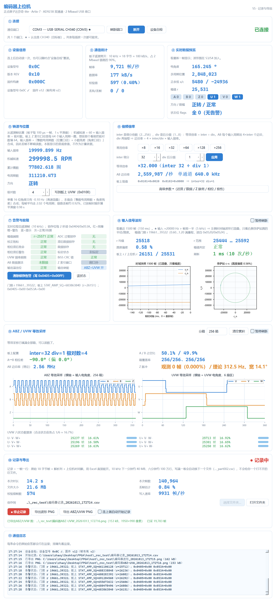

# host_app（host/）

运行在 Windows 上的上位机软件，用来连接 FPGA 编码器采集板（正点原子达芬奇-lite /
Artix-7 XC7A35T + AD9238），实时显示角度、转速、各路波形与状态，并记录数据。

需求与验收标准见 [`docs/10_host_requirements.md`](../docs/10_host_requirements.md)（v1.0 冻结版）。

S5 实际外观（真机 COM3 连上、v12 位流、正在记录）：

---

## 快速开始

```
双击  host\run_host.bat
```

或者命令行：

```bat
cd /d C:\Users\zhaoy\Desktop\FPGA
python host\app.py                 :: 启动界面
python host\app.py --port COM3     :: 启动并自动连接 COM3
```

依赖（已装好）：`pyserial`、`PySide6`。缺了就跑 `pip install pyserial PySide6`。

---

## 打包成单文件 exe（S6）

目标机**不需要装 Python**，把 `host\dist\host_app.exe` 拷过去双击即可
（需求 `docs/10_host_requirements.md` §3「交付形式」：源码 + 单文件 exe 两个都要）。

```bat
:: 现场重新打包（产物 host\dist\host_app.exe，约几分钟）
pwsh -File tools\build_host_exe.ps1
:: Windows PowerShell 5.1（本机 pwsh 不在 PATH 时）
powershell -ExecutionPolicy Bypass -File tools\build_host_exe.ps1

:: 打完之后真机验证（连板子）
host\dist\host_app.exe --port COM3
host\dist\host_app.exe --port COM3 --record --export   :: 无人值守：连上就记录 + 各导出一张 PNG
host\dist\host_app.exe --smoke smoke.png --seconds 4      :: 不连板子：建窗 → 截图 → 退出（烟测）
```

命令行参数与源码方式**完全一致**（同一个 `app.py`）。

### ★ 双击了却"没反应"时怎么查（2026-10-13 新增）

单文件包是 GUI 子系统（`console=False`，**没有黑窗**）：一旦问题出在"进到窗口之前"
（解包被挡、缺 DLL、导入期异常），错误文本**没有任何地方能落下来** —— 用户能说的只有
"打不开"。为此加了三样东西：

1. **exe 旁边的运行日志** `host\dist\host_app_run.log`：每次启动写一行
   `启动：…`，建窗成功再写一行 `已建窗显示（耗时 x.x s）`。判读：
   * **文件完全没有** ⇒ 一次都没跑到 Python，问题在**解包/加载**层（**`%TEMP%`
     不可写 / 受限令牌** —— 见下面「最先怀疑 `%TEMP%` 写不进去」、杀软拦截、磁盘环境）；
   * 有 `启动`、没有 `已建窗显示` ⇒ 卡在解包或 Qt/依赖加载；
   任何异常（导入期、主循环、Qt 槽里的未捕获异常）都会把 traceback 追加进去并弹窗，
   弹窗失败还会退回 Win32 `MessageBoxW`；日志到 256 KB 自动轮转一份 `.1`。
2. **`--diag`（不建窗）**：把冻结信息、exe 目录/TEMP/工作目录的可写性、磁盘空间、
   关键 import 打印并写进同一份日志：
   ```bat
   host\dist\host_app.exe --diag      :: GUI exe 看不到 stdout，看那份日志
   ```
3. **小号诊断包** `host\dist\host_app_diag.exe`（8.2 MB、**带黑窗**、只用标准库）：
   把它和 `host_app.exe` 放进同一个目录，双击即可（放在别处也行，用
   `--app <exe 路径>` 指定要查谁）—— 它会检查冻结路径、各目录可写性、磁盘、exe 的
   Mark of the Web 与可读性，扫 `%TEMP%\_MEI*`（**目录在但 0 文件 = 解包被挡过**），
   然后**替你试跑** `host_app.exe --diag`（最多等 180 s）并回读那份运行日志
   （默认读**被查 exe 旁边**的日志，兼容放别处的情况），最后写一份 `diag_report.txt`。
   它自己就是"**最小的单文件包**"：**它能不能出黑窗，直接说明单文件解包这条路在
   目标机上通不通** —— 而"解包"正是单文件包与目录版唯一的区别。
   ```bat
   :: 现场打这个诊断包（几秒出产物）
   python -m PyInstaller --noconfirm --clean --workpath host\_exe_work_diag --distpath host\dist host\host_diag.spec
   :: 它还有目录版（零解包）：万一是"解包被挡"，单文件诊断包自己也会解不开 ⇒ 用这个
   python -m PyInstaller --noconfirm --clean --workpath host\_exe_work_diag_onedir --distpath host\dist_diag host\host_diag_onedir.spec
   ```
   ★ **最坏情况就用目录版诊断助手** `host\dist_diag\host_app_diag\host_app_diag.exe`：
   它不解包，连"解包被挡"这种故障也照样能出报告 —— 沙箱内已实测（报告里如实写出
   `_MEI*` 两个 0 文件目录、等 180 s 试跑超时、没有日志三件事）。

★ **"解包这一步就死了" —— 先怀疑 `%TEMP%` 写不进去**（2026-10-13 深夜定案，用户真机证据齐全）。
事件原貌：用户双击 `host\dist\host_app.exe` 只弹一个 `Error`
`Could not create temporary directory!`（PyInstaller 引导器在 `%TEMP%` 建 `_MEIxxxxxx` 失败的原话），
而**目录版**（零解包）一开就活。诊断报告给出两条互相印证的事实：
① `TEMP` 写测试 `[Errno 13] Permission denied`、`TEMP 建目录 … [WinError 5] 拒绝访问`，
**而 `exe 目录`"可以写 / 可以建子目录"**；② `%TEMP%` 里的 `_MEI*` 全是 10/11–10/12 建的
（每个 101 文件、内容属另一个程序 `AgentCore-Light-BLE-Helper.exe`），**当天一个都没建成**
⇒ 每次单文件启动都死在"建解包目录"这一步。而 `%TEMP%` 的权限**查不出任何毛病**：
`icacls` 是 `NT AUTHORITY\SYSTEM`/`BUILTIN\Administrators`/`ROG\zhaoy` 三条 `(I)(OI)(CI)(F)`、
`Get-Acl` 无 Deny 且 owner 就是当前用户、不是重解析点、无加密属性、磁盘还有 24 GB、
系统里没有第三方文件系统过滤驱动。

★★ **"受限令牌"曾被当成根因，后来被推翻**：新版诊断助手（`host/diag.py` 的「运行身份」一段）
在用户机器上给出的判词是 `受限 SID 数：0`、`能力 SID：无`、`判断：普通用户令牌（未受限）`、
启动链只有它自己一个进程（父进程已退出 = 就是资源管理器双击的正常样子）⇒ **不是令牌的问题**，
而是这台机器的 `%TEMP%` 对本程序不给写；原因在 DACL 之外（安全软件 / 组策略 / 受控文件夹访问一类，
沙箱里 `Get-MpPreference` 查不了，需要本人到"Windows 安全中心 → 病毒和威胁防护 → 保护历史记录"看）。

**⇒ 交付上绕开这个坑**：单文件包改用**本地解包版**（`runtime_tmpdir="."`，解到 exe 旁边）；
要绝对稳就给**目录版**（零解包，见下一节）。自证办法（在**自己的** cmd 里跑，用来区分
"整机 `%TEMP%` 坏了"还是"只拦这个程序"）：

```bat
mkdir %TEMP%\_t1 && echo hi > %TEMP%\_t1\a.txt && rmdir /s /q %TEMP%\_t1
```

能建 ⇒ 只有本程序被拦（多半杀软/受控文件夹访问）；不能建 ⇒ 这台机器的 `%TEMP%` 整体坏了，
别的软件也会出毛病。★ 注意：**相对**的 `runtime_tmpdir` 是相对**当前工作目录（CWD）**、
不是 exe 目录 —— 实测把 CWD 换成不可写的 `C:\Windows` 启动，引导器立刻报
`Could not create temporary directory!`。所以本地解包版要**双击**（资源管理器双击时 CWD = exe 所在目录）；
快捷方式把"起始位置"设成别处、或从别的目录用路径启动，都不成立。
（附带结论：在 DSH 沙箱那种**写受限令牌**下，本地解包也救不了 —— 引导器新建的 `_MEI*`
只给"用户 SID"、不继承父目录 ACE，沙箱进程照样写不进去，见下面「在 DSH 沙箱里打包可以…」。）

**遇到"打不开"先排除这三件不是 bug 的事**：① 首次启动要把 208 MB 解到 `%TEMP%`，
正常 3~10 s，杀软全盘扫描时可能几十秒 —— **别急着关，看任务管理器有没有 `host_app.exe`**；
② 杀软的"实时保护/受控文件夹访问"可能拦下这次自解包（查 Defender 保护历史，必要时加排除项）；
③ 文件本身要完整（单文件包 **218 MB** 左右，明显偏小就是拷贝/下载没完成）。
都不成立再用上面的日志和诊断包。**兜底交付：目录版**（见下一节，零解包）或**本地解包版**
（`host\dist_local\host_app_本地解包.exe`，解到 exe 旁边，不用 `%TEMP%` —— 见下面的构建命令）。

**打"本地解包版"（`%TEMP%` 不可写的机器上唯一能双击的单文件形态）**：

```bat
:: 主程序（spec 支持两个环境变量覆盖：解包目录与产物名）
$env:HOST_EXE_RUNTIME_TMPDIR = "."            :: 相对当前工作目录 ⇒ 双击时就是 exe 旁边
$env:HOST_EXE_NAME = "host_app_本地解包"
python -m PyInstaller --noconfirm --clean --workpath host\_exe_work_local --distpath host\dist_local host\host_exe.spec
:: 诊断助手也照打一份（%TEMP% 坏了它自己也能出报告）
$env:HOST_DIAG_RUNTIME_TMPDIR = "."; $env:HOST_DIAG_NAME = "host_app_diag_本地解包"
python -m PyInstaller --noconfirm --clean --workpath host\_exe_work_diaglocal --distpath host\dist_local host\host_diag.spec
```

2026-10-13 实测：`host\dist_local\host_app_本地解包.exe` **218,401,916 B**、
`host\dist_local\host_app_diag_本地解包.exe` **8,602,367 B**；
"相对 `runtime_tmpdir` = 相对 CWD"这条语义用 `CWD=C:\Windows` 实测反证过（报
`Could not create temporary directory!`）。**该版未在沙箱外验证**（沙箱里本地解包同样写不进去）。

> ⚠️ **关于上面这些中文产物名**（`host_app_本地解包.exe`、`host_app_diag_本地解包.exe`）：
> 它们是上面那两条命令**显式传进去的环境变量值**，属"用户机器上的产物名"，**不是仓库里的文件名**，
> 也不进版本库（`host/dist_local/` 已在 `.gitignore`）。竞赛那条"仓库内目录名与文件名必须纯英文"
> 的硬性要求管的是**提交进仓库的东西**，所以这里不改。**唯一真正要干净的是单文件/目录版打包产物的
> 默认名**——那已由 `host/host_exe.spec`（⇒ `host\dist\host_app.exe`）与
> `host/host_onedir.spec`（⇒ `host\dist_onedir\host_app\host_app.exe`）保证为 ASCII。
> 同理，`host/recorder.py` 的默认保存目录 `我的文档\host_app记录\` 也保留中文（对用户更友好）。

**打这个包最容易踩的七个坑**（前四个与第七个在处理方式上写死在 `host/host_exe.spec`
和源码里，第五、六个在 `tools/build_host_exe.ps1` 里）：
1. **`host/host_exe.spec` 的 `SPECPATH` 已经是目录**（= `host/`），不要再套一层
   `os.path.dirname` —— 套了会得到仓库根，报
   `ERROR: script '...\FPGA\app.py' not found`（首次打包就踩过）。
2. **`tools/` 必须打进 exe。** `host/link.py` 直接 import `tools/uart_scope.py` 与
   `tools/uart_spi.py`（协议权威实现，故意不复制进 `host/`），而这两个 import 在
   函数体内、PyInstaller 静态分析看不到 ⇒ 不写 `hiddenimports` 就是
   "源码能跑、exe 报 `ModuleNotFoundError: uart_scope`"。
3. **单文件模式下 `__file__` 指临时解包目录**（`sys.executable` 才是 exe 落点，
   临时目录退出即删）⇒ 找 `tools/`、找可写的落盘目录都不能用 `__file__`。
   `host/link.py::_ensure_tools_on_path`、`host/recorder.py::_load_tools`、
   `host/export_png.py::_writable_dir`、`host/selftest_ui.py::_tmp_dir` 都按这个事实写。
4. **`matplotlib.use("QtAgg")`** 是字符串形式的后端选择，同样要显式声明
   `matplotlib.backends.backend_qtagg`，否则界面能起、一导出 PNG 就崩。
5. **GUI exe 在 PowerShell 里"看起来立刻退出"。** exe 是 GUI 子系统
   （`Subsystem=2`、`console=False`），`& host_app.exe …` **不等待窗口进程**
   ⇒ 脚本拿去判"退出码/截图"全是空气，首轮烟测就误报"没生成截图"。
   必须 `Start-Process -Wait`（`tools/build_host_exe.ps1` 已改）。
6. **`.ps1` 里绝不能出现中文文件名。** 本仓库约定 `.ps1` 存 UTF-8 **带 BOM**
   （见 `tools/to_lf.py` 的例外规则）；退化成无 BOM 时 Windows PowerShell 5.1 按
   ANSI 解码，中文字符串会**吃掉行尾换行和引号**，脚本报一堆
   `Missing closing '}'` / `The ampersand (&) character is not allowed`
   （首次打包的脚本就是这么崩的；`python tools/to_lf.py --check` 会把"缺 BOM 的 .ps1"报成问题）。
7. **模块名绝不能和标准库重名。** `host/signal.py` 原来自造了这个坑：源码模式下
   `app.py` 把 `host/` 插到 `sys.path[0]`，碰巧 import 到自己的 `signal`；打包后
   PyInstaller 的 PYZ 里同名模块只有一份，**标准库赢** ⇒ exe 启动即崩
   `panel_alarm.py:66 AttributeError: module 'signal' has no attribute 'ALARM_ROWS'`。
   2026-10-13 已改名 `host/alarm.py`（6 处 `import alarm as sg`）。自检办法：
   `ZlibArchiveReader(r"host\_exe_work\host_exe\PYZ-00.pyz").extract("signal")` 里能查到
   `valid_signals` 就说明 PYZ 里那份是标准库。

★ **在 DSH 沙箱里打包可以，但单文件 exe 起不来 —— 那是沙箱，不是产物问题**（已查清）：
报 `[PYI-…:ERROR] Failed to extract Lerc.dll: failed to open target file! / fopen: Permission denied`，
GUI 版则只弹一个 `Could not create temporary directory!`。根因是沙箱的**受限令牌**
（write-restricted）：PyInstaller 引导器用**显式安全描述符**创建 `%TEMP%\_MEIxxxxxx`
（只给"当前用户 SID"完全控制），而沙箱进程的写权限是靠**令牌里的能力 SID**
（`S-1-4-…`，见 `icacls C:\Users\zhaoy\Desktop\FPGA`）授的；一旦引导器显式给了 DACL，
就**不再继承**父目录的 ACE，而它不会把能力 SID 写进去 ⇒ 它自己建的目录自己写不进去。
实测：预建 `_MEI*` + 追加能力 SID（`W,D,DC`）能写，但引导器每次都新建随机名目录；
`--runtime-tmpdir` 指到仓库内也没用（**目录建出来了、文件写不进去**，见上节实测）；
`_MEIPASS2` 复用解包目录在引导器字节里**不存在**。**唯一的解法是令牌层豁免**
（以非写受限令牌运行该命令），文件夹级授权救不了。
**⇒ 沙箱内只跑 `powershell -File tools\build_host_exe.ps1 -NoSmoke` 出产物，
单文件 exe 的烟测/真机验证请在沙箱外的普通终端里做**（双击也行）。
**⇒ 用户手上就是这台机器**：他双击单文件包报 `Could not create temporary directory!`，
而目录版一开就活。★ 我们一度以为这说明"单文件包是被（受限令牌的）沙箱进程启动的"，
**2026-10-13 深夜被新版诊断助手的「运行身份」判词推翻**：用户机器上是 `受限 SID 数：0`、
`普通用户令牌（未受限）`，`%TEMP%` 还是写不进去，而 exe 目录能写 ⇒ **这台机器的 `%TEMP%`
对本程序不放行**（DACL 之外的原因），与"谁启动它"无关。所以：**单文件包在这台机器上要能双击，
只能用 `runtime_tmpdir="."` 的本地解包版**（上一节的构建命令）——它在沙箱里同样起不来，
但那是沙箱的受限令牌问题，两码事。
**要"双击一定能开"的交付，就给目录版**（下一节）。

★ **要在沙箱内验证打包产物，用 onedir 版**（零解包、不建 `_MEI`，已实测可跑）：

```bat
:: ★★ 正式交付只用这一条命令（打源头闸 → PyInstaller → 门禁：标签/文件数/SHA256/PYZ/烟测/清残留）
powershell -ExecutionPolicy Bypass -File tools\build_host_onedir.ps1
::   受限令牌（DSH 沙箱 / 被降权的终端）会被**直接拒绝打包** —— 那种环境打出来的 exe 带 Low 标签，
::   用户双击后只能写标签允许的目录（[Errno 13] / [WinError 5]，见 docs/ai-collaboration-log.md 记录 72）；
::   明知在受限环境里也要打，加 -Force（门禁随后会用 -Fix 试着把标签救回来）。
:: 事后复核 / 交付前复验（PASS 时 exit 0；FAIL 时 exit 1 并逐条列出问题）：
powershell -ExecutionPolicy Bypass -File tools\check_package.ps1 -Smoke
::   覆盖：①当前终端是不是受限令牌 ②exe/交付目录/包内树/工作区根有无 Low 标签与 S-1-4-… 指纹
::        ③文件数与总字节 + SHA256 ④包内 PYZ 复核 ⑤包内烟测（跑完自动清掉 ui_prefs.json 等残留）

:: ★ 手动打（脚本不可用时用）—— 顺序别变，产物 host\dist_onedir\host_app\，约 179 MB
::   ★ 2026-11-02 起默认用「OpenBLAS 版 numpy」的构建环境（见 host\requirements-build.txt）：
::     Conda 的 numpy 带 222 MB MKL，而本程序只用到数组运算/arctan2/rfft/lstsq，用不上 AVX-512/TBB 那套；
::     换成 PyPI 官方 wheel（单个 19.5 MB 的 libscipy_openblas64）后整包 375 MB → 179 MB（−52%）。
::     没有这个环境也能打，只是大 210 MB；脚本会在有 .venv-blas 时自动用它：
::         powershell -ExecutionPolicy Bypass -File tools\build_host_onedir.ps1
::         powershell -ExecutionPolicy Bypass -File tools\build_host_onedir.ps1 -Python .venv-blas\Scripts\python.exe
python -m PyInstaller --noconfirm --clean --workpath host\_exe_work_onedir --distpath host\dist_onedir host\host_onedir.spec
python tools\check_pyz.py host\dist_onedir\host_app\host_app.exe
::   ↑ PYZ 模块数 + 正向标志串全命中 + 逆向退场串无命中（产物写 %TEMP%，PASS 时 exit 0）
icacls host\dist_onedir\host_app\host_app.exe | findstr /I "Mandatory S-1-4-"
::   ↑ 一条都不该出现；出现 Low 标签就 icacls <路径> /setintegritylevel "(OI)(CI)M" /T /C /Q 后重打
::   ★ 别顺手用 icacls /reset /T：工作区树上的 S-1-4-… 授权与 Everyone deny 是 DSH 沙箱的**预期状态**
::     （技能 diagnose-windows-sandbox-acl 的口径），/reset /T 会把沙箱机制一起删掉
:: 沙箱外也能端到端验证：离线截图 + 连板记录导出
host\dist_onedir\host_app\host_app.exe --smoke smoke.png --seconds 4
host\dist_onedir\host_app\host_app.exe --port COM3 --seconds 10 --record --record-dir 目录 --export
:: ★ 烟测会在包里留下 ui_prefs.json 与 host_app_run.log —— 交付前删掉，保持出厂目录干净
del host\dist_onedir\host_app\ui_prefs.json host\dist_onedir\host_app\host_app_run.log
:: ★ 源码侧也有一条门禁（2026-10-17 全面自查批新增）——只量产物是不够的：
powershell -ExecutionPolicy Bypass -File tools\check_offline.ps1
::   覆盖：compileall + 15 个模块自检（含 analysis/record_bin/replay/panel_lut/panel_health/linkctl/taskrunner）+ 名字检查 + 界面级 317 项
::   任一项失败 exit 1。动机：这七条命令在 README 里挂了很久却**从来没人跑**，导致两个自检恒假失败没被发现。
:: ★ 改过 tools\*.ps1 之后跑一次 python tools\fix_ps1_bom.py --fix：
::   Windows PowerShell 5.1 读没有 BOM 的 .ps1 会按 GBK 解码，报一堆"莫名其妙的语法错"（实测踩到）
::   ★ 同源坑：5.1 在 $ErrorActionPreference="Stop" 下，原生命令往 stderr 写一行就抛 NativeCommandError
::     （Qt offscreen 会正常打印 propagateSizeHints 告警）⇒ tools\check_offline.ps1 用 Invoke-Py 包装
::     （临时改回 Continue，只看退出码）。
```

2026-10-13 实测：离屏截图 1166×2597；连板 8.8 s / 89,896 帧 / 10,235 帧每秒 / 丢帧 0.77%，
导出 `encoder_wave_*.png` 1950×1080、`encoder_abz_uvw_*.png` 1950×990，CSV 14.5 MB，
且 exe 旁边生成了 `ui_prefs.json`（冻结路径修复端到端生效）。

★ **上上版**（2026-10-23 **00:03 重打**（第十八次 = **收尾批**：
在第十七次 25 条修复之上，把三个「结构性」问题收掉——任务线程改**单工作队列**（同一根串口
本来就该串行，连点十次只排队、不堆线程，关窗 `task.shutdown(0.8)` 收尾）、异常钩子改
「永远写日志 + 弹窗 60 秒最多一次」（原来定时器槽一出错就弹模态框，界面基本不可用）、
关窗顺序把工作线程也纳入。并做了 10 分钟无硬件浸泡：**1,331,000 帧 / 翻页 40 / 导出 3，
RSS 119.9→128.5 MB（+8.5，持平）**。上板清单见 `docs/24_board_acceptance_morning.md`）：
`host\dist_onedir\host_app\host_app.exe` **8,132,580 B @2026-10-23 00:03:23**、SHA256
`529F0854BA76CA7E3C2D3D06475CF9C7FEA9EC89439C67E6AA57C9CC5FCC6D25`，目录共 **440 文件 / 585,408,568 B**（558.3 MB）；
`PYZ` 689 模块、包内烟测 exit 0、`check_package.ps1` 全 PASS。

★ **上一版**（第十七次 = 全面复查批，2026-10-22 23:45，`host_app.exe` 8,131,033 B、
SHA256 `9006C8…87D45`、440 文件 / 585,407,021 B；25 条审计修复 + 日志队列/停流离主线程/
UDP 独占绑定/排水分批/CSV 元数据都在这一版）。

★ **上一版**（第十六次 = 显示链路 + 界面梳理，2026-10-22 22:20，`host_app.exe` 8,126,262 B、
SHA256 `968B41…FDEDD`、440 文件 / 585,402,250 B；数据一致性的包络/平滑/缺块标黄就是这一版引入的）。
本轮源码改动：新增 `filters.py`（envelope/smooth/downsample_for_display）与
`selftest_filter.py`（29 checks）、`selftest_display.py`（10 checks）；`panel_capture` 重写 `CapturePlot`
（包络 + 黄色缺块带 + 角标）、新增「显示」下拉与 `smooth_changed`；`panel_wave` 接 `set_smooth`；
`capture.py` 的 `to_csv/to_png` 支持 `note` 且 PNG 用包络 + 中文字体；`ui_prefs` 登记 `capture.smooth`；
`udp_capture`/`main_window` 增加"流开着先停流"三道闸（退出、抓包、命令行）；
`ui_prefs.save()` 改原子写。`PYZ` **689 模块**、包内烟测 exit 0、`check_package.ps1` 全 PASS。

★ **上一版**（第十五次，以太网适配，2026-10-22 21:46，`host_app.exe` 8,117,166 B、
SHA256 `A32787…DFEDD`、440 文件 / 585,391,830 B）。

★ **上一版**（2026-10-17 **08:13 重打**（第十四次 = **全面自查批**（19 类真问题修复 + 两个"恒假失败的自检"
修好 + 新增 `tools\check_offline.ps1`/`check_package.ps1`/`build_host_onedir.ps1` 三道门禁），内容含第十三次的
阶段 5「现场反馈落地」A–D 批 + 收尾批 + 更早的**界面重构四阶段**：阶段 1（R20 读数精炼
+ 全局「原始值」开关）、阶段 2（左侧窄侧栏 + 六页 + 顶栏工具条，取消 ⛶ 单卡放大、`Ctrl+1…6` 接管翻页）、
阶段 3（Apple 视觉：Inter 随包 + `theme.py` 令牌重写 + 位图开关）、阶段 4（文档与交付定稿））：
`host\dist_onedir\host_app\host_app.exe` **8,067,586 B @2026-10-17 08:13:58**、SHA256
`72825284A5812867D837156723492A482C1BCFBF2FD0BAC37C723C6B67A8ADB3`，目录共 **439 文件 / 585,334,685 B**（558.2 MB）；
本轮源码改动（19 类修复的入口，详见本文件「全面自查批」一节）：`link` 命令 FIFO 队列（取代单槽 `_cmd_req`）+
`_skip_to_sync` 短缓冲重同步 + `reply_ok` 拒"6 字节全相同"、`main_window._tick` 异常不再每 100 ms 弹框 +
`_update_live` 全改 `.get()`、`ui_prefs` 补 `ui.scale`/`wave.trig` 默认项、`panel_record._show_diag` 复用旧框、
`export_png` 失败即删半截 PNG、`abz` 相位差带 `div` + `configure` 清累积 + 方波阈值统一、`panel_abz` 补 `notice` 信号、
`encoder` 口径迟滞补出口、`diag`/`app` 写探针不毁同名文件 + Toolhelp32 句柄修正；
新增代码：`host/abz_popup.py`（⑨ 等效采样图独立大窗口）、`panel_abz` 的 `popup_requested`/`mirror`/`canvas_h`、
`recorder` 的写入诊断与进程取证（`diag_write`/`write_diagnosis`/`acl_report`/`cfa_state`/`token_flags`/
`parent_process`/`env_warning`/`pick_dir`/`writable_dir_or_fallback`）、`panel_record` 的「写入诊断」按钮与
四级「打开文件夹」兜底、`main_window._on_export()` 导出前探写改存；另有上一批的 `host/wave_popup.py`（波形独立大窗口）、
`panel_wave` 触发（`_find_trigger`/`TRIG_SOURCES`）、`abz` 方波硬判决（`_decide`/`sq_conf`/`sq_per_bins`/`ideal_*`）、
字号自适应（`app_qss(scale)`/`auto_scale`/`refresh_fixed_lines`）；包内 `PYZ` **684 模块**
（比上一版多 `abz_popup`），正向 **19 个模块名 + 33 个标志串**全命中，**逆向核对**十二个退场串
（`CardMax`/`install_maximize`/`_setup_card_maximize`/`_enter_card_max`/`_restore_card_max`/`set_max_layout`/
`SIDE_MAX_W`/`MAX_BTN_ON`/`maxHide`/`set_plain_wheel_zoom`/`_plain_zoom`/`MAX_BTN_WIDTH`）**全无命中**；
★ **`icacls host_app.exe` = `Medium Mandatory Level`、目录树 Low 标签 0 / `S-1-4-` ACE 0**（见下方收尾批）；
包内烟测 `host\dist_onedir\host_app\host_app.exe --smoke …` exit 0、`截图成功：…1413x824`，运行日志写明
「界面字体：Inter 已装载（4 个文件）」⇒ 字体确实从包内装载（逐条证据见 `docs/DEV_STATUS.md`
§1.86–§1.90、§1.92 与 `docs/16_host_ui_refactor_R16_R20.md` §10–§13.10）。
★ **第十次与第九次内容等价**（exe 字节数、目录文件数、目录总字节完全相同），只有 PE 构建时间戳不同 ⇒ SHA256 变；
**包号要连大小与时间戳一起说**，别拿哈希当"内容没变"的唯一判据。★ **第十四次 ≠ 第十三次**：源码改了 19 处 ⇒
exe `8,059,995 → 8,067,586 B`（+7,591 B）、目录总字节 `585,327,094 → 585,334,685 B`，哈希当然也变。
`selftest_s4`/`selftest_ui` 按设计不进包。★ 用户机器上 `%TEMP%` 写不进去 ⇒
**单文件包在这台机器上起不来，交付用目录版**（见 §1.78）。

exe 是**产物不是源码**：`host/dist/`、`host/dist_onedir/`、`host/_exe_work*/` 已在 `.gitignore` 里，
交付时现打现给（`tools/build_host_exe.ps1` 会打印大小、时间与 SHA256，便于留档）。


无界面自检（不弹窗，用来确认链路和参数对不对）：

```bat
python host\selftest_s5.py  --port COM3 --seconds 12  :: S5 验收：记录 → 回读 CSV → 导出两张 PNG
python host\selftest_s5.py  --port COM3 --soak-minutes 30  :: S5 长稳：连续 30 分钟记录，每 30 s 采内存/帧率
                                     :: （10 kHz 约 1.5 MB/s ⇒ 30 分钟 ≈ 2.7 GB；跑前自动预检盘空间）
python host\selftest_s5.py  --verify-dir host\_s5_soak :: 只离线核对已有记录（逐卷查 24 列/行数/时间单调/原始帧解回）
python host\selftest_s5.py  --port COM3 --reconnect  :: 拔插检查：连上收帧 → 空窗 1 s → 重连还能收帧
python host\selftest_s4.py  --port COM3 --seconds 10  :: S4 验收：等效采样 + 六状态表 + A/B 正交 + Z 脉冲
                                    :: （填箱不够会自动延长采样，上限 max(4×--seconds, 40) s，可用 --max-seconds 改）
python host\selftest_s3.py  --port COM3 --seconds 5 --clear  :: S3 验收：波形统计 + 幅值门限 + 告警翻译 + 清锁存
python host\selftest_s2.py  --port COM3 --seconds 6   :: S2 验收：身份证 + 频率交叉验证 + 倍频写回读
python host\selftest_link.py --port COM3 --seconds 5  :: S1 链路自检：列端口 → 读身份证 → 收帧 → 写回测
python host\selftest_ui.py                            :: 界面级回归（offscreen，277 项，不需要板子；含阶段 1/2/3/5：
                                     :: 读数精炼与原始值、六页与侧栏、Inter 字体与 Apple 令牌、抓图读像素验配色、
                                     :: A 批标题/小数位、B 批字号自适应、C 批波形触发与独立窗口、D 批记录回退与方波判决、
                                     :: ㉖ 记录页写入兜底与进程身份取证、㉗ ⑨ 等效采样图独立窗口、
                                     :: ㉘ 第二轮自查 9 项（脏字节/假应答/命令队列/记忆项落盘）、
                                     :: ㉙ 第三轮自查 10 项（相位带 div/阈值口径/口径迟滞出口/写失败回流等）、
                                     :: ⑭ 段补 3 条「高级参数」提示文案断言）
python host\selftest_ui.py --real-port COM3 --seconds 6 :: 追加真机核对：一键使能 UVW（读-改-写 0x0109 → 六状态转正 → 复原）
                                     :: 、「方波可看 / 还原」（读-改-写 0x0101 → 分箱/inter 配对 → 原样复原）
                                     :: 再跑：记录 → 关窗，验"取帧→落盘逐帧对齐"
python host\recorder.py --selftest                    :: CSV 记录离线自检（14 条，不需要板子；第 6/6b 条验"目录不可写 ⇒ 自动改存"与"兜底用尽 ⇒ 明确报错"，第 8 条写入性能按"同机格式化上限的 35% + 绝对 2 万行/秒"判定，机器快慢不影响结论）
python host\export_png.py --selftest                  :: PNG 导出离线自检（12 条，不需要板子；配色判据直接取 `theme.C`，不再自抄色值）
python host\abz.py     --selftest                     :: ABZ/UVW 等效采样离线自检（20 条，不需要板子；含"采样不足/muddy"路径，用 `synth_frames(..., fine_bits=)` 造真实板子那样的帧）
python host\alarm.py   --selftest                     :: 幅值/告警逻辑离线自检（25 条，不需要板子）
python host\encoder.py --selftest                     :: 转速估算离线自检（11 条，不需要板子）
python host\regs.py    --selftest                     :: 倍频编解码离线自检（2043 组往返）
```

★ **别一条条手敲上面这些 —— 跑一条命令就够**（2026-10-17 全面自查批新增）：

```bat
powershell -ExecutionPolicy Bypass -File tools\check_offline.ps1          :: 离线总门禁：compileall + 15 模块自检 + 名字检查 + 界面级 317 项
powershell -ExecutionPolicy Bypass -File tools\check_offline.ps1 -SkipUi  :: 只想快速看逻辑层时跳过界面级
```

（`host\diag.py` **没有** `--selftest` 模式，别把它列进门禁；`tools\check_offline.ps1` 里也不含它。）

---

## 界面结构（2026-10-16 阶段 2：从「卡片墙」改成「一次一页」）

外壳＝**左侧 176 px 窄侧栏**（概览 / 实时 / 编码器信号 / 告警 / 记录 / ── / 诊断）＋**顶栏工具条**＋右侧
`QStackedWidget` 六页，每页各有自己的滚动区。顶栏只放"工具与全局开关"：端口、刷新端口、连接、设备自检、
连接状态、全局「原始值」开关。

| 页 | 装了什么 | 什么时候来 |
| --- | --- | --- |
| 概览 | 六行结论：设备与链路 / 输入频率 / 机械转速 / 信号幅值 / 告警 / 记录；每行右边「查看 ›」直接跳页 | 刚连上，先看"现在正常吗" |
| 实时 | 实时数据预览 + 转速与位置 + 倍频倍率 + 输入信号波形 | 看波形、调量程、改倍率 |
| 编码器信号 | ABZ/UVW 等效采样（六状态表、一键使能、「方波可看 / 还原」、方波判决） | 查正交/占空比/六状态均衡 |
| 告警 | 告警与故障 + 清锁存（只留"看状态 + 清锁存"） | 现在是不是异常 |
| 记录 | 记录与导出 | 开始/停止记录、导出 PNG |
| 诊断 | 设备信息 + 通信统计 + **高级参数** + 通信日志 | 排障、改门限/迟滞/限频/Z 脉宽/极性 |

* **「⛶ 放大」整体取消**：卡片标题行不再有放大按钮，`Esc`/`PgUp`/`PgDn`/`Ctrl+←→` 这些放大态专用键一起下线；
  `F`/`F11` 全屏、`Ctrl+滚轮` 缩放、双击图内恢复自动量程、`E` 导出当前视图**照旧**。翻页用 `Ctrl+1…6`。
* **卡片标题里的 ①②③ 编号在阶段 5 全部删掉了**（下方早期章节里若出现"卡片⑨"这类叫法，都只是**历史编号**，
  界面上现在只显示标题）；缩放字号用 `Ctrl+=` / `Ctrl+-` / `Ctrl+0`。
* **方向键跟当前页走**：在「编码器信号」页调等效采样图的角度窗口/通道间距，其余页调「输入信号波形」的时基/幅值（`Shift` 微调）。
* **数据管线不重排**：换页只切视图，后台串口线程、记录器、转速估算器都不重启，换回来数据是连续的。
* **「高级参数」搬到诊断页**（原来在倍频倍率卡的折叠区整块摘走），倍频倍率卡的按钮退化成带路：
  「高级参数 ▸（在「诊断」页）」，点一下跳到诊断页。
* 最小窗口仍为 **1600×900**（再小就出滚动条；1600×900 下六页都不需要横向滚动）。

## 视觉与资源（2026-10-16 阶段 3：Apple 视觉落地）

| 类别 | 取值 |
| --- | --- |
| 页面底 / 卡片 | `#F5F5F7` / `#FFFFFF`（圆角 12，1 px `#E5E5EA` 细边） |
| 强调 | 单一蓝 `#0071E3`（主按钮、导航选中、曲线 s_n/U 相/进度条） |
| 文字 | 正文 `#1D1D1F`、次要 `#6E6E73` |
| 状态 | 正常 `#34C759`、警告 `#FF9F0A`、故障 `#FF3B30`（只表状态，不做装饰） |
| 字号阶梯 | 页标题 22 / 卡片标题 17 / 正文 13 / 次要 12 / 单位 11 / 大读数 28（**唯一偏离 doc16 §7 的地方**：§7 草案把 28 给页标题，这里 28 让给读数、页标题落 22，正文取 13 而非 15，否则最小窗口 1600×900 的「实时」页要出纵向滚动） |

* **Inter（OFL 1.1）随包分发**：`host/assets/fonts/Inter-{Regular,Medium,SemiBold,Bold}.ttf` + `OFL-1.1.txt`；
  `host/ui_font.py` 用 `QFontDatabase.addApplicationFont` 注册，回落链 `Inter → Segoe UI Variable → Segoe UI →
  Microsoft YaHei UI → Microsoft YaHei`（中文逐字回落）。打包靠两份 spec 的 `datas` 进 `_internal/assets/`
  （**不能靠"exe 旁边放一份"** —— 冻结后由 `theme._bundle_dir()` 从 `sys._MEIPASS`/`_internal` 读）。
* **表格数字**：`ui_font.use_tabular()` 开 Inter 的 `tnum` 特性，读数不再依赖等宽字体。
  ★ 坑：`setStyleSheet("color:…")` 会把字体特性一起重置 ⇒ **必须先上色再开 tnum**
  （`panel_abz._set_val_color()` 就是为此存在的）。
* **位图控件**：`tools/make_ui_assets.py`（PIL 4× 超采样）生成 `host/assets/img/{chk_off,chk_on,sw_off,sw_on}.png`
  与各自 `@2x`；QSS 里 `QCheckBox::indicator` 18×18、`QCheckBox[switch="true"]::indicator` 36×20（滑块开关）。
* **走查方式**：1950×1080 与最小 1600×900 逐页离屏截图 ＋ **真实平台**（150% DPI ⇒ 抓成 2400×1350）抓整窗。
  离屏平台**保留颜色**，所以自检 ⑳ 节直接抓像素验 `#F5F5F7`/`#FFFFFF`/`#0071E3`
  （**更正**：阶段 2 曾记"离屏截图不能验配色"，那是当时那套令牌本就偏灰所致）。

## 界面重构 · 阶段 1：读数精炼与「原始值」开关（R20，2026-10-16）

* **末位不再来回跳**：读数走 `READOUT_SPEC` 表 + `ui_kit.Stable`（死区 + 1 s 平滑窗），频率/转速/幅值等
  在真值附近抖动时不闪末位；提示行标出分辨力（如「1 s 平滑窗，分辨力 ≈ ±1 Hz」）。
* **全局「原始值」开关**（顶栏最右，滑块）：勾上＝显示未平滑的原始值；状态存 `ui_prefs.json` 的 `display.raw`。
* **悬停看原始值**：鼠标停在读数上给出原始值与平滑值的对照。
* 导出 PNG 与卡片读数同源（`export_png.py` 直接 `import theme as th` 取色，不再自抄一份色值表）。
* 界面自检条数：**159**（阶段 1 收尾）→ **151**（阶段 2：放大态用例退场、换成分页/侧栏用例）→ **164**
  （阶段 3：新增 ⑳ 节字体/令牌/位图/抓像素 13 项、⑯ 参数记忆用例改用 1200×760）→ **222**
  （阶段 5：A/B/C/D 四批各加一节 ㉑/㉒/㉓/㉔/㉕）→ **235**（第五批：㉖ 记录页写入兜底 13 项）→ **239**
  （第五批补：㉖ 加 4 项进程身份取证）→ **255**（收尾批：㉗ ⑨ 等效采样图独立窗口 16 项）→ **277**
  （全面自查批：㉘ 第二轮自查 9 项 + ㉙ 第三轮自查 10 项 + ⑭ 段补 3 条提示文案断言）。

---

## 全面自查批（2026-10-17：功能实现程度 / 稳定性 / bug 与修法）

> 起因：用户要求"全面自查上位机软件，检查功能实现程度、稳定性，检查并修复可能存在的 bug"。
> 做法：四路子代理只读审计（链路与协议 / 算法与面板 / 生命周期·记录·导出 / 需求追溯）＋**一名反方验证员**
> （专门证伪其他子代理的指控）＋我自己的交叉核对（host 寄存器语义 ↔ `rtl/reg_file.v`、帧布局 ↔ `rtl/uart_scope.v`、
> 合成畸形帧压测）。细节见 `docs/DEV_STATUS.md` §1.92 与 `docs/16_host_ui_refactor_R16_R20.md` §13.10。

**修掉的真问题（每条都有实测或 RTL 依据）**

* **⑨ 独立窗口整条链路是坏的**：`main_window.py` 建完 `AbzPopup` 后接 `p.notice.connect(...)`，而 `panel_abz.AbzPanel`
  **根本没有 `notice` 信号** ⇒ `AttributeError` 被 Qt 槽吞掉，**五个信号一个都没接上**（`mirror()`/`set_connected()`
  也从没调过）；更糟的是窗口已建成 ⇒ 第二次点击走 `_abz_win is not None` 分支直接 `show()`，坏得无声无息。
  修：`panel_abz` 补 `notice = Signal(str, str)`；㉙ 加"窗口真可见 + 有 notice"断言（光看"点了按钮"抓不到）。
* **相位差读数漏 `div`**：`abz.py` 的相位用 `inter/bins`，而同文件的 `ab_period_deg`/`per_bins` 都用
  `inter/(bins*div)` ⇒ **div>1 时相位差错 `div` 倍**（面板报"偏 90°"），会误导用户去改本来正确的硬件。
  修：相位带 `max(1, div)`；㉙ 用 4 档 div 各断言一次 90°。
* **改 `inter`/`div` 不清旧累积**：`configure()` 只对 `bins/pairs` 置 dirty ⇒ 新旧口径混在一张图上（`phase=None muddy=True`）。
  修：`inter`/`div` 也置 dirty（tooltip 本来就承诺"会自动清空"）。
* **方波阈值三套口径打架**：`abz.py` 判据不含 `div`、面板判绿用的是含 `div` 的 `sq_per_need` ⇒ 同一屏既判"绿"又
  告警"请把 inter 降到 ≤128"。修：统一到 `bins*max(1,div)/inter`。
* **命令队列单槽竞态**：`link.transact` 用单个 `self._cmd_req` 槽，设备信息后台线程与 UI 线程同时发命令时
  后者覆盖前者，前者**命令从未上线却干等到超时**（假超时）。修：改 FIFO 队列 `_cmd_queue`，超时的请求自动跳过。
* **应答判据太弱**：`reply_ok` 只看"6 字节异或为 0" ⇒ 6 个相同字节（死线/恒定电平很容易造出）就被当成合法应答。
  修：加"不能 6 字节全相同"。
* **短缓冲盲区**：脏字节 + 缓冲不足 18 B 时，里面那条完整应答要等下一批字节才解析。修：`_pump` 增加 2b 步
  （缓冲不足一帧且帧头不对 ⇒ 立即重同步），重同步逻辑抽成 `_skip_to_sync`。
* **`_tick` 没有异常保护**：`app.py` 的 `sys.excepthook` 会弹**模态**框，而 `_tick` 是 100 ms 定时器 ⇒ 一个坏帧
  就能每 100 ms 弹一个模态框（界面等于锁死）。修：`_tick` 包 try（异常记 fault 日志、同签名告警去重）。
* **坏帧直接下标**：`_update_live` 用 `f["angle_deg"]`/`f["amp_sq"]` 这类硬下标（同函数对 `io_bits` 却是防御式）
  ⇒ 就是上面那条的触发源。修：全部改 `.get(...) or 0`。
* **两条记忆项写了等于没写**：`ui_prefs.DEFAULTS` 里没有 `ui` 段和 `wave.trig` 键，而合并只遍历默认键 ⇒
  缩放字号与波形触发源**每次启动都回默认值**（自检发现不了：同会话内存往返读得到）。修：补默认键 + ㉘ 加
  落盘往返断言 + 新增"静态交叉核对"（正则扫 `host/*.py` 里所有 `up.put/number/choice`，键不在 DEFAULTS 里就报）。
* **导出与关窗的顺序问题**：`_on_export` 的"探目录/取名"在 try 之外（异常冒进 Qt 槽，记录卡停在上次"已导出"）；
  `closeEvent` 无保护（`disconnect_port()` 一抛就存不了参数、窗口也关不掉）。修：两处都包 try 且保证善后必执行。
* **「写入诊断」连点会攒窗口**：每次点击新建 `QDialog` 且不关旧的。修：复用同一个框。
* **导图失败留半截 PNG**：`_save` 的 `makedirs` 少了 `exist_ok=True`，且 `savefig` 失败后已写出的半个文件不删。
  修：`exist_ok=True` + 失败时只在"本次新建的文件"上做清理。
* **转速口径迟滞没有出口**：`encoder.py` 注释承诺"退出阈值 1.5%"，代码只有入口 ⇒ 一次丢帧 >3% 之后**整场会话**
  锁在较吵的"帧数时钟"口径。修：补退出阈值。
* **写串口失败没人知道**：`req["error"]` 只赋值、全仓无读取 ⇒ "写失败但读还活着"的窗口期界面只显示超时。修：写失败
  同时 `_emit_error`。
* **进程链取证本身有 bug**：`CreateToolhelp32Snapshot` 没声明 `restype` ⇒ 64 位下句柄被截断成 `c_int`，
  "拿不到快照"永远检测不到（报告里"会崩溃"不成立，只是把非法句柄当有效句柄用）。修：补齐 `restype/argtypes`。
* **写探针会毁同名文件**：固定名 `host_app_write_test.tmp` + `open(w)` 会先截断用户同名文件，失败还不清理。
  修：带 pid 命名 + `finally` 清理（`app.py::_write_probe` 同源隐患一起修）。
* **提示文案过时（会让人改错硬件）**：诊断页「高级参数」提示里，AB 迟滞写"0 = 用默认档"（v9 起 0 = **不启用**迟滞，
  单位 360°/2048）、Z 脉宽写"0 = 不出 Z"（v9 起 **0 也出 1 步**）。修：三处文案按 `rtl/abz_gen.v:120/:130/:519-520`
  更正，并在 `selftest_ui` ⑭ 段加文案断言锁死。

**被证伪的指控（探针实测过，没有改代码）**

* "脏字节会让解析器每轮只前进 1 字节、永久解析不出应答" —— 实测 `resync` 一次吃掉整段垃圾，不存在活锁。
* "读线程异常会静默死亡" —— `try/except/finally` 兜住并 `_emit_error` + 断开。
* "先 stop 再 drain 会丢尾帧" —— 现有顺序是**有意为之**（旧顺序会丢 1~2 批），只在文档注明 join 超时是已知取舍。
* "报警判定被稳定值放宽" —— `alarm.evaluate` 的 `r` 只进**文案**，越限判定来自板上 `io_flags`/`latch` 位。
* "幅值二次开方 ⇒ 满屏漏报"、"丢帧率会 >100%"、"淘汰 batch 不计数"、"int() 截断丢小数" 等 6 条同样是误判。

**"门禁自己坏了"这件事（本轮最值得记的）**

README 里列着七个 `--selftest` 命令，**从来没人一条条跑**，结果两个自检**恒假失败**且长期没人发现：

* `export_png.py` 的像素判据里写死了一份**旧调色板**，而画图侧早就改成从 `theme.C` 取色（`primary` 从 `#2E7DD1`
  变成 `#0071E3`）⇒ 判据 [2]/[4] 永远匹配不上。修：判据改成 `_hex_rgb(th.C[...])`。
* `recorder.py` 的 [6] 条还在断言"目录不可写 ⇒ 报 error"，而阶段 5 D 批起记录器**先探写再自动改存** ⇒ 断言过期。
  修：改成验"改存成功 + `did_fallback`"并新增 [6b] 验"兜底用尽才报错"。

⇒ 所以本轮把清单变成门禁：**`tools\check_offline.ps1`**（compileall + 15 模块自检 + 名字检查 + 界面级 317 项，任一项失败
`exit 1`），交付侧另有 `tools\check_package.ps1`（量产物）。教训一句话：**"记得跑"不是防线，跑不过就交不出去才是。**

**数字**

* 离线门槛：`compileall` exit 0；`encoder` 11 条 / `alarm` 25 条 / `regs` 2043 组往返 / `ui_prefs` 16 条 /
  `abz` 20 条 / `recorder` 14 条 / `export_png` 12 条 全 PASS；`selftest_ui.py` **277 项 / 0 失败**。
* 交付包**已重打（第十四次）**：`host\dist_onedir\host_app` = **439 文件 / 585,334,685 B**，
  exe **8,067,586 B @2026-10-17 08:13:58**、SHA256 `7B0EB3C51A97B4A81AAFD1550372D3E160767215A99EE5555B9B2A74FA08DC82`、
  `Medium` 标签；用 `tools\build_host_onedir.ps1` 一条命令打完（源头闸 + 打包 + `tools\check_package.ps1` 门禁全 PASS）。
* 需求追溯（`docs/12` R1–R20）：已实现 61 / 部分 5 / 未实现 0 / 已退场 4；**R20 十八项全部落地**。
  发现 6 处文档过期（R6/R7-A/R8/R9②/R10/R11 仍写"✅ 已实现"，实际随阶段 2「⛶ 放大」退场），已在
  `docs/12_host_ui_requirements.md` 更正。
* 仍未实现（如实说明，非 bug）：R2/R3 的**游标测量**（文档里本来就写"可选、默认关"，代码完全没有）。

---

## 阶段 5：现场反馈落地（2026-10-16，A–D 四批 + 收尾批）

> 用户接上板子用了一轮后提的 14 条意见（原始清单见 `docs/12_host_ui_requirements.md` 的 **R20**）；
> 实施记录见 `docs/16_host_ui_refactor_R16_R20.md` §13/§13.8、`docs/DEV_STATUS.md` §1.89/§1.90。
> **卡片标题里的 ①②③ 编号全部删掉了**，
> 下面一律按标题点名。

**A 批（小改，含 1 个真 bug）**

* **修 bug**：概览页一直显示"型号未知" —— 判据 `"0x0C" in dev.upper()` 里 `upper()` 把 `0x0c` 变成 `0X0C`，
  模式永远不匹配。改成 `dev_id_ok()`：先按 `int(text, 16) == EXPECT_DEVICE_ID` 比，再退回大小写无关匹配。
* 11 张卡片标题去掉 ①②③ 编号；概览页删掉「现在怎么样」标题。
* 累计圈数 / 电周期数 → 1 位小数（圈数带"圈"）；等效倍率 → 整数（`×256（inter 256 ÷ div 1）`）。
* 波形刷新读数去掉「（画图 0.7 ms）」（耗时移进 tooltip）。
* 「编码器信号」页默认分箱 **1024**；删掉「采样不足：A/B 波形不可信，只看 Z 与读数」这条判定
  （原来会改标题、把 A/B 两条线变淡）⇒ 改成卡片顶部**可执行建议**。

**B 批（字号随窗口自适应）**

* 整界面（字号、控件内边距、圆角、侧栏宽、提示标签行高、matplotlib 字号）随窗口**等比缩放**：
  `1600×900` = 1.0×，上限 1.6×（`ui_font.auto_scale()`）。
* 手动覆盖：`Ctrl+=` 放大 / `Ctrl+-` 缩小 / `Ctrl+0` 回到自动；当前档位存进 `ui_prefs.json` 的 `ui.scale`（0 = 自动）。
* 提示标签用 `fix_lines()` 的最小/最大高度窗口，缩放后由 `ui_kit.refresh_fixed_lines()` 重算，不会切字。

**C 批（波形：触发静止 + 独立大窗口）**

* 「输入信号波形」新增**触发源**下拉：`s_n` 过零（默认）/ `c_n` 过零 / Z 索引升沿 / 自由（跟随最新帧）。
* 触发用**插值过零**定位（不是取最近样本点），触发点钉在画幅 25% 处 ⇒ 波形像真示波器一样**相对静止**，
  不再随刷新左右滑动；横轴改成相对触发点标注。
* **独立大窗口**：双击卡片标题，或点控制行的「独立窗口」按钮 —— 打开一个可自由缩放的大窗（`Esc` 关），
  里面工具与主界面完全一样（同一个面板类），两块图随窗口长高。**「输入信号波形」（⑧）与「ABZ / UVW 等效采样」（⑨）
  两张卡片都有**（收尾批补齐 ⑨）：两个独立窗口各看各的，视图设置（横轴/纵轴/排布/分箱）各窗口独立，
  输出与测量值互相同步。
* 图内双击仍然是"恢复自动量程"（这条没变）。

**D 批（记录目录健壮性 + 方波判决）**

* **记录打不开的根因处理**：程序现在会**真写一个探针文件**去试目标目录（只看权限位不够 ——
  Windows「受控文件夹访问」是运行时拦截）；写不进去就**自动改存**到别的可用目录（我的文档 → 桌面 →
  `~/host_app记录` → `%LOCALAPPDATA%` → 临时目录），并把原因用人话写出来（放行 `host_app.exe` /
  CSV 被 Excel 占用 / 目录只读）。记录卡片上显示的是**真正在写的那个文件**。
* **方波判决（方案 C = 实测 + 理论两条线）**：「编码器信号」页除了原有平均值曲线，还画一条**按箱多数票的
  硬判决方波**（空档处断开，不画假线），以及一条按实测相位对齐的**理想方波**（虚线，作参照）；
  新增读数「方波判决 %」「每周期箱数」。
* **物理约束（这条要记住）**：一箱 = `inter/bins` 个 A/B 周期 ⇒ 每周期至少 8 箱才看得出方波形状，
  即 **`bins ≥ 8×inter`；1024 箱 ⇒ `inter ≤ 128`**。`inter=256` 时每周期只有 4 箱，**任何算法都画不出
  标准方波** —— 此时程序给的是"请把 inter 降到 ≤128"的建议（点「方波可看」会一次配好）。
  等效采样靠角度遍历慢慢填箱（`inter=64`/1024 箱时 8 万帧约 41%），**箱覆盖率是独立读数**，
  判决线只在已填到的箱上可信（真机实测：`inter=64` 时与理想方波一致 437/439 = 99.5%）。

**收尾批（记录页为什么打不开 / 写不进去 —— 真凶在工作区 ACL 上）**

* **⑨ 也给了独立大窗口**（新增 `host/abz_popup.py`，16 项界面自检 ㉗）。
* **打开文件夹**不再单靠 `os.startfile()`：改成 `explorer /select,<文件>` → `os.startfile(文件)` →
  `explorer <目录>` → 复制路径到剪贴板，四级兜底（任一成功即返回），按钮下面直接写用的是哪一级。
* **导出 PNG 前先确认目录能写**：`recorder.writable_dir_or_fallback()` 会真写探针；写不进去就改存并写明
  "已改存到 …（原目录 … 不能写：原因）"，不会再出现"存图失败"却没有下文。
* **记录页多了「写入诊断」按钮**：非模态对话框，一次给出目标目录、探针结果、各级回退目录、`icacls` 摘要、
  `Documents`/`cfa_state()` 受控文件夹访问状态，以及新增的**『进程身份』**段（完整性级别 / 受限令牌 /
  父进程 / 是否提权 / 环境里的 `DSH_*` 指纹）。★ **这一段才是这次的关键证据**。
* ★★ **根因（不是程序 bug）**：这台机器上工作区根目录 `C:\Users\zhaoy\Desktop\FPGA` 自己带着
  `Mandatory Label\Low Mandatory Level:(OI)(CI)(NW)` 和 `S-1-4-…` 两个 ACE（构建环境留下的痕迹），
  PyInstaller 把**低完整性标签继承**给了包目录与 `host_app.exe`；Explorer 双击启动时按镜像标签把进程
  **降权到低完整性级别**，于是它只能写标签允许的位置 ⇒ "管理员能写、程序写不了"。诊断为
  `令牌 integrity Low（S-1-16-4096）` + `has_restrictions=1`，exe 文件本身就是 `Low Mandatory Level`。
  修法：对工作区 `icacls … /reset /T` + `icacls … /setintegritylevel "(OI)(CI)M" /T`（32,799 个对象），
  复核 exe 与全树回到 **Medium、低标签 0、`S-1-4-` ACE 0**。详见 `docs/ai-collaboration-log.md` 记录 72。
* ★ 因此**打包清单多一条**：打完包必须 `icacls` 复核 `host_app.exe` **没有 Low 标签、没有 `S-1-4-` ACE**
  （见下方"打成目录版"），否则用户装到任何机器上都可能重演。
* ★★ **这条清单已经变成工具，不再靠"记得"**（2026-10-17 收尾）：
  * `tools\build_host_onedir.ps1` —— 交付用的**唯一一条命令**：打包前先看当前终端是不是受限令牌
    （是就**拒绝打包**，除非 `-Force`）→ PyInstaller → 自动调门禁 → 打印"这次该把哪些数字抄进哪几个文件"。
  * `tools\check_package.ps1` —— 交付门禁：①终端令牌 ②exe/交付目录/包内树/工作区根的 Low 标签与
    `S-1-4-` 指纹 ③文件数 + 总字节 + SHA256 ④包内 PYZ 复核 ⑤包内烟测（跑完清残留）；
    有问题 exit 1 并逐条列出，`-Fix` 只改**完整性级别**（绝不 `/reset`）。
  * `tools\check_pyz.py` —— PYZ 模块数 + 正向串命中 + 逆向退场串无命中（固化的第四道复核）。
  * 也就是说：**病根在"用受限令牌打包"**，第一道闸就拦在那里；后四道是万一漏了的兜底。
  * `tools\check_offline.ps1` —— 源码侧门禁（2026-10-17 全面自查批补上）：`compileall` + 七个模块
    `--selftest` + 界面级 277 项，任一项失败 `exit 1`。**这条是被"两个自检恒假失败没人发现"逼出来的**：
    清单挂在 README 上不等于会跑，只有"跑不过就交不出去"才算防线。

---

## 怎么用

1. **接板子**：USB 线插板子上的 CH340 口。下拉框会自动列出所有串口，
   认出目标板的那一条后面会带 `★`；拔插后点“刷新端口”。
2. **连接**：选中端口 → 点**顶栏**的“连接”。顶栏右侧状态变成“已连接”＝连上了。
   也可以直接在下拉框里手输端口名（例如 `COM9`），手动指定。
3. **设备自检**：连上后会自动读一次；随时可以点顶栏的“设备自检”重读（结果落在「诊断」页的『设备信息』卡片）。
   预期结果：设备型号 `0x0C`、版本 `0x10`、固件构建 `0x000C`（v12，帧布局 v2）。
4. **看数据**：「实时」页的『实时数据预览』显示最新一帧的电角度、位置、正余弦、幅值、
   六路输出电平（A/B/Z/U/V/W）、方向与状态告警。
5. **转速与位置（S2）**：输入频率、机械转速（`60 × 输入频率 ÷ 极对数`）、累计圈数、
   电周期数、方向。“极对数”默认 4（＝板上 `0x0100` 复位值）；板上 Z 索引口径是每 64 个
   输入周期一圈，想按那个看就把它填 64。频率 =「整数电周期数（位置口径）+ 小数残差
   （角度口径）」合成，丢帧不影响读数。
6. **倍频倍率（S2）**：`inter`（细分 2…256，写 0 表示 256）与 `div`（后分频 1…8），
   等效倍率 = `inter ÷ div`，AB 边沿率 = `4 × inter ÷ div × 输入频率`。
   选好点“应用”＝写 `0x0101`/`0x0102` 并**自动回读比对**（对不上会中文提示）。
   常用倍率（×8…×256）一键填；**门限 / 迟滞 / 限频 / Z 脉宽 / 相位 / 极性与输出使能**都搬到了
   **「诊断」页的『高级参数』**卡片（倍频倍率卡上的「高级参数 ▸（在「诊断」页）」按钮带路；写之前自动
   读-改-写，不会碰同寄存器的其它位）。点“写到板上 UVW（0x0100）”把极对数写进板子。
7. **告警与故障（S3）**（「告警」页）：左半边是实时位（跟着遥测帧每 100 ms 更新），右半边是锁存位
   （每 2 秒读一次 `0x0404`/`0x053A`）。灰＝正常/待测，蓝＝提示，橙＝警告，红＝故障。
   点“读状态”立刻刷新；点“清除锁存告警”＝写 `0x0405=0x00FF`（W1C 清位）并读回确认。
   ★ 若清完还有位没掉，说明故障此刻仍然存在（幅度越限/限频），界面上会直接告诉你先处理什么。
   ★ **通信日志按级别显示**（日志在「诊断」页的『通信日志』卡片）：默认只显示「信息」及以上，
   告警寄存器的 2 秒周期轮询记为「调试」（值没变就不显示，值变了才以「信息/警告」打一条），
   所以日志不再被刷屏；想看全部明细在日志卡片的「显示级别」下拉里切到「全部（含调试）」，
   「清空日志」按钮清屏。
8. **输入信号波形（S3）**：取最近 1500 帧（150 ms）——左侧是 `s_n`/`c_n` 时域快照，
   右侧是李萨如圆（`c_n` 对 `s_n`）。**本板输入 ≈20 kHz > 帧率一半（5 kHz），时间轴上的
   正弦必然混叠**（看着像缓变直线，这不是 bug）；此时真正有意义的是右侧圆的**半径与圆度**
   （圆度偏差＝半径的不圆程度，越好越接近理想正余弦）。卡片里同时给出 r 均值/范围、
   板上 `STAT_AMP_SQ` 与上位机算的 r 对照、以及**实测重画间隔与刷新次数**
   （界面以 100 ms 为节拍取数、最快 10 次/秒重画，读数 ≥10 次/秒显示绿色）。
   勾“暂停刷新”可冻结画面慢慢看。★ 幅值门限：`0.60…1.20` 满量程（r = 19661…39322）。
   ★ **像示波器一样调**：卡片上有「横轴」档位（自动（跟随输入）/ **17 档**：0.5 / 1 / 1.5 / 2 / 3 / 5 /
   7.5 / 10 / 15 / 20 / 30 / 50 / 75 / 100 / 150 / 200 / 300 ms 满屏）、「纵轴」档位
   （自动 / **7 档**：±1.00 / ±0.75 / ±0.50 / ±0.35 / ±0.25 / ±0.15 / ±0.10 满量程）、「排布」叠加/分离
   （分离把 `s_n`、`c_n` 上下错开，长时间看相位关系更清楚）、「恢复自动」按钮。
   ★ **挡位旁边有「◀ ▶」步进按钮**（纵轴是「− +」）：一格一档，**到档位两端会自动变灰**，
   不会点半天没反应；键盘 `←/→`（时基）与 `↑/↓`（幅值）等效，**按住 `Shift` 是微调**（每次 ×0.9，
   不进档位表），移动方向键后状态栏会写出"时基：横轴 7.5 ms（手动）"这种提示。
   **手动一调就锁定**（图下方那行会标「手动」），**双击图内**或点「恢复自动」（`R`）回到自动量程。
   ★ **图上操作**：**Ctrl+滚轮**以光标为中心缩放，**左键拖动**平移；裸滚轮永远只滚页面
   （阶段 2 起卡片独占放大已整体退场，见第 12 条）。
   ★ **触发（阶段 5）**：控制行多了「触发」下拉 —— `s_n` 过零（默认）/ `c_n` 过零 / Z 索引升沿 /
   自由（跟随最新帧）。触发时**波形相对静止**（触发点钉在画幅 25% 处、过零点用插值定位），
   横轴改标"0 = 触发点"；选「自由」才是旧的"0 = 最新帧"。
   ★ **独立大窗口（阶段 5）**：**双击卡片标题**或点控制行的「独立窗口」按钮，弹出一个可自由缩放的大窗
   （`Esc` 关），工具与主界面一样、两块图随窗口长高，适合凑近观察；里面双击图内仍是"恢复自动"。
9. **ABZ / UVW 等效采样（S4）**：把每帧的 `(电角度, 六路电平)` 按角度分箱取均值——这就是
   “等效采样”。左图横轴是**输入电角度**（一屏画完整个输入周期，A/B 会来回 32 次，看的是
   正交与占空比），右图横轴是 **UVW 电角度**（6 个扇区，U/V/W 各 120°）。下方是**六状态
   数据表**：合法状态应各占 1/6 ≈ 16.7%，偏离超过 2%/6% 会变橙/变红。
   卡片读数：A/B 占空比（应各 50%）、**A→B 相位差（应 −90° 或 +90°，偏差 ≤25° 显示绿色）**、
   箱覆盖率（256/256 表示等效采样已填满）、AB 边沿率（理论值）、Z 脉冲观测/理论。
   “分箱”可调 64…1024（箱越多越细，但要更长的累积）；“清空累积”重新采样。
   改 `inter`/`div` 后卡片会自动清空重来（相位-时间关系变了）。
   ★ **像示波器一样调**：「横轴」档位（自动（整圈 360°）/ **11 档**：5 / 10 / 20 / 30 / 45 / 60 / 90 /
   120 / 180 / 270 / 360° 满屏，同样有「◀ ▶」步进按钮与 `←/→` 快捷键）、
   「通道间距」0.6…2.5（A/B/Z 三条波形的基线间隔，UVW 同理；键盘 `↑/↓` 每次 0.1、
   `Shift+↑/↓` 每次 0.05）、「排布」叠加/分离、 「恢复自动」；
   **双击图内**或点「恢复自动」回到整圈。手动放大到 90° 以内时，UVW 的 60° 扇区分隔线会自动
   收起（否则全在画面外）。Ctrl+滚轮缩放、左键拖动平移同上。
10. **记录与导出（S5）**：点“开始记录”就把收到的每一帧写进 CSV —— **一行一帧，原始
    18 字节帧 + 解析列 + 上位机时间戳三样都有**，事后不看上位机也能按 `tools/uart_scope.py`
    解回。默认存到 `我的文档\host_app记录\encoder_record_年月日_时分秒.csv`，
     “选择文件夹…”可换位置，“打开文件夹”直接跳过去。卡片实时给出**本次时长 / 帧数 /
    文件大小 / 丢帧估计 / 校验错帧数 / 写入速率**。
    ★ **随动随止**：点“停止记录”的那一刻，卡片六项读数**全部定格**（链路计数器还在后台走，
      但不再写进这张卡片，特别是「校验错帧数」不会再涨）；再点“开始记录”从 0 重新起算。
    ★ 10 kHz 下一分钟约 40 MB、六分钟就满 100 万行，所以**写满一卷自动换下一卷**
    （`…_part002.csv`、`…_part003.csv`…），不会给你一个 Excel 打不开的巨文件；
    每卷都是整齐的整块，序号跨卷连续。长时间拷机可以勾“连上就自动开始记录”。
    两个导出按钮（“导出波形 PNG”“导出 ABZ/UVW PNG”）会把当前波形重新画成
    1950×1080 / 1950×990 的大图，**顶部带上端口、设备、固件、输入频率、倍频、方向、
    导出时间**——图发出去也能自证是哪台机器什么配置下测的。文件同样落在记录位置。
    ★ 两张图卡片里另有**「导出当前视图」**按钮：按屏幕上现在的量程/排布导出（文件名带
    「当前视图」），适合把调好量程的局部直接贴进报告；全貌导出与像素契约保持不变。
11. **断开**：再点一次按钮（此时是“断开”）。断开时会自动停表并保留统计。
12. **滚轮**：鼠标滚轮在界面**任何位置都是滚动页面**（像素级跟随）——数字框、下拉框不再被
    滚轮误改（改值请用键盘输入或点开下拉），日志框与端口表上是滚它们自己。
    **Ctrl+滚轮**在当前鼠标下的图上缩放（见第 8、9 条）。★ 阶段 2 起**没有例外**了：卡片独占
    放大（⛶）已整体退场，裸滚轮一律滚页面，图表缩放只认 `Ctrl+滚轮`。
13. **换页**：点左侧侧栏的六项切换页面，或按 `Ctrl+1…6`（概览 / 实时 / 编码器信号 / 告警 / 记录 / 诊断）。
    换页只切视图，**不动数据管线**（串口线程、记录器、估算器都在后台照原样跑），换回来读数连续。
    ★ 页与卡片按钮的呼应：概览页每行「查看 ›」直接跳到对应页；「实时」页里倍频倍率卡的「高级参数 ▸（在
    「诊断」页）」跳诊断页；「导出当前视图」等按钮都只作用于当前页。
14. **界面参数会记住**：示波器量程/通道间距/触发源/日志显示级别/窗口大小/缩放档位存在 `host\ui_prefs.json`
    （关窗时写、开窗时读）；文件被删或写坏都只是回到默认值，不会报错。这个文件属运行态，
    已在 `.gitignore` 里。★ 打包成 exe 后（`host\dist\host_app.exe`）这个文件落在
    **exe 旁边**（即 `host\dist\ui_prefs.json`）——不能落在单文件 exe 的临时解包目录里，
    那个目录退出就删，参数会丢。

### 键盘快捷键一览（2026-10-16 阶段 2 重分配；阶段 5 补缩放键）

| 按键 | 作用 | 备注 |
| --- | --- | --- |
| `Ctrl+1` … `Ctrl+6` | 切页：概览 / 实时 / 编码器信号 / 告警 / 记录 / 诊断 | 与点侧栏等效 |
| `Ctrl+=` / `Ctrl++` | 界面字号放大一档（阶段 5） | 存进 `ui_prefs.json` 的 `ui.scale` |
| `Ctrl+-` | 界面字号缩小一档（阶段 5） | 下限 1.0×（1600×900 的基准） |
| `Ctrl+0` | 回到"跟随窗口自动"（阶段 5） | `ui.scale = 0`；上限 1.6× |
| `←` / `→` | 当前页：「输入信号波形」时基 或「等效采样」角度窗口 细一档 / 粗一档 | 调完状态栏写出新量程 |
| `↑` / `↓` | 当前页：「输入信号波形」幅值放大 / 缩小一档（等效采样页是通道间距 +0.1 / −0.1） | 到端点自动停 |
| `Shift+←/→/↑/↓` | 同上的**微调**（时基/角度 ×0.9，间距 ±0.05） | 不进档位表 |
| `R` | 恢复自动量程（等价双击图内） | |
| `Space` | 暂停 / 继续刷新（等价卡片上的「暂停刷新」） | |
| `E` | 导出当前视图 PNG（等价「导出当前视图」按钮） | 像素契约 1950×1080 / 1950×990 |
| `F` / `F11` | 真·全屏 / 退出全屏 | 退出时回到原来的窗口大小 |
| ~~`PgDn` / `PgUp`、`Ctrl+←/→`、`Esc`~~ | 已随「⛶ 放大」一起下线（阶段 2） | 翻页改用 `Ctrl+1…6` |

> 键盘只管**当前页**：在「编码器信号」页调等效采样图的角度窗口/通道间距，其余页调「输入信号波形」的时基/幅值。
> 焦点在输入框/数字框里时这些键**全部让给输入框**（打字、移光标不会顺手改掉量程）。

---

## 实机全面复查记录（2026-10-14）

板子接在 **COM3**（USB-SERIAL CH340，2 Mbaud）；`DEVICE_ID=0x0C`、`REV=0x10`、
`RTL_BUILD=0x000C`（v12，帧布局 v2）；输入 **≈1.01 kHz**、`inter=256 div=1`、极对数 4、
**UVW 输出关着**（`0x0109=0x0040`，只开 ABZ）。

| 项目 | 结果 |
| --- | --- |
| S1 `selftest_link.py` | ✅ 9917 帧/秒、179,954 字节/秒（2 Mbaud 的 90%）、本窗口校验错 200（0.397%）、重同步 3680 字节、丢批/丢帧 0/0 |
| S2 `selftest_s2.py` | ✅ 输入频率交叉验证 1006.87 Hz（独立路径 1055.33 / 帧数时钟 1000.20）、机械转速 15103 RPM、倍频写通路 inter=64/256/2 写读都生效并复原 |
| S3 `selftest_s3.py` | ✅ r 均值 25899.6（min 25348 / max 26305、圆度偏差 3.696%、削顶 0）、板上 r 26032.5（差 0.51%）、`--force-fault` 真造告警（`STAT_LATCH=0x08`）→ 撤源仍锁存 → 写 `0x0405=0xFF` 清成 0x00 |
| S4 `selftest_s4.py` | ✅ 8 项通过、2 项按需跳过（见下"3 个修掉的真问题"第 1 条）|
| S5 12 s 记录 | ✅ 119,222 帧 / 18.4 MB / 9922 帧每秒 / 丢帧 0.76%；CSV 逐卷回读、抽行解回一致；PNG 1950×1080 与 1950×990 |
| S5 10 分钟长稳 | ✅ 5,952,554 帧 / 937.6 MB / 9921 帧每秒 / 丢帧 0.77% / 6 个分卷；帧率中位 9895（最低 9428、最高 10415）；**内存 163 → 84 MB 不涨**；丢批 0、丢帧 0 |
| S5 `--reconnect` | ✅ 关端口→重开，前后各收 19,973 / 19,923 帧 |
| 界面 `--real-port` | ✅ 界面取 60,501 帧 = 记录器落盘 60,501 行（差 0）、链路解析 73,614 帧 |
| GUI 真机跑图 | ✅ 13.9 s / 135,226 帧 / 20.9 MB（9696 帧每秒）/ 丢帧 0.79%，两张导出图与 CSV 都正常 |

**3 个修掉的真问题**（都在这一轮改完并复验）：

1. **S4 在 UVW 未使能时误报 FAIL** —— `selftest_s4.py` 的「无非法 UVW 状态」「六个合法状态
   都出现」两条检查无条件执行，而 UVW 关着时 U/V/W 恒 0（`U-V-W-` 不属于六个合法态），
   实测 165,094 帧全被算成"非法态" ⇒ 每次这样跑都报"2 项不满足"。现已跟「六状态占比均衡」
   一起 gate 在 `0x0109 bit7` 上，并把它记进"跳过"清单（跳过原因写清楚）。
2. **`0x0405` 的 b5（scamp＝幅值越限）锁存位没有被翻译** —— `host/alarm.py` 只映射
   b0/b2/b3/b4，真机 `STAT_LATCH=0x24`（b2 laglim + b5 scamp）时卡片⑦显示"幅值越限 正常"，
   只有底部摘要 `0x0405=0x24` 能看出矛盾。现补上：实时门限告警优先，只有"历史锁存、
   当前已恢复"才显示「已锁存 b5」；`alarm.py --selftest` 加 3 条断言（22 → 25 条）。
3. **ABZ「等效采样」把采样不足画成"看着像方波"的假波形** —— 成因文案原来说"输入频率太高、
   请降到 20 kHz 以内"，可真机在 **1.0 kHz** 也是这样：真因是 `bins`(256) ≤ `4×inter`(1024)
   ⇒ 每箱跨 ≥1 个 A/B 周期、每箱均值必然趋近 0.5。现按"箱数不够 / 边沿率接近帧率"分因给出
   可行做法（如 `inter` 降到 ≤ 箱数/8，保证每箱跨 ≤0.5 个 A/B 周期、每周期 ≥8 点），并且
   **在图上就地标明**「采样不足：A/B 波形不可信」（A/B 两条线变淡）—— 光靠卡片顶部一行
   提示不够，图会骗人。（2026-10-14 晚又修了两处文案/数值：`per_cyc` 多乘了 2 导致"每箱跨
   几个周期"虚报一倍；"箱数提到 ≥1024"在 `inter=256` 时不成立，现在按上限分两支说。）

**同一天晚些时候的追加（用户追问"三个为什么"+ 一键使能）**：

| 用户的问题 | 结论（依据都在 RTL 里） |
| --- | --- |
| 为什么 ADC 会过载锁存？ | `rtl/ad9238_capture.v:43-45` 把 ADC 的 OTR 引脚做成 **sticky**（`clr_otr`/复位/`en` 下降沿才清，清优先）。旧版顶层把 `clr_otr` 硬接 `1'b0`（`rtl/reg_file.v:82/:133-137` 有注释）⇒ 一旦瞬态过载就永久亮；现在写 `0x0405` bit0 会发清除脉冲（`rtl/reg_file.v:429`）。**另外"过载"不一定是真的溢出**：模拟前端超量程、偏置过大、或增益档不匹配都会打 OTR —— 遥测里它并进 `stat bit0 oflow`（`rtl/enc_top.v:806`），所以"输出溢出位"和它是同一盏灯。 |
| 为什么 BiSS 会 CRC 错误？ | FPGA 是 **BiSS-C 从机**（`rtl/biss_c_slave.v:89-99`，`ST_BITS=26/MT_BITS=12`）。帧复位要求 `ma`（主机时钟，异步、最高 10 MHz）与 `sl` 同时高 ≥ `TIMEOUT_CYCLES=10` 个周期 = **100 ns**（`:74-80`）；主机背靠背连续打时钟（帧间空隙 <100 ns）就会被判"CRC 之后继续打时钟"的协议违例，`crc_err_seen` 粘滞置位（`:110-111`、`:337`）。没接 BiSS 主机时该位应为 0 —— 若你板上没接却看到它亮，多半是 `ma` 上有毛刺/串扰或引脚悬空。 |
| 为什么 ABZ 采样不足、A/B 波形不可信？ | 等效采样按"输入电角度"分箱（默认 256 箱），箱内取 A/B 的平均电平。判据是 `bins ≥ 8×inter`（每箱跨 ≤0.5 个 A/B 周期）：你现在 `inter=256`、256 箱 ⇒ **每箱正好跨 1.0 个完整 A/B 周期** ⇒ 箱内均值恒 ~0.5，与角度不再相关（`host/abz.py` 里 97% 的箱都这样）⇒ `ab_muddy` 成立、A→B 相位差判为不可测。此时图上那条"方波"是采样混叠出的假象：帧率 ~10 kHz、每帧电角度走 ~35°（≈26 箱），远远跳着采 258.6 kHz 的 AB 基波。**要么把 `inter` 降到 ≤32（256 箱）或 ≤128（1024 箱），要么上示波器**。 |

**GUI 加了"一键使能"入口（`host/panel_abz.py` 卡片⑨ 新增"输出使能"行）**：两个 checkable
按钮「ABZ 使能」「UVW 使能」+ 一行状态（`输出使能：ABZ 使能（0x0109 = 0x0040）`）。点击只发
一次 `output_requested` 信号，由 `host/main_window.py::_on_set_output` 做**读-改-写**：只在已读回
的 `0x0109` 上改 bit6/bit7，同字节的极性/方向位原样保留（纯函数 `output_write_value()` 便于自检），
写完自动回读并回灌面板；串口没连/正忙/还没读回 `0x0109` 时**拒绝写入并把按钮拨回去**，不留
假状态。UVW 打开后卡片⑨ 的六状态表就会开始转正、S4 的第 3/4 项也不再需要跳过。

**★ 真机第一次验这个功能就抓出一个老 bug（已修）**：点一下「UVW 使能」时，日志里蹦出

```
[log:fault] !! 处理 写高级参数 的结果时出错：not enough values to unpack (expected 3, got 2)
```

根因在 `host/main_window.py`：`_done_adv` 与 `_done_apply` 都写成
`for addr, val, hexs in result["readback"].items()`，而 `readback` 是 `{地址: 值}`（2 元），
原始应答在另一个键 `hexes` 里（3 元的只有 `writes`）。异常被 `_on_task_done` 的
`except Exception` 兜住，所以**寄存器其实已经写进板子了、界面却从不刷新**：`interp.regs_raw`
停在旧值，于是"再点一次"算出"已是目标值"、连命令都没发。`git blame` 显示这两行来自首次入库
（`5e9c326`，2026-10-13）—— **不是本轮引入，而是从没被自检覆盖过**（旧 `selftest_ui.py` 里
`readback` / `_done_apply` / `_done_adv` 一次都没出现）。受影响的是三条写路径：倍频「应用」、
高级参数「应用」、一键使能。现已改成 `for addr, val in result["readback"].items()` +
`hexs = (result.get("hexes") or {}).get(addr)`，并加了离线回归「⑨ 补3 写任务结果处理器」——
用真机形状的结果走完整的 `_on_task_done` 分发路径，断言"没有 '结果时出错' 日志"且
`interp.regs_raw` 与按钮同步（界面自检 115 → **117 项**）。修完真机复跑：
`0x0109 = 0x00C3 → 0x0043 → 0x00C3`（bit7 跟随、同字节其它位不动、复原不残留），
六状态表 `合法 19597 / 非法 0`。

**新增「方波可看 / 还原」一键预设（卡片⑨ 头部两个按钮）**：预设按 `箱数 ≥ 16×inter` 自动配一组
"能看出方波"的参数（纯函数 `main_window.square_pair()`：优先保住 inter、只把分箱提到最小的够用档，
实在不行才降 inter），并读-改-写 `0x0101` 把 inter 写下去（走 `task_apply_inter_div`，`_done_apply`
自动回灌 ⑥/⑨ 卡）；「还原」把 inter 与分箱改回按下之前。配好后 ⑨ 卡不再写"采样不足"、
`A→B 相位差` 从 `—` 变 ≈90°。

真机上这一步又抓出两个问题（都已修 + 加离线回归）：

1. **调用参数写错**：`_on_square_restore` 写成了 `task_write_advanced(w, dict(raw), "adv")` ——
   第三个实参本该给 `task.run` 的 tag。当时的离线自检看不出来（`_runf` 只记 tag、**不调用**
   任务函数），于是"点了还原什么都不写"。现在离线用假串口**真跑**任务函数，参数错会进 `_errs`，
   并断言写入序列就是当初读到的两个原始值。
2. **回读可能拿到陈旧应答**：真机上出现过"写 `0x0101=0x0000` 之后，任务里的回读却是上一次
   写进去的 `0x0040`"—— `0x0101` 在现板上是 **16 位对写**（写它等于同时写 `r_inter0/r_inter1`），
   一次写会带出一串应答，链路忙时容易取到旧的那条。后果不只是显示错：`regs_raw` 被污染，
   而「还原」的"原值"正是从它来的。现在 `task_write_advanced` 在回读不符时**再读一次确认**
   （与 `task_apply_inter_div` 同一套路），并且「还原」改成**逐字节写回当初读到的原始值**，
   而不是按 `(inter, div)` 重新编码 —— `decode→encode` 不是恒等（原始 `0x0000/0x0000` 解成
   256/1，再编回去是 `0x0000/0x0001`），只有原样写回才能逐字节复原。

真机端到端（`--real-port COM3`）：`0x0101/0x0102 = 0x0000 0x0000 → 0x0040 0x0000`（inter 256→64）
`→ 0x0000 0x0000`（原样复原）；另加一条"窗口自检读到的值 vs 直读值一致"的检查，把"链路陈旧应答"
单独报出来，而不是笼统判失败。

**已修：微调后档位组合框不再"就近显示"（R15，用户 m11938 拍板要做）**：以前 `Ctrl+滚轮`/`Shift+方向键`
微调到 49.15 ms，组合框却显示"满屏 50 ms"（`panel_wave.py`/`panel_abz.py` 的 `_sync_controls()` 用
"最接近的档位"兜底），与提示行的"量程：横轴 49.15 ms"对不上。现在改走 `ui_kit.sync_span_combo()`：
值正好落在档位上就选那一档并**删掉**临时档；是微调值就在"自动"后面插一条
`满屏 49.15 ms（微调）`（已有就原地更新），位数与 `_view_text()` 对齐（横轴 `%.4g`、纵轴 `%.2f`），
两处写的数字一模一样。三条曲线（卡片⑧ 时基、卡片⑧ 幅值、卡片⑨ 角度窗口）都改了。
离屏取证（放大态 50 ms → `Ctrl+滚轮`）：组合框 `满屏 49 ms（微调）`、量程行 `横轴 49 ms（手动）` ——
数字一致；点"恢复自动"或选回真档位，临时档自动收掉。新增离线回归 12 项（含"删临时档后下标校正"）。

**还留着、等你拍板的一条（不影响正确性）**：

- ~~`Ctrl+滚轮` 缩放后，时基/角度档位组合框按"最近档位"显示~~ —— **已修（R15，见上）**。

> 两个数字别混淆：**校验错 0.39%** 是串口链路逐帧 XOR 校验口径（与 BiSS 帧 CRC 无关）；
> **丢帧估计 0.77%** ＝ 校验错帧 + 重同步吞掉的帧，占应到帧时隙的比例（卡片的 tooltip 里写了）。

---

## 文件说明

| 文件 | 作用 |
| --- | --- |
| `app.py` | 入口：装配 `QApplication`、**装载包内 Inter（`ui_font.apply`）**、套样式表、开窗；`--smoke` 用于自动化截图验证；`--diag` 不建窗、只把环境与 import 结果打印并写日志；启动/建窗/异常都会写 exe 旁边的 `host_app_run.log`（GUI exe 没有黑窗，这是唯一能落地的证据），日志里会写明「界面字体：Inter 已装载（N 个文件）」；`_write_probe()`（临时目录探测）**全面自查批**改成带 pid 的文件名 + `finally` 清理 |
| `diag.py` | 打包版**现场诊断**小工具（只用标准库 ⇒ 产物几 MB、带黑窗）：查目录可写性/磁盘/Mark of the Web，扫 `%TEMP%\_MEI*`（**0 文件 = 解包被挡过**），并试跑同目录的 `host_app.exe --diag`、回读那份运行日志，写 `diag_report.txt`；打包配置见 `host_diag.spec`（单文件）与 `host_diag_onedir.spec`（目录版，零解包 ⇒ 最坏情况也能出报告）。★ 必需件：`fix_streams()` + `read_tail()` —— 否则日志里的 UTF-8 BOM 撞 GBK 管道会让工具自己崩（实测踩过）。**全面自查批**：`CreateToolhelp32Snapshot` 补 `restype`（不声明的话 64 位下句柄被当成 `c_int` 截断 ⇒"拿不到快照"**永远检测不到**）、`Process32FirstW/NextW` 补 `argtypes`；`write_probe()` 改成带 pid 的文件名 + `finally` 清理（原来会截断用户的同名文件、失败还留垃圾） |
| `main_window.py` | 主窗口：**左侧侧栏 + 顶栏 + 六页**（`_build_topbar()`/`_make_pages()`/`show_page()`，每页一个自己的滚动区），100 ms 定时刷新；把界面动作转成后台任务；概览页的六行结论由 `_refresh_overview()` 填（型号判定走 `dev_id_ok()`，阶段 5 修掉 `dev.upper()` 永不匹配的老 bug）。★ 全局滚轮路由（`_route_wheel`）、键盘快捷键（`_setup_keys`：`Ctrl+1…6` 翻页、`Ctrl+=`/`Ctrl+-`/`Ctrl+0` 缩放、方向键跟当前页走、焦点在输入框里自动让键）、真·全屏（`_toggle_fullscreen`）都在这里；**卡片放大（`_enter_card_max`/`_restore_card_max`/`_setup_card_maximize`）已整体删掉**（阶段 2），`resizeEvent` 在阶段 5 以"按窗口尺寸调 `_apply_scale()`"的新身份回来；`_open_wave_popup()` 管波形独立窗口（`_wave_win`，帧同时喂两处）；`_open_abz_popup()` 管 ⑨ 等效采样图独立窗口（`_abz_win`）；**全面自查批**：`_tick()` 全程 try（`app.py` 的 excepthook 会弹模态框，而 `_tick` 是 100 ms 定时器 ⇒ 一个坏帧能每 100 ms 弹一个模态框）、`_update_live()` 的帧字段全改 `.get(...) or 0`、`_on_export()` 的探目录/取名挪进 try、`closeEvent()` 分四段 try 且保证存参数与关窗必执行 |
| `cmds_mixin.py` | 命令与采集控制（主窗口拆分第 3 步）：一次点击 → 参数校验 → 挑任务 → `TaskRunner` → 回填面板；抓包/连续流的启动、停止、异常收尾也在这里。**不直接碰串口**（全在 `tasks.py`），忙态互斥（`if self.busy: return`）**不在这里省**。 |
| `live_mixin.py` | 实时链路（拆分第 2 步）：`_tick`/`_tick_body`、回放 `_replay_tick`、链路看门狗 `_watch_link`/`_auto_reconnect`、概览汇总 `_refresh_overview`、转速换算 `_update_speed`。**喂面板一律过 `isVisible()` 门**（matplotlib 重绘抢 GIL 是连续流丢包的主因）。 |
| `logview.py` | 日志子系统：`LogMixin` + `LOG_RANK/LOG_COLOR/LOG_FILTERS` + `_esc`。工作线程只投递（`_logq`）、界面线程 200 ms 泵一次；历史与显示分离，切级别只重画不丢历史。 |
| `tasks.py` | 纯 I/O 任务函数（读寄存器、写倍频、写补偿表、读板上状态、清锁存…）。**不 import Qt**，所以能在没有 `QApplication` 的机器上跑自检。返回的原始 hex 串是"能复现台架"的证据链。 |
| `linkctl.py` | `LinkWatchdog`（静默 3 s 报故障、15 s 重连、最多 3 次、来帧清零）、`pick_reconnect_port()`（拔插后 COM 号变了也能挑回板子）、`drain_events()`（断开前排空队列，否则队列里的帧进不了 CSV）。 |
| `taskrunner.py` | 串行任务队列：一条工作线程 + `queue.Queue`，`done` 信号把 `{tag, result}` 送回界面线程；异常也当结果送回，界面不会永远"忙"。`shutdown()` 后拒收新任务。 |
| `net_frames.py` | 网口模式下的翻译层：把连续流的 (s, c) 现算成 10 kHz 帧（角度 / pos_full / ABZ / UVW / Z）。**A/B/Z/UVW 是按板上配置推导的，不是测出来的**；自检覆盖解回绕、UVW 六状态、占空比、反向、空输入。 |
| `ui_consts.py` | 两边都要用的小东西：`TAG_TEXT`（tag→中文名，日志与错误提示的唯一来源）、`STREAM_POINTS`、`cfg_from_regs()`。只放纯数据与纯函数。 |
| `link.py` | **通信层核心**：独占串口的后台线程，遥测帧与寄存器应答无损分流；**全面自查批**：命令槽 `_cmd_req` 改成 FIFO 队列 `_cmd_queue`（两个线程同时发命令时，后来者覆盖前者 ⇒ 前者"命令没上线却干等到超时"的假超时）、`reply_ok` 拒绝"6 字节全相同"的假应答、`_pump` 增加 2b 步短缓冲立即重同步（`_skip_to_sync()`）、写串口失败同时 `_emit_error` |
| `ports.py` | 枚举串口、识别 CH340、格式化端口名 |
| `theme.py` | **Apple 视觉主题（阶段 3 重写）**：色板 `C`（`#F5F5F7` 页面底 / `#FFFFFF` 卡片 / `#0071E3` 单一强调 / `#1D1D1F`·`#6E6E73` 文字 / `#34C759`·`#FF9F0A`·`#FF3B30` 状态）+ 全局样式表 **`app_qss(scale=1.0)`**（卡片圆角 12 与 1 px 细边、侧栏、顶栏、导航项、步进小按钮、开关位图、细滚动条；阶段 5 起非 1.0 时用一条正则统一缩放全部 77 处 `px`）+ 资源定位 `ASSET_DIR`/`FONT_DIR`/`IMG_DIR` 与 `IMG` 四条 url（冻结时从 `sys._MEIPASS`/`_internal` 取）；★ `QToolButton#CardMax` 样式随放大按钮一起删了；导出图不再自抄色值 —— `export_png.py` 直接 `import theme as th` |
| `ui_font.py` | **界面字体（阶段 3 新增）**：`apply()` 把包内 `assets/fonts/Inter-*.ttf` 用 `QFontDatabase.addApplicationFont` 注册成全局字体（失败自动回落 Segoe UI Variable/Segoe UI，中文逐字回落）；`use_tabular()`/`apply_tabular()` 给读数开 Inter 的 `tnum`（表格数字等宽）。**阶段 5 加缩放**：`auto_scale(w, h) = clamp(min(w/1600, h/900), 1.0, 1.6)`、`set_scale()`/`current_scale()`、`pt(base)`（给 matplotlib 字号用）、`apply(app, px=…)` 连全局默认字号一起改 |
| `ui_kit.py` | 共享界面零件（卡片、字段、电平小标签、`step_button()` 步进小按钮、`ScopeNav` 图内缩放/平移），避免面板与主窗口循环 import。**阶段 2/3 新增** `Sidebar`（`PAGES` + `page_changed`）、`page_header()`、`SIDEBAR_W = 176`；`field()` 对读数调 `ui_font.use_tabular()`；`fix_lines()` 用**最小 + 最大高度**夹住多行提示（★ 别再改回 `setFixedHeight` —— 窄窗口下会切掉末行），**阶段 5** 又加 `refresh_fixed_lines(root)`（缩放后按 `fixedLines` 属性重算高度）。放大态用的 `install_maximize()`、`v._row_lay`、`set_plain_wheel_zoom()` 已删 |
| `encoder.py` | 转速/位置估算（纯逻辑，无 Qt）：pos_full 解回绕、整数+小数合成频率、累计圈数；**全面自查批**补上"退出阈值"（原实现只有入口 ⇒ 一次丢帧 >3% 后**整场会话**锁在较吵的帧数时钟口径）；`--selftest` **11 条** |
| `regs.py` | 寄存器位域编解码（纯逻辑，无 Qt）：inter/div、极对数、输出使能、高级字段 |
| `alarm.py` | 幅值与告警逻辑（纯逻辑，无 Qt）：环形缓冲统计、r 门限判定、14 行告警中文翻译。★ 原名 `signal.py`，会**遮蔽标准库 `signal`** ⇒ 打包成 exe 后 PYZ 里标准库赢、exe 启动即崩（`AttributeError: module 'signal' has no attribute 'ALARM_ROWS'`），2026-10-13 改名 `alarm.py` |
| `abz.py` | ABZ/UVW 等效采样逻辑（纯逻辑，无 Qt）：按电角度分箱、A/B 正交与占空比、六状态统计、Z 观测/理论；**阶段 5 新增方波判决** —— `_decide()`（按箱多数票 `hi/n ≥ 0.5`，空档只跨 ≤ `SQ_GAP = 12` 箱、再长断开）、`sq_a/sq_b/sq_z/sq_u/sq_v/sq_w`、`sq_conf`（"说得准"的箱占比）、`sq_per_bins = bins*div/inter`、`ideal_a/b/u/v/w`（相位对齐的理论方波）；`BINS_DEFAULT = 1024`；**全面自查批**：相位差带 `div`（原来漏了 ⇒ div>1 时报错角）、`configure()` 对 `inter`/`div` 也置 dirty（不再新旧口径混图）、方波阈值统一成 `bins*max(1,div)/inter`、`feed(..., snapshot=False)` 可跳过全量快照（面板本来就不用它的返回值，bins=1024 时白烧约 6% 单核）；`--selftest` **20 条** |
| `recorder.py` | **CSV 记录（纯标准库，无 Qt/串口依赖）**：一帧一行、时间戳回推（时间列 6 位小数）、自动分卷、异常不崩；**阶段 5 新增写探测与自动改存** —— `probe_writable()`（真写探针文件，`os.access()` 判断不了 Windows「受控文件夹访问」）、`dir_hint()`（把 PermissionError 翻成常见原因，现为**四条**、含"管理员能写、本程序不能写 ⇒ 目录权限/完整性级别在挡"）、`fallback_dirs()`、`Recorder.did_fallback`；**收尾批新增写入诊断与进程取证** —— `diag_write()`/`write_diagnosis()`（报告含**「进程身份」段**）、`acl_report()`（`icacls` 摘要）、`cfa_state()`（受控文件夹访问）、`token_flags()`（ctypes 读令牌：完整性级别/受限 SID/提权/会话；★ 必须显式声明 `argtypes`/`restype`，否则 64 位下句柄被截断、全部静默返回 `None`）、`parent_process()`、`env_warning()`（检测到低完整性/受限令牌时直接在记录卡上说明）、`pick_dir()`、`writable_dir_or_fallback()`；`--selftest` **14 条**（[6] 验"目录不可写 ⇒ 自动改存成功 + `did_fallback`"、[6b] 验"兜底用尽 ⇒ 明确报错" —— 全面自查批发现旧的 [6] 还在断言"不可写就报 error"，早被 D 批的自动改存推翻了） |
| `export_png.py` | **PNG 导出（无 Qt）**：用 matplotlib 重画波形/等效采样大图并写进配置与读数；支持 `view=` 按界面当前量程导出；`--selftest` 12 条（★ 像素判据直接 `_hex_rgb(th.C[...])` 取主题令牌 —— 全面自查批发现判据里写死着旧调色板 ⇒ [2]/[4] 两条**恒假失败**很久没人发现） |
| `filters.py` | **显示链路（2026-10-22 新增）**：`envelope()` 每像素列 min/max（尖峰不会被抽稀丢掉）、`smooth()` 零相位平滑（SG/中值/均值 3/5/9/15 点）、`downsample_for_display()`；纯 numpy、不改输入数组 |
| `selftest_filter.py` | 滤波/包络自检：29 checks（长度守恒、不篡改输入、保线性、去毛刺、降噪 ≥5 dB、包络含极值、性能） |
| `selftest_display.py` | 显示链路自检：包络含尖峰、平滑只画不改、缺块区间换算、`ui_prefs` 往返 |
| `ui_prefs.py` | 界面参数记忆（纯标准库）：`host/ui_prefs.json` 存示波器量程/通道间距/触发源（`wave.trig`，阶段 5）/字号缩放档位（`ui.scale`，0 = 自动）/日志级别/窗口尺寸，坏文件自动回落默认；打包成 exe 后该文件落在 exe 旁边（冻结时按 `sys.executable` 定位，不落临时解包目录）；`--selftest` **16 条**（含"静态交叉核对"：正则扫 `host/*.py` 里每个 `up.put/number/choice` 的段/键，不在 `DEFAULTS` 里就报出来 —— 全面自查批发现 `ui.scale`/`wave.trig` 一直是**写了等于没写**） |
| `page_overview.py` | **概览页（阶段 2 新增）**：六行结论（`ROWS` = 设备与链路 / 输入频率 / 机械转速 / 信号幅值 / 告警 / 记录），每行「查看 ›」发 `jump_requested(page)` 跳页；`set_row(key, value, verdict, level)` 由主窗口填 |
| `panel_speed.py` | 转速与位置卡（输入频率/机械转速/累计圈数/电周期数/方向/极对数）；阶段 5 起圈数与电周期数只给 **1 位小数** |
| `panel_interp.py` | 倍频倍率卡；**高级参数整块搬去诊断页** —— `take_adv_box()` 把折叠区交出去、按钮改成「高级参数 ▸（在「诊断」页）」并 emit `adv_page_requested`；等效倍率阶段 5 起只给**整数** |
| `panel_alarm.py` | 告警与故障卡（实时位 + 锁存位 + 清锁存按钮）；给概览页提供 `level(key)` 与 `summary()`（挑最严重的一条）。★ `_state` 只在 `_refresh()` 里赋值，取用必须 `(getattr(self, "_state", None) or {})` |
| `panel_wave.py` | 输入信号波形卡（时域快照 + 李萨如圆，matplotlib 嵌入 Qt；时基/幅值档位、叠加/分离、导出当前视图）；**阶段 2 起只剩一种版面** —— 放大态右侧 300 px 竖排（`set_max_layout`/`_reflow_readouts`）已删；**阶段 5 新增触发**（`TRIG_SOURCES` 四档、`TRIG_POS = 0.25`、`_find_trigger()` 插值过零 ⇒ 波形相对静止）与 `popup_requested`（标题双击 / 「独立窗口」按钮）；`canvas_h=None` 时不钉 250 px（弹窗里随窗口长高） |
| `panel_abz.py` | ABZ/UVW 等效采样卡（双图 + 六状态数据表，matplotlib 嵌入 Qt；角度窗口/通道间距、叠加/分离、导出当前视图；**"输出使能"行 = 一键使能 ABZ/UVW（读-改-写 `0x0109` bit6/bit7）**；**「方波可看 / 还原」一键预设**（按 `箱数 ≥ 16×inter` 自动配对，见 `main_window.square_pair()`））；`_set_val_color()` 先上色再开 tnum（`setStyleSheet` 会把字体特性一起重置）；**阶段 5** 主曲线改画**硬判决方波** + 虚线**理想方波**，并新增读数「方波判决 %」「每周期箱数」；默认分箱 1024；**收尾批**新增 `popup_requested` 信号（标题双击 / 「独立窗口」按钮）、`__init__(bins, parent, canvas_h=240, show_popup=True)`、`mirror(other)`（同步输入频率与输出位/寄存器口径，视图设置各窗口独立）；**全面自查批**：补 `notice = Signal(str, str)`（⑨ 弹窗那边的 `p.notice.connect(...)` 原来一直抛 `AttributeError`，被 Qt 槽吞掉 ⇒ 五个信号一个都没接上）、`_clear_readouts()` 补清 `v_sq`/`v_sqper`、喂帧时传 `t_now` 且 `snapshot=False` |
| `wave_popup.py` | **波形独立大窗口（阶段 5 新增）**：`WavePopup(QDialog)` 内嵌**第二个 `WavePanel` 实例**（触发/时基/幅值/排布/恢复自动/暂停/导出全部复用，零重复代码），`Esc` 关窗；主窗口把同一批帧同时喂给主卡与弹窗 |
| `abz_popup.py` | **⑨ 等效采样图独立大窗口（收尾批新增）**：`AbzPopup(QDialog)` 内嵌**第二个 `AbzPanel` 实例**（`canvas_h=None` 不钉高、`show_popup=False` 隐藏自身的「独立窗口」按钮），`Esc` 关窗；入口是 ⑨ 卡标题双击或控制行「独立窗口」按钮（`popup_requested` 信号）；主窗口 `_open_abz_popup()` 把导出/输出使能/方波预设回调接到弹窗面板上，`_tick` 里弹窗可见时 `mirror()` + 喂帧（同步输入频率与输出位，**视图设置各窗口独立**） |
| `panel_record.py` | 记录与导出卡（开始/停止、时长帧数丢帧、两个 PNG 导出按钮）；阶段 5 起选目录就先做**写探测**并预警，开始记录后显示**真正在写的文件**（不可写时自动改存）；**收尾批新增**「写入诊断」按钮（非模态只读对话框：目标目录 / 探针结果 / 各级回退目录 / `icacls` 摘要 / 受控文件夹访问状态 / **进程身份**）与「打开文件夹」**四级兜底**（`explorer /select,<文件>` → `os.startfile(文件)` → `explorer <目录>` → 剪贴板，按钮下方写明用的哪一级）；**全面自查批**：「写入诊断」改成**复用同一个对话框**（原来连点 N 次会攒 N 个常驻窗口） |
| `selftest_link.py` | S1 无界面自检 |
| `selftest_capture.py` | 抓包块解析 / 导出 / 摘要自检（25 checks） |
| `selftest_udp.py` | UDP 头解析 / 缺包归位 / 端口自检（26 checks） |
| `selftest_stream.py` | 连续流包头 / 环形缓冲自检（29 checks） |
| `selftest_ui.py` | 界面级自检（277 checks，离屏驱动真窗口） |
| `selftest_s2.py` | S2 无界面验收自检（频率交叉验证 + 倍频写回读） |
| `selftest_s3.py` | S3 无界面验收自检（波形统计 + 幅值门限 + 告警翻译 + 清锁存实测） |
| `selftest_s4.py` | S4 无界面验收自检（等效采样覆盖 + A/B 正交 + 六状态均衡 + Z 脉冲） |
| `selftest_s5.py` | S5 无界面验收自检（记录 → 回读 CSV → 出图；`--soak-minutes` 长稳） |
| `run_host.bat` | 双击启动（`chcp 65001` + 调 `python host\app.py`） |

协议代码不重写：`tools/uart_scope.py`（帧校验/解码）与 `tools/uart_spi.py`
（命令编码/应答校验）被 `link.py` 直接 import，保证与固件约定不漂移。

---

## 转速口径（2026-11-02 更正，依据 docs/20 §12）

界面「极对数」那个输入框填的**不是电机极对数 P**，而是**每转正弦周期数**——
本机编码器 EI58C9.25-2048SC5N4 是 **2048 周期/转**：

| 填什么 | 同一台机器读出的转速 | 说明 |
|---|---|---|
| **2048** | 210.8 rpm | 正确（本机默认值） |
| 64 | 6,746 rpm | 旧磁环 demo 的口径，差 32 倍 |
| 4 | 107,942 rpm | 板上 `0x0100` 的复位值，是**电机极对数**，差 512 倍 |

两件事别再混：

* 板上 `0x0100` = 电机极对数 P，只给板上 UVW 生成用；连接时只读来记日志，
  **不再**写进速度口径（以前一连上就写，于是转速差 512 倍）。
* 界面「极对数」= 每转正弦周期数，默认 2048，掉电记忆。

`cycle_cnt` 在本机 EI58 位流里是 16 位（65536 个值），`pos_full = cycle_cnt<<16 | angle`；
按 22 位解回绕仍然安全，因为单帧最多 ±32 个周期（2^21 计数），远小于任何回绕周期。
`angle` 单独不能用来算转速——10 kHz 采样下对 7 kHz 输入必然混叠（见下条事实）。

## 九个必须知道的事实（踩过的坑都在这里）

**1. 串口只能有一个主人。** 板子只有一条串口链路，10 kHz 遥测帧与寄存器读写应答
**共用**它，下位机内部仲裁。所以：界面的一切 I/O 都交给 `link.SerialWorker` 这一个
后台线程，界面上任何“再开一个线程读串口”的写法都会撕裂数据流。
`tools/uart_spi.py` 里的 `Link` 类不能直接给界面用——它每次操作前会
`reset_input_buffer()`，把正在流入的遥测帧全丢掉。

**2. 写寄存器要“发写帧 + 跟着发读帧”，再按地址回显收应答。** TW28 重叠响应使得
命令 N 的应答要到第 N+1 帧才移出 ⇒ **写命令自己那一帧永远收不到自己的应答**。
所以 `write_reg()` 固定发 `[写, 读, 读, 读]`，把地址对得上的应答收下来：
第 1 个是写的结果、第 2 个是同帧回读值（返回值就是回读值，正好满足需求里
“点应用后自动回读比对”）。读寄存器则沿用“超时自动重发”，因为重发才能拿到
上一条命令压出来的应答。★ 重同步时**必须同时认遥测帧头 `AA 55` 和应答头 `0x5A`**：
只找 `AA 55` 会跳过夹在中间的那 6 字节应答，症状就是“写生效了但报写失败”。

**3. ~0.38% 的校验错是链路固有特性，不是软件 bug。** 2 Mbaud 上遥测占了约 90% 带宽
（10 kHz × 18 字节 ≈ 180 kB/s），CH340 + Windows 驱动偶发丢字节。
实测对照：`python tools\uart_scope.py --port COM3 --seconds 6` 报
「XOR 校验失败 212 帧、同步丢弃 3,940 字节、179,963 字节/秒」，与上位机通信层
（192 帧 / 3,606 字节 / 179,954 字节/秒）数值一致；坏帧里 193/212 是多比特错
（疑似丢/插字节），单比特只有 19。丢一帧对显示没有可见影响，所以不重传。

**4. 读应答是“两个字节”：低字节 = 地址 `addr` 的内容，高字节 = `addr+1` 的内容。**
所以日志里 `读 0x0108 -> 0xC004` 的高位 `0xC0` 其实是 `0x0109`（OUTPUT）的值，
`0x0108` 自己只有低字节 `0x04`（zwidth=4）。写寄存器只写目标地址那一个字节，
解码一律只取低字节 —— `regs.py` 全部按这个约定写，看到“奇怪的高字节”不用慌。

**5. 输入频率只能用「整数电周期数 + 小数残差」合成，不能除以收到的帧数。**
板子每 100 µs 出一帧（`SAMPLE_DIV=5000 @50 MHz`，正好 10 kHz），但 CH340 链路实测丢
约 0.7~0.9% 的帧（约 0.3% 被 XOR 校验抓到、约 0.4% 被重同步吞掉）。拿“位置增量 ÷
收到的帧数”算，少算帧数就把频率抬高约 0.8%（实测读数 20 156 Hz，真值 20 000 Hz）。
现在的做法：整数部分＝窗口内位置增量取整（抗丢帧），小数部分＝每帧角度的残差
（mod 1 个电周期，丢帧不影响它）⇒ 读数 19 999.9 Hz，与“帧数时钟 + 丢帧补偿”口径
（20 006 Hz）在 0.03% 内一致。★ 上位机墙上时间口径会因 USB 批量到达/排队差几个百分点，
只当参考。★ 两种口径差超过 2% 时卡片只给出告警（读数仍用「整数+残差」口径）；只有差超过
**10%**（说明每帧跨过半个电周期、整数部分已不可信，通常是丢帧过半）才**改用带丢帧补偿的
帧数时钟口径**，并在卡片上写明“已改用帧数时钟口径”。

**6. 时间轴上的正弦波形必然混叠，看李萨如圆的圆度。** 输入 ≈20 kHz，而遥测帧率只有
10 kHz ⇒ 帧率一半（5 kHz）以上的波形按时间轴画出来就是一坨（看着像缓变直线），
这不是画图 bug，卡片上也有提示。这个卡片的正确用法：看右侧李萨如圆的半径与圆度
（本板实测圆度偏差 0.5% 左右），以及 r 是否落在 `0.60…1.20` 满量程门限内。
想看 AB 边沿级的真实时间波形只能上示波器/ILA（板上另有 ILA 位流）。

**7. 界面按“固定几何”排布，数据再怎么变也不会把窗口推来推去。** 之前会“抖”，是因为
布局输入跟着数据变：数字用比例字体时位数一变宽度就变、提示行换行数在 1~3 行之间跳导致
卡片高度变、长文本（幅值门限串、告警名列表）把卡片撑宽导致整行重排、matplotlib 坐标轴
随数据自动缩放、滚动条时隐时现。现在的做法：**数值一律等宽数字**（阶段 3 起改用 Inter 的 `tnum` 表格数字特性 ——
`ui_font.use_tabular()` 给所有 `mono="true"` 的读数标签开；★ `setStyleSheet` 会把字体特性一起重置，
所以必须**先上色、后开 tnum**）、**提示/备注固定行高**
（`ui_kit.fix_lines()`，内容再多也只占预留行数）、**每张卡片设最小宽度**、**坐标轴范围写死**
（时域图固定 150 ms 窗，标题里标明帧数）、**竖直滚动条常驻**、**画布固定高度 250 px**。
另外状态 chip 文字一律写短（锁存位写成 `已锁存 b0/b2/b4`），完整来源放在 tooltip 里。
★ 唯一会“变几何”的操作是**切换页面**（界面说明第 13 条）：六页各自一个滚动区，切页只换视图、
不重建面板也不重排数据管线（`_enter_card_max`/`_restore_card_max`/`resizeEvent` 已随「⛶ 放大」整体删掉）。
`host/selftest_ui.py` 第 ⑭ 节现在断言的是“侧栏 + 六页 + 每页滚动区”这套结构，第 ⑲ 节断言“卡片只剩一种版面”。
验证手段：`host/_stab.py`（连真机后每 250 ms 采样 9 张卡片 + 16 个关键标签的 geometry，
30 个采样点内零变化；该脚本属临时工具，已删除）。

**8. AB/UVW 的“等效采样”是唯一能在帧流里看到波形形状的办法；Z 抓不到是正常现象。**
`inter=32` 时 AB 边沿率 = `4×32×20 kHz ≈ 2.56 MHz`，比帧率高 256 倍，按时间轴画必然是一片
噪声。把每帧按**电角度分箱取均值**后，箱内均值就是“该相位下的高电平比例”，于是能重建出
A/B 正交方波、Z 的窄门控和 UVW 的六扇区——真机实测 A/B 占空比各 49.5%、相位差 −90.0°、
256 箱全覆盖、六状态各 ≈16.7%。★ Z 是特例：它只占 `(z_width+1)/(4·inter·div)` ≈ 3.9% 的
AB 周期，且每 64 个输入周期才出现一次；而本板输入 ≈ 20 000 Hz ≈ 2.000× 帧率，帧落在
输入周期内的相位几乎不动（每次运行只漂 0.1 Hz）⇒ **Z 可能连续几十秒一帧都抓不到**
（实测 0、16、121、123 帧都出现过，理论上每 10 秒应见到约 5 个脉冲）。这不是板子坏了，
也不是软件坏了。想稳定看到 Z：把信号源频率偏离帧率整数倍（例如设 20 100 Hz，此时等效
采样 1 秒内就能扫完整个周期）。另外 Z 允许出现在 `z_window` 标志之外，那是 RTL 有意为之
（`rtl/abz_gen.v` 只在窗口内“装载”，脉冲推进与 4096 拍超时兜底在窗外继续）。

**9. 记录文件必须“离开上位机也能读懂”，所以一行一帧、三样都写。**
CSV 24 列 = **原始 18 字节帧（hex）+ 全部解析列 + 上位机时间戳**：只写解析列的话，
万一以后解析口径改了或有争议，原始帧还在就能重算；只写原始帧又逼着人写脚本才能看。
两个具体设计：① **时间戳按帧时隙回推**——一批帧的**末帧等于本批到达时刻**，批内往前
每帧 0.1 ms，但**不许早于上一批的末帧**（界面每 100 ms 才交一次、一次含好几个 50 ms 批，
若一律按“末帧 − (n−1)×0.1 ms”回推，这批的头会落到上一批之前 ⇒ CSV 里时间倒流，真踩过）；
链路卡 3 秒就在时间轴上留 3 秒台阶，**不凭空补帧**。② 时间列写 **6 位小数（1 µs）**——
写 4 位（0.1 ms）会把同一批的相邻帧写成同一时刻，写 3 位更甚（板上一帧只占 0.1 ms，
时钟列要能区分相邻帧）。
★ 文件编码 `utf-8-sig` + CRLF（Excel 直接双击不乱码、能分列），写文件失败（磁盘满/被占用）
只在卡片上给中文提示并自动停表，**绝不把界面带崩**。

---

## 排障

| 现象 | 原因与处理 |
| --- | --- |
| 控制台中文变成 `��` | PowerShell 默认 GBK。脚本里已 `chcp 65001` + Python 侧 `reconfigure(utf-8)`；手敲命令时先 `chcp 65001` |
| 连上但一直 0 帧/秒 | 遥测没开或端口被别的程序占用（`tools\` 下的脚本、串口助手）。关掉别的程序再连 |
| 提示“打开串口失败：拒绝访问” | 端口被占用。检查是否另开了串口工具 |
| 提示“写…没拿到应答”但回读显示已生效 | 旧版本的重同步缺陷，已修（见“事实 2”）；若仍偶发，点“应用”重试一次即可 |
| 输入的频率读数比信号源低一截 | 看卡片上的“上位机计时口径差…Hz”。差额大说明电脑在卡/丢帧，读数以帧数时钟口径为准 |
| “输入频率”一个很怪的小值（如 0.1 Hz） | 那是只看 16 位角度的对照值；主口径（大字）才是正确读数 |
| 波形图看着是两条缓变直线 | 正常现象：输入 20 kHz > 帧率一半（5 kHz），时间轴必然混叠。看右边李萨如圆的半径/圆度 |
| 告警清不掉 / 清完又亮 | 故障此刻仍然存在（幅度越限、限频触发）。`0x0405` 是 W1C 清位，但下一拍会用实时状态重新锁存 —— 先按界面提示消除原因 |
| ⑨卡 A/B 一屏有 64 个方波 | 正常：横轴是**输入电角度**（整个输入周期），`inter=32` 每个输入周期就有 128 个 AB 边沿。想看单个边沿请把“分箱”加到 1024 或上示波器 |
| ⑨卡 Z 一直是 0、覆盖率总是 256/256 | 见“事实 8”：输入频率 ≈ 帧率整数倍时帧相位几乎不动，Z 脉宽只占 3.9% ⇒ 抓不到。把信号源设成 20 100 Hz 之类的非整数倍即可 |
| 拔线后界面 | 不要求自动重连，但**不得崩溃**：通信层会报错并停在“故障”，插回后点“刷新端口”→“连接”即可 |
| 帧率明显低于 9,900 | 电脑卡顿导致丢批（卡片里“丢批/丢帧”会 >0）。关掉占 CPU 的程序 |
| ⑩卡 CSV 的“上位机时间”是 1970 年 | 旧版本把单调时钟直接当墙上时间格式化，已修（见“事实 9”）；重新记录即可 |
| 记录文件太多/太大 | 正常：10 kHz 一分钟约 40 MB。写满一卷（默认 100 万行 / 256 MB）会自动换卷 `…_part002.csv`；停止记录后可以把整段拼起来 |
| 点“开始记录”没反应 | 没连上时按钮是灰的；先连上。若刚写失败过，卡片会给出中文原因（磁盘满、路径不可写、文件被 Excel 占用） |
| 记录建不了文件夹 / “拒绝访问” | 默认位置（`我的文档\host_app记录`）被 OneDrive、权限或安全软件挡住。点“选择文件夹…”换到别的盘即可；写失败只会给中文提示并停表，不会崩 |

---

## 进度

| 里程碑 | 内容 | 状态 |
| --- | --- | --- |
| S1 | 工程骨架 + 串口层 + 连接界面（M1） | ✅ 已完成，真机验证通过 |
| S2 | 转速与位置（M3）+ 倍频面板（M2） | ✅ 已完成，真机验收 PASS（20.00 kHz／×32 回读一致） |
| S3 | 输入信号波形与李萨如（M4）+ 告警（M7） | ✅ 已完成，真机验收 PASS（自检 exit 0；清锁存实测有效） |
| S4 | ABZ/UVW 等效采样与六状态表（M5） | ✅ 已完成，真机验收 PASS（12 项；A/B 相位差 −90.0°、六状态各 ≈16.7%、256 箱全覆盖） |
| S5 | CSV/PNG 记录导出（M6）+ 打磨 | ✅ 已完成，真机验收 PASS（8 项；30 分钟长稳 14/14、17,858,785 帧 / 2.74 GB / 18 卷 / 丢帧 0.76%、内存不涨、拔插恢复 2/2）；全面自查后重跑：**9 项**（新增「盘空间预检」）、长稳 **15/15**（17,859,119 帧 / 2.77 GB / 18 卷 / 丢帧 0.76%、内存不涨、丢批 0，与 `link.py` 重写前基线逐项一致）、拔插 2/2 |
| S6 | PyInstaller 打包 exe | 🟡 打包链路已通，**打包产物已在沙箱内端到端验证**（用 onedir 版）。**最新单文件包**：`host\dist\host_app.exe` **218,401,905 B / 208.3 MB @2026-10-13 23:40:11**、SHA256 `7B0EB3C51A97B4A81AAFD1550372D3E160767215A99EE5555B9B2A74FA08DC82`（同目录另有现场诊断助手 `host_app_diag.exe`，8.2 MB）。包内逐项核对通过 —— `alarm` 模块在位且含 `ALARM_ROWS`、PYZ 里的 `signal` 是标准库那一份（`valid_signals` 命中、`ALARM_ROWS` 不命中）、`ui_prefs`/`_install_wheel_router`/`wheelOwn`/`CardMax`/`scope_view` 等子串全部命中。**本轮修掉一个会让打包版启动即崩的真 bug**：`host/signal.py` 与标准库 `signal` 同名 ⇒ PYZ 里标准库赢 ⇒ `AttributeError: module 'signal' has no attribute 'ALARM_ROWS'`（已改名 `host/alarm.py`）。**目录版（onedir，可在沙箱内直接跑）** 实测：离屏截图 1166×2597；连板 8.8 s / 89,896 帧 / 10,235 帧每秒 / 丢帧 0.77%，导出 PNG 1950×1080 与 1950×990、CSV 14.5 MB、exe 旁生成 `ui_prefs.json`。**单文件 exe 仍无法在 DSH 沙箱内运行**（受限令牌 write-restricted：引导器自建 `_MEI*` 目录的 DACL 只给用户 SID、不给沙箱能力 SID ⇒ `Failed to extract … Permission denied`；文件夹级授权无解，只能令牌层豁免）⇒ 单文件包的双击/真机验证请在沙箱外终端做，见「打包成单文件 exe（S6）」一节。**用户报"单文件双击打不开"后（2026-10-13 晚）**：打包版已加**启动日志**（`<exe 旁>\host_app_run.log`）与 `--diag` 子命令，并配了现场诊断助手 —— 单文件版 `host\dist\host_app_diag.exe`（**8,593,678 B @23:35:52**、SHA256 `7B0EB3C51A97B4A81AAFD1550372D3E160767215A99EE5555B9B2A74FA08DC82`）与**目录版** `host\dist_diag\host_app_diag\`（18.8 MB / 59 文件，零解包 ⇒ 连"解包被挡"也能出报告）。用户把诊断助手和 `host_app.exe` 放一起、双击，读 `diag_report.txt` 即可判定卡在哪一层；判读规则见「★ 双击了却"没反应"时怎么查」。诊断链路已在沙箱内端到端验证：报告能列出 `%TEMP%` 里 **0 文件** 的 `_MEI*`、试跑超时、日志缺失，并抓到引导器原话 `fopen: Permission denied` / `[PYI-21468:ERROR] Failed to extract entry: LIBBZ2.dll.`；期间还揪出并修掉一个"打印带 BOM 的日志撞 GBK 管道 ⇒ 工具自己崩"的编码坑（`diag.py::fix_streams`/`read_tail`、`app.py::_say`）。**2026-10-13 深夜根因定案（推翻早先的"受限令牌"说）**：用户机器上的诊断报告显示 `受限 SID 数：0` / `能力 SID：无` / `判断：普通用户令牌（未受限）`，但 `%TEMP%` 里既写不进文件（`[Errno 13] Permission denied`）也建不了目录（`[WinError 5] 拒绝访问`），而 `exe 目录`"可以写 / 可以建子目录"；`%TEMP%` 的 ACL 无 Deny、owner 就是本人、非重解析点、无加密属性、无第三方文件系统过滤驱动 ⇒ **这台机器的 `%TEMP%` 对本程序不放行**（原因在 DACL 之外，疑杀软/受控文件夹访问，需本人看安全中心"保护历史记录"）。**交付形态据此调整**：新增**本地解包版** `host\dist_local\host_app_本地解包.exe`（**218,401,916 B @2026-10-13 23:59:58**，`runtime_tmpdir="."` ⇒ 解到 exe 旁边，双击时 CWD = exe 目录）与 `host\dist_local\host_app_diag_本地解包.exe`（**8,602,367 B**）；两个 spec 增加 `HOST_EXE_RUNTIME_TMPDIR`/`HOST_EXE_NAME`、`HOST_DIAG_RUNTIME_TMPDIR`/`HOST_DIAG_NAME` 环境变量覆盖；"**相对 `runtime_tmpdir` 是相对 CWD**"已用 `CWD=C:\Windows` 反证（引导器报 `Could not create temporary directory!`）。**用户已确认能开的是目录版** `host\dist_onedir\host_app\host_app.exe`（556.8 MB，零解包）。★★ **交付形态定案（用户 m08788：「不管了，就用 …\host\dist_onedir 里面的软件吧，不搞其他的了」）**：正式交付 = **目录版**（整目录一起拷，双击里面的 `host_app.exe`）；单文件包 `host\dist\`、本地解包版 `host\dist_local\`、诊断包 `host\dist_diag\` 降级为**备用/实验产物**，`%TEMP%` 被拒一事**按用户意愿不再追查**（自测判据与安全中心检查已写在上一节，留档备查）。**目录版最近一次重打（2026-10-14 16:48，含界面批次 4a/4b + 实机复查三个修法）**：`host\dist_onedir\host_app\host_app.exe` **7,991,315 B @2026-10-14 16:48:10**、SHA256 `7B0EB3C51A97B4A81AAFD1550372D3E160767215A99EE5555B9B2A74FA08DC82`，目录 426 文件 / 583,871,454 B。 |
| 自查 | S1–S5 全面自查（6 路分片审计 + 逐条复核 + 真机全套复跑） | ✅ 已完成，修掉 **26 处真缺陷**（`encoder` 丢帧率口径、`link` 命令 0.502 s/丢命令、`regs` 读失败按 0 覆盖、`disconnect_port` 丢尾巴、当时叫 `signal.py` 的 `evaluate` 崩溃〔该文件现名 `alarm.py`〕等）；报告见 `docs/11_host_selfcheck_s1_s5.md`，逐条证据见 `docs/DEV_STATUS.md` §1.66 |
| 界面 | 稳定性打磨（等宽数字 / 固定行高 / 固定坐标轴 / 固定卡片宽度） | ✅ 已完成，真机 30 点采样几何零变化 |
| 界面·批次 4a | 放大后的界面：排版打底（R7-B）、滚轮缩放（R8）、挡位加密 + 步进按钮 + 键盘（R9① ②）、收起提示 + 读数放大（R11）、全屏 + 换卡片（R10） | ✅ 已完成，`selftest_ui.py` **95/95 PASS**（原 73 + 新增 ⑱ 22 项）、离线模块自检全绿；需求与证据见 `docs/12_host_ui_requirements.md` |
| 界面·批次 4b | 放大态版面重排（R7-A：控制条 + 量程行 + 读数竖排进右侧 300 px，图表独占左侧并吃满整高；放大态读数改一行一条） | ✅ 已完成，`selftest_ui.py` **105/105 PASS**（原 73 + ⑱ 22 + ⑲ 10）、`compileall` 与离线模块自检全绿；需求与证据见 `docs/12_host_ui_requirements.md` |
| 复查 | 用户接上板子后的实机全面复查（S1–S5 + 10 分钟长稳 + GUI 跑图 + 写通路/锁存监视） | ✅ 已完成（2026-10-14）：全部 PASS（S1–S5、长稳 15/15、内存不涨、界面取帧=落盘逐帧对齐），修掉 3 个真问题（S4 的 UVW 未使能误报 FAIL、告警漏译 `0x0405` b5、ABZ 采样不足画假方波且归因说错）+ 自查又抓出 2 个连带问题（建议阈值"箱数/4"算错档、`synth_frames` 造不出 muddy ⇒ 该路径零覆盖）；`selftest_ui.py` **107/107 PASS**、`alarm.py --selftest` 25 条、`abz.py --selftest` 18 条；交付包按最终源码重打（16:48，7,991,315 B，SHA256 `E295B0FD…C60A6`；**后又因一键使能与写结果处理器修法在 17:19 再重打一次：7,995,302 B，SHA256 `63019D2D…023E`**） |
| 追加·方波可看（本行时间上接在下面「复查·追加」之后：那个功能真机过关后才加的预设） | 用户问"为什么 ABZ 波形图不是标准方波、怎么才能变成方波"，并要求加一个**「方波可看」一键预设** | ✅ 已完成：`main_window.square_pair()` 按 `箱数 ≥ 16×inter` 自动配对（优先保住 inter、只提分箱，实在不行才降 inter）+ ⑨ 卡头部「方波可看 / 还原」两个按钮；「还原」改成**逐字节写回当初读到的原始值**；★ 真机又抓出 2 个问题并修掉（`task_write_advanced` 被多传一个 tag 实参 ⇒ 点还原什么都不写；任务内回读拿到陈旧应答 ⇒ `regs_raw` 被污染、还会污染"原值"）+ 加离线回归（假串口真跑任务函数、断言写入序列、回读第二次机会）；`selftest_ui.py` **133/133 PASS**；真机 `0x0101/0x0102 = 0x0000 0x0000 → 0x0040 0x0000（inter 256→64）→ 0x0000 0x0000`（原样复原）；**交付包 2026-10-14 18:18:56 重打：8,000,459 B，SHA256 `7B0EB3C51A97B4A81AAFD1550372D3E160767215A99EE5555B9B2A74FA08DC82`，426 文件 / 583,880,598 B** |
| 追加·微调档显示 | 用户点名要修最后一条待办：`Ctrl+滚轮` 微调后时基/角度组合框按"最近档位"显示（显示"满屏 50 ms"而实际 49.15 ms），与「量程：」读数不一致 | ✅ 已完成（R15）：新增 `ui_kit.sync_span_combo()` —— 值正好落档位就选那档并**删掉**临时档，是微调值就插一条「满屏 49.15 ms（微调）」（已有则原地更新、位数与 `_view_text()` 的 `%.4g`/`%.2f` 对齐）；卡片⑧ 时基、卡片⑧ 幅值、卡片⑨ 角度窗口三处都改；离线新增 ⑨ 补5 的 12 项 + `Ctrl+滚轮` 真滚后的显示核对 1 项、`selftest_ui.py` **146/146 PASS**；离屏取证（放大态 50 ms → Ctrl+滚轮）组合框 `满屏 49 ms（微调）`、量程行 `横轴 49 ms（手动）` 数字一致；**交付包 2026-10-14 18:43:02 重打（第五次）：8,001,154 B，SHA256 `7B0EB3C51A97B4A81AAFD1550372D3E160767215A99EE5555B9B2A74FA08DC82`，426 文件 / 583,881,293 B** |
| 复查·追加 | 用户追问"ADC 过载锁存 / BiSS CRC / ABZ 采样不足"三个成因 + 要求 GUI 有**一键启动 ABZ、UVW** 的入口 | ✅ 已完成：三个成因都给出 RTL 行号级依据（写进上面的复查记录）；卡片⑨ 新增"输出使能"行（`panel_abz.py`）+ 主窗口 `output_write_value()/_on_set_output()`（只改 `0x0109` 的 bit6/bit7、未读回就拒绝并回滚按钮）；顺手修掉 muddy 文案的 2 倍虚报与"箱数提到 ≥1024"的不成立建议；★ 真机第一次验一键使能就抓出 `_done_adv`/`_done_apply` 的 **2 元结果被按 3 元解包**老 bug（写进板子但界面不刷新，`5e9c326` 起就有）并修掉 + 加离线回归；`selftest_ui.py` **117/117 PASS**（新增 ⑨补2 的 8 项、⑨补3 的 2 项）、`abz.py --selftest` **19 条**、其余离线自检全绿；真机 `0x0109 0x00C3→0x0043→0x00C3`、六状态 `合法 19597 / 非法 0`；**最终交付包 2026-10-14 17:19:37 重打：7,995,302 B，SHA256 `7B0EB3C51A97B4A81AAFD1550372D3E160767215A99EE5555B9B2A74FA08DC82`，426 文件 / 583,875,441 B** |
| 重构·阶段 1 | R20 读数精炼与稳定化 + 全局「原始值」开关（顶栏/设置里的开关、悬停看原始值） | ✅ 已完成（2026-10-16）：`READOUT_SPEC` + `ui_kit.Stable`（死区 + 1 s 平滑窗）让末位不再来回跳，分辨力写进提示行；`selftest_ui.py` **159/159 PASS**（原 146 + ⑨补6 读数/原始值 8 项 + ⑨补7 默认窗口与 ⑧ 控制行 5 项）+ 真机 PASS；默认窗口 1600×900；交付包第七次重打 `8,012,765 B @18:47:35`、SHA256 `7CCFAB7E…1BE63F`、426 文件 / 583,892,904 B |
| 重构·阶段 2 | 信息架构：左侧 176 px 侧栏 + 六页（概览/实时/编码器信号/告警/记录/诊断）+ 顶栏工具条；**取消 ⛶ 单卡放大**、快捷键重分配（`Ctrl+1…6` 翻页）；「高级参数」从折叠区搬成诊断页正式卡片；新增 `page_overview.py` | ✅ 已完成（2026-10-16）：六个面板原地创建、最后 `addWidget` 搬进页面（面板内部几乎没改），`self.scroll` 语义改为"当前页滚动区"；退出放大态后**逆向核对** PYZ 又抓到六处残留死代码（`CardMax`/`set_max_layout`/`_reflow_readouts`/`_plain_wheel_zoom`/`_row_lay`/`_setup_card_maximize`）并删净重打；顺手修 `fix_lines()` 用 `setFixedHeight` 在窄窗口切字；`selftest_ui.py` **151/151 PASS**、真机 PASS（界面取帧 = 记录器行数、队列丢弃 0）；交付包第八次重打 **`8,014,886 B @19:10:22`、SHA256 `C6E8F280…FA2562`、426 文件 / 583,895,025 B**；记录见 `docs/16_host_ui_refactor_R16_R20.md` §10 |
| 重构·阶段 3 | Apple 视觉：Inter 字体随包（OFL 1.1）+ `theme.py` 令牌重写（`#F5F5F7`/`#FFFFFF`/`#0071E3`、字号阶梯）+ 位图开关 + 读数 `tnum` + 逐页走查 | ✅ 已完成（2026-10-16）：`host/assets/fonts/` 四个 `Inter-*.ttf` + `OFL-1.1.txt`、`tools/make_ui_assets.py` 出 4 张位图与 `@2x`；新增 `ui_font.py`、`page_overview`/`panel_abz` 的 tnum 修复、`export_png.py` 与主题同源取色；两份 spec 补 `datas`；`selftest_ui.py` **164/164 PASS**（新增 ⑳ 13 项）、真机 PASS（界面取 60879 帧 = 记录器 60879 行、丢帧 780、队列丢弃 0）、真实平台 150% DPI 逐页走查；交付包第九次重打 **`8,021,631 B @19:25:53`、SHA256 `CDEAB910…4C89C7`、439 文件 / 585,288,730 B**；记录见 `docs/16_host_ui_refactor_R16_R20.md` §11 |
| 重构·阶段 4 | 文档同步与交付包定稿（`docs/12` 补 R17/R18/R19、`docs/13` §5 前向注记、`docs/16` §12、本文与 `docs/DEV_STATUS.md` §1.88 回填） | ✅ 已完成（2026-10-16）：**未改任何源码**；交付包第十次重打 **`8,021,631 B @19:39:55`、SHA256 `2CBEA58C…5782C7`、439 文件 / 585,288,730 B**（与第九次内容等价，仅 PE 构建时间戳不同 ⇒ 包号要连大小与时间戳一起说）；PYZ **682 模块**正向全命中、逆向九串无命中；包内烟测 exit 0 且日志「界面字体：Inter 已装载（4 个文件）」；两道门槛复跑 **离线 164/164 PASS、真机 PASS**（界面取 60907 = 记录器 60907 行、文件行数 112180 = rows、丢帧 944、队列丢弃 0）；记录见 `docs/16_host_ui_refactor_R16_R20.md` §12 |
| 阶段 5（现场反馈落地 A–D 批） | 用户接板实测后的 14 条意见（`docs/12` 的 **R20**）：型号识别 bug / 字号随窗口自适应 / 删卡片编号与「现在怎么样」/ 小数位 / 删「画图 ms」/ 波形触发静止 / 波形独立大窗口 / 默认 1024 箱 / 删「采样不足」判定 / 消掉阶梯做成方波 / 告警页字号 / 记录打不开 | ✅ 已完成（2026-10-16）：A 批修 `dev_id_ok()`（`"0x0C" in dev.upper()` 永不匹配的老 bug）+ 11 张卡去编号 + 小数位 + 默认 1024 箱 + 删采样不足判定；B 批 `app_qss(scale)` 统一缩放 77 处 px、`auto_scale()` 1.0–1.6×、`Ctrl+=`/`Ctrl+-`/`Ctrl+0`、`refresh_fixed_lines()`；C 批触发（插值过零 + `TRIG_POS = 0.25`，波形相对静止）与 `wave_popup.py` 独立大窗口；D 批 `probe_writable()`/`fallback_dirs()`/`dir_hint()` 记录自动改存与诊断、ABZ 硬判决方波 + 相位对齐理论方波（方案 C）；`selftest_ui.py` **222/222 PASS**（A 173 → B 182 → C 200 → D 222）、真机 PASS（界面取 63696 = 记录器 63696 行、文件行数 120843 = rows、丢帧 1011、队列丢弃 0、方波可看 1024 箱 / inter 64）；交付包第十一次重打 **`8,040,142 B @22:21:30`、SHA256 `FB03757F…DC841`、439 文件 / 585,307,241 B**，PYZ **683 模块**正向 60 串全命中、逆向 12 串全无命中；记录见 `docs/16_host_ui_refactor_R16_R20.md` §13、`docs/DEV_STATUS.md` §1.89 |
| 全面自查批（功能实现程度 / 稳定性 / bug） | 用户要求"全面自查上位机软件，检查功能实现程度，稳定性，检查并修复可能存在的 bug" | ✅ 已完成（2026-10-17）：四路子代理只读审计（链路/算法面板/生命周期记录导出/需求追溯）+ **一名反方验证员**逐条证伪 + 我自己的 `host`↔`rtl` 交叉核对（寄存器地址/位域与 `rtl/reg_file.v:58-71/:559-570`、帧布局与 `rtl/uart_scope.v` 逐条对上）⇒ **修掉 19 类真问题**：⑨ 弹窗 `notice` 信号缺失（五个信号从未接上）、相位差漏 `div`、改 `inter/div` 不清累积、方波阈值三套口径、`link` 命令单槽竞态（假超时）、`reply_ok` 放过"6 字节全相同"假应答、`_pump` 短缓冲盲区、`_tick` 无异常保护（坏帧 ⇒ 每 100 ms 弹模态框）、`_update_live` 硬下标坏帧、`ui_prefs` 的 `ui.scale`/`wave.trig` **写了等于没写**、导出/关窗善后不在 try 内、诊断框连点攒窗口、导图失败留半截 PNG、`encoder` 口径迟滞无出口、写串口失败不回流、Toolhelp32 句柄被截断、写探针毁同名文件、三处高级参数提示文案过时（v9 语义）；**被证伪 6 条**（含"解析器活锁""读线程静默死亡""先 stop 再 drain 丢尾帧""判定被稳定值放宽"）⇒ 不改；★ **顺带发现两个自检自己坏了**（`export_png` 写死旧调色板、`recorder` [6] 契约过期）⇒ 修好并新增 `tools\check_offline.ps1` 离线总门禁；门槛：`compileall` exit 0 + 七模块自检 + `selftest_ui.py` **277/277 PASS**（㉘ 9 项 + ㉙ 10 项 + ⑭ 补 3 项）；需求追溯 R1–R20 = 已实现 61 / 部分 5 / 未实现 0 / 已退场 4（**R20 十八项全落地**），6 处 `docs/12` 状态列过期已更正；**交付包已重打（第十四次）**：exe `8,067,586 B @2026-10-17 08:13:58`、SHA256 `7B0EB3C51A97B4A81AAFD1550372D3E160767215A99EE5555B9B2A74FA08DC82`、目录 **439 文件 / 585,334,685 B**（用 `tools\build_host_onedir.ps1` 一条命令打完，`tools\check_package.ps1` 门禁 PASS）；记录见 `docs/DEV_STATUS.md` §1.92、`docs/16_host_ui_refactor_R16_R20.md` §13.10、教训见 `docs/ai-collaboration-log.md` 记录 73 |
| 阶段 5·收尾批（记录页真凶 + ⑨ 独立大窗口） | 用户两轮反馈「记录页记录不进去、打不开文件夹」（R20-15/-16/-17）+ 确认「⑨ 编码器等效采样图也要一个独立大窗口」 | ✅ 已完成（2026-10-16/17）：★ **根因不是程序 bug** —— 工作区根 `C:\Users\zhaoy\Desktop\FPGA` 自身带 `Mandatory Label\Low Mandatory Level` + `S-1-4-…` 沙箱 ACE（构建环境痕迹），PyInstaller 继承给 exe ⇒ Explorer 双击时按镜像标签把进程**降权到低完整性** ⇒ 只能写标签允许的位置（机制证据：PID 37920 父进程 `explorer.exe`、令牌 `integrity Low(S-1-16-4096)` + `has_restrictions=1`、exe 自持 Low 标签、树内 636 行 Low / 634 行 `S-1-4-`）；修法 `icacls <工作区> /reset /T` + `/setintegritylevel "(OI)(CI)M" /T`（各 32,799 对象、0 失败）⇒ 全树回 Medium、Low 标签与沙箱 ACE 归零；产品侧加固 `panel_record._open_dir()` 四级兜底、`_on_export()` 导出前探写改存、`recorder` 的 `diag_write`/`write_diagnosis`/`acl_report`/`cfa_state`/`token_flags`/`parent_process`/`env_warning`/`pick_dir`/`writable_dir_or_fallback` 与记录页「写入诊断」按钮（诊断报告新增「进程身份」段）、`env_warning()` 直接在卡上说明；⑨ 新增 `host/abz_popup.py::AbzPopup`（第二个 `AbzPanel`、`popup_requested` 信号、标题双击/按钮入口、`mirror()` 同步输出、视图各窗口独立、`Esc` 关窗）；`selftest_ui.py` **255/255 PASS**（㉖ 17 项 + ㉗ 16 项）、`compileall` exit 0、**真机门槛本轮未跑**（用户明确先只重打包，板子不接）；交付包**第十二次**重打 `8,050,160 B @22:37:05`、SHA256 `E2C4F4FC…5BE3D`（记录加固）、**第十三次** `8,059,995 B @23:07:57`、SHA256 `7B0EB3C51A97B4A81AAFD1550372D3E160767215A99EE5555B9B2A74FA08DC82`、439 文件 / 585,327,094 B（加 ⑨ 弹窗），PYZ **684 模块**、正向 19 模块名 + 33 串全命中、逆向 12 串无命中、★ `icacls` exe = Medium 且全树 Low 标签 0 / 沙箱 ACE 0、包内烟测 exit 0 `截图成功：…1413x824`；记录见 `docs/16_host_ui_refactor_R16_R20.md` §13.8、`docs/DEV_STATUS.md` §1.90、教训见 `docs/ai-collaboration-log.md` **记录 72** |
| 界面稳定性批 | 用户反馈「软件界面不要抖来抖去」 | ✅ 已完成（2026-11-02）：先用 `tools\_find_jitter.py` 把“抖”量成几何变化 ⇒ 根因是**汉字回落字体行高比 Inter 数字高 4~6 px**（读数标签 27↔31 px ⇒ 波形卡 520→512、整页卡片被顶得上下跳），不是数值本身；修法：`ui_kit` 新增 `cjk_height()/lock_row_height()` 锁死行高并覆盖 `FieldName/BigValue*/Mono`，`panel_wave` 的「幅值判定 / 刷新」两格加宽到 176 px + 自动横轴加迟滞（`need ∈ [cur/2.5, cur*1.25]` 不换档）与 5 ms 下限（10 kHz 遥测下 0.5 ms 只有 5 个点），`panel_status` 值列固定 168 px；验证：`_find_jitter.py` 七个页面**全部 0 个控件变尺寸**、`_find_flicker.py` 只剩电角度与累计圈数在变（这两个本该变）、离线门槛 **307 项 PASS**；交付包第二十次重打 `host_app.exe` **7,891,395 B @2026-11-02 21:44:01**、SHA256 `7B0EB3C51A97B4A81AAFD1550372D3E160767215A99EE5555B9B2A74FA08DC82`、目录 1068 文件 / 178,915,139 B；记录见 `docs/42_host_change_log.md` §6 |
| 数据源切换批 | 2026-11-02 22:14 | 顶栏加「数据源」按钮：串口遥测 ↔ 网口连续流；`net_frames.py` + 收包线程 10 kHz 抽头；exe 7,907,262 B / 1068 文件 178,931,023 B / SHA256 `C29CA6FF…0CE9F9` |
| 数据源可选批 | 2026-11-02 22:22 | 顶栏改成下拉框「网口连续流 / 串口遥测」，**默认网口**、连上自动开流、6 s 起不来自动退回串口、选择记进 `ui_prefs.json`；exe 7,908,348 B / 1068 文件 178,931,967 B / SHA256 `1D8B31A7…6A32BF` |
| 真波形批 | 2026-11-02 23:04 | 网口模式下「输入信号波形」改吃连续流原始样点（12.5 MSPS，按像素列 min/max 包络抽稀），10 kHz 帧只喂转速/质量/ABZ；修 `fs_for_dec` 模块级函数误用（曾把实时页打死）；exe 7,912,405 B / 1068 文件 178,936,212 B / SHA256 `C08FC5B3…219AFD0` |
| 抖动第二轮 + UVW 可调 | 用户 m02689「字多字少还是上下乱晃；不仅 ABZ 可调，UVW 也要可调」 | ✅ 已完成（2026-11-02）：真因不是行高而是**宽度** —— `QLabel` 不换行时 `minimumSizeHint == 文字宽度`，读数从「观测 2 帧」到「观测 15 帧」列宽 +10 px、右邻列被推走，列宽越界后横向滚动条出现/消失又改可视区高度（实测 4 个读数 224↔234 连跳 35 次）；修法：`ui_kit.field()` 数值标签水平策略设 `Ignored`（宽度只由格子决定）、`_apply_fixed_lines()` 高度锁成正好 N 行（原 `N~N+1` 让一条 Hint 在 47↔48 px 跳 25 次）、新增 `allow_lines()` 给静态说明留余量、新增 `TipLabel` 让被裁文字可悬停看全文，`panel_abz` 两列读数各给最小宽且 `Z 脉冲` 独占一行；UVW 半边新增独立 横轴（360/180/120/90/60/30°）、每转周期数（1…256，改后自动重分箱）、扇区线开关，并把 UVW 波形改成**按 60° 扇区多数票画粗块**（原来 1024 箱里只有 16 箱有数，`steps-post` 连起来是锯齿）；验证：`_watch_layout.py` 1280/1600 两种宽度 × 七页 **14 组全部 0 个控件变几何**、`_audit_hints.py` 装不下的提示 0 条、离线门槛 **311 项 PASS**；交付包第二十一次重打 `host_app.exe` **7,895,089 B @2026-11-02 22:03:10**、SHA256 `7B0EB3C51A97B4A81AAFD1550372D3E160767215A99EE5555B9B2A74FA08DC82`、目录 1068 文件 / 178,918,842 B；记录见 `docs/42_host_change_log.md` §7–8 |
| 重连修复批 | 2026-11-02 23:22 | host_app.exe 7,912,822 B，SHA256 9AA31E98…BDFA5C | 断开再连后网口自动恢复（三处修复）；界面级 317 项 |
| 上板验证 + 真波形横轴 | 2026-11-03 07:08 | `host_app.exe` 7,913,759 B，SHA256 `434708AD…E784952` | 重连 5/5 + 端到端 20/20 全过；真波形自动横轴改用原始样点估频（38 kHz 输入不再是一色带）；界面级 317 项 |
| 前端质量口径批 | 2026-11-03 | `host_app.exe` 7,914,526 B @07:18:09，SHA256 `7B0EB3C5…FA08DC82`，目录 1068 文件 / 178,938,269 B | 前端质量改按**机械角秒**判（`set_pairs` + `k_arc=3600/pairs`），阈值 1″/5″、偏置 1.5″/8″、合计 2″/10″；读数单位 `°`→`″`；正常时不再整行标红。界面 317 项 PASS。 |
| 上板复测批 | 2026-11-03 13:41 | 7,925,529 B | 1,068 / 178,949,247 B | `DC43354989C39223C17DE5B532CDD88F6EFBEE512196B0D885965E21DE5EE263` |
| 网口预览修复批 | 2026-11-03 13:48 | 7,925,674 B | 1,068 / 178,949,377 B | `995896D95E151844FA7F55527A0AEB2BDE8A44ABF0052D4ABC44C624C4E0A776` |
| 上板复测二批 | 2026-11-03 17:07 | 7,926,075 B | 1,068 / 178,949,768 B | `D732F1E3C7188F0ABB6F427B29EF8B1C8287B830D82839F1C4BCEF5708EE4778` |
| 网口刷新尾巴 / 关掉 AB 限频 | 2026-11-03 | 7,926,832 | `28DF787D…81AB110C` | 1068 / 178,950,568 | 概览页在网口模式下原来根本不刷新（`_refresh_overview()` 只挂在串口路径尾）；倍频卡新增「关掉 AB 限频」（0x0106 读-改-写，抬到 50 MHz 上限） |
| 删掉 AB 限频 | 2026-11-03 | 7,925,415 | `B646745E…2440CE` | 1068 / 178,949,161 | 限频提示与按钮整块删除；每次「应用倍频」和每次连上都会自动把 0x0106 写成 0（上限 50 MHz，永不触发），`inclim` 不再常亮 |
